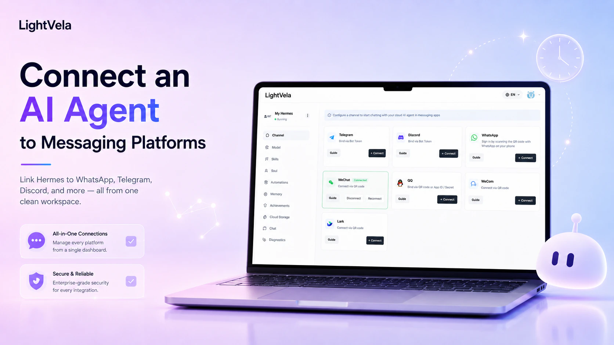
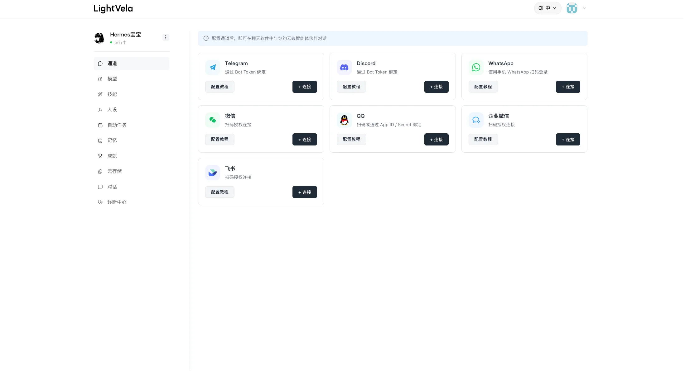
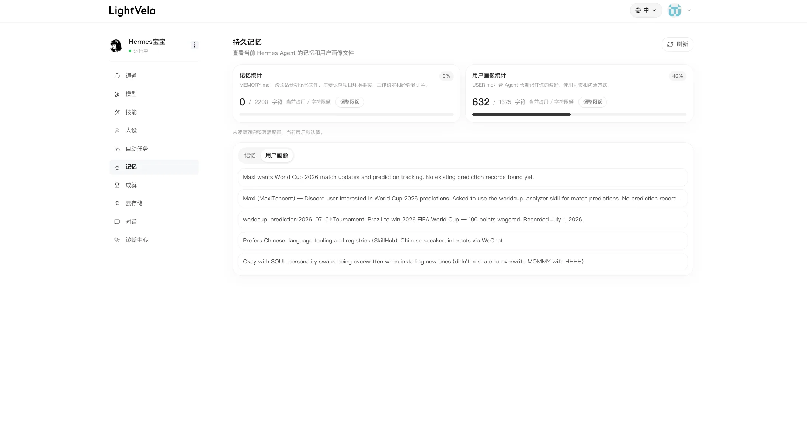

# วิธีเชื่อมต่อเอไอเอเจนต์กับแพลตฟอร์มส่งข้อความ

## สรุป

**การเชื่อมต่อ Hermes Agent กับแพลตฟอร์มการส่งข้อความตั้งอยู่บนแนวคิดหนึ่ง: ช่องทางเป็นจุดเข้า และ Agent คือสิ่งที่ทำงานได้ Agent บนคลาวด์หนึ่งตัวใช้โมเดล ทักษะ และความจำเดียวกันข้ามทุกช่องทางที่เชื่อมต่อ ดังนั้นจึงไม่จำเป็นต้องมีบอทแยกต่อแพลตฟอร์ม** กระบวนการประกอบด้วยสี่ขั้นตอน: ยืนยันว่าช่องทางสามารถใช้ได้ในภูมิภาคของคุณ (ภูมิภาคโลกสนับสนุน Telegram, WhatsApp, Discord, Slack, WeChat, QQ, WeCom, และ Lark; ภูมิภาคจีนสนับสนุน WeChat, QQ, WeCom, Lark, และ DingTalk); ดำเนินการให้สิทธิ์บนฝั่งแพลตฟอร์มเพื่อรับข้อมูลประจำตัว; เชื่อมต่อในคอนโซลและยืนยันว่าช่องทางแสดงสถานะเชื่อมต่อแล้ว; จากนั้นส่งข้อความทดสอบและตรวจสอบว่าคำตอบมาถึงในการสนทนาที่คุณส่งข้อความออกไป ข้อมูลประจำตัวเป็นข้อมูลสำคัญ - อย่าเขียนลงในบริบทระยะยาวหรือวางลงในแชท



## ใครที่เหมาะกับสิ่งนี้

คู่มือนี้สำหรับใครก็ตามที่ต้องการสนทนากับ Hermes ผ่านแอปส่งข้อความ แทนที่จะใช้เฉพาะจากเว็บคอนโซลเท่านั้น นอกจากนี้ยังมีประโยชน์ถ้าคุณต้องการผู้ช่วยหนึ่งคนที่สามารถใช้งานได้หลายแห่ง - ตัวอย่างเช่น Telegram สำหรับการใช้งานส่วนตัว และ Discord สำหรับชุมชน

เริ่มด้วยช่องทางเดียว เพิ่มอีกช่องทางก็ต่อเมื่อมันสอดคล้องกับบริบท ผู้ชม หรือพฤติกรรมการใช้เครื่องมือต่างหาก

## ข้อกำหนดเบื้องต้น

- บัญชี LightVela กับเอเจนต์ Hermes ที่กำลังทำงานอยู่ ใช้ [Quickstart](../02-quickstart.md) หากคุณต้องการสร้างหนึ่งบัญชี

- การตั้งค่าโมเดลการทำงานหรือเครดิตทดลอง เพื่อให้ Hermes สามารถตอบกลับหลังจากที่ช่องทางเชื่อมต่อแล้ว

- การเข้าถึงแพลตฟอร์มที่คุณต้องการเชื่อมต่อ แพลตฟอร์มบางแห่งใช้กระบวนการอนุญาตผ่านรหัส QR ในขณะที่บางแห่งต้องใช้โทเค็นบอทหรือข้อมูลประจำตัวของแพลตฟอร์ม

- ข้อความทดสอบที่คุณสามารถส่งได้ทันทีที่การตั้งค่าเสร็จสิ้น

## ขั้นตอน / แนวคิดสำคัญ

### 1. เลือกช่องทางที่ตรงกับการสนทนา

เลือกตามที่ที่คุณจะใช้งานผู้ช่วยจริง ๆ ไม่ใช่จำนวนแพลตฟอร์มที่คุณสามารถเชื่อมต่อ Telegram, WhatsApp, Discord, Slack และ WeChat เป็นตัวเลือกที่พบบ่อย:

| ช่องทาง | เหมาะสมกับ |
| --- | --- |
| Telegram | การส่งข้อความส่วนตัว กิจวัตรเบา ๆ และการสนทนาโดยตรง |
| WhatsApp | การสื่อสารประจำวันและการแจ้งเตือนที่ WhatsApp เป็นค่าเริ่มต้นของคุณแล้ว |
| Discord | ชุมชน กลุ่มนักพัฒนา และพื้นที่สำหรับการสนทนาที่เป็นระเบียบ |
| Slack | การทำงานร่วมกันของทีม การแจ้งเตือนในพื้นที่ทำงาน และเวิร์กโฟลว์ของช่องทาง |
| WeChat | การสนทนาส่วนตัวสำหรับผู้ที่ใช้ WeChat ทุกวัน |

LightVela ยังมีหน้าการตั้งค่าสำหรับช่องทางที่รองรับอื่นๆ หน้า Channel ในคอนโซลเป็นแหล่งข้อมูลที่เชื่อถือได้สำหรับสิ่งที่มีให้บริการแก่เอเจนต์ Hermes ของคุณในปัจจุบัน

### 2. ทำขั้นตอนการเชื่อมต่อเฉพาะแพลตฟอร์มให้สมบูรณ์

เปิดพื้นที่ Channel ในคอนโซล เลือกแพลตฟอร์ม และทำตามขั้นตอนการอนุญาตหรือการรับรองของแพลตฟอร์มนั้น ใช้คู่มือที่เกี่ยวข้องแทนการคัดลอกข้อมูลรับรองจากแพลตฟอร์มที่ไม่เกี่ยวข้อง:

- [Telegram](../configuration/channel-telegram.md)
- [WhatsApp](../configuration/channel-whatsapp.md)
- [Discord](../configuration/channel-discord.md)
- [Slack](../configuration/channel-slack.md)
- [WeChat](../configuration/channel-wechat.md)

ปฏิบัติต่อโทเค็นของบอท รหัสแอปพลิเคชัน และความลับเหมือนรหัสผ่าน อย่านำไปวางในแชทกลุ่ม เอกสารสาธารณะ หรือส่งข้อความให้ผู้อื่น หากข้อมูลรับรองถูกเปิดเผย ให้หมุนเวียนในแพลตฟอร์มที่ออกให้ก่อนเชื่อมต่ออีกครั้ง Hermes



### 3. ตรวจสอบการเชื่อมต่อด้วยการสนทนาง่าย ๆ

หลังจากคอนโซลแสดงสถานะช่องทางว่าเชื่อมต่อแล้ว ให้หาบอทหรือการสนทนาในแพลตฟอร์มนั้นและส่งข้อความสั้นๆ:

```text
Hi Hermes. Please reply with the channel you received this from.
```

สิ่งนี้ตรวจสอบเส้นทางทั้งหมด: แพลตฟอร์มสามารถส่งข้อความได้ Hermes มีโมเดลที่ทำงานได้ และการตอบกลับสามารถกลับไปยังที่เดิมได้ หากไม่ทำงาน ให้ตรวจสอบสถานะการเชื่อมต่อก่อน จากนั้นยืนยันโมเดลที่ใช้งานอยู่ใน [Configure Models](../configuration/model.md)

### 4. ตัดสินใจว่าสิ่งใดควรคงไว้เป็นสิ่งที่แชร์ร่วมกันระหว่างช่องทาง

เมื่อมากกว่าหนึ่งช่องทางเชื่อมต่อกับ Hermes เอเจนต์เดียวกัน พวกมันคือประตูที่ต่างกันเข้าสู่ผู้ช่วยเดียวกัน ซึ่งหมายความว่าเอเจนต์สามารถเก็บความจำ ความชอบในการทำงาน และทักษะที่ติดตั้งไว้เหมือนเดิมในทุกช่องทางที่รองรับ

ใช้ [การจัดการหน่วยความจำ](../configuration/memory.md) เพื่อตรวจสอบบริบทระยะยาวที่คุณต้องการให้ Hermes จดจำ หากช่องทางหนึ่งสำหรับผู้ชมที่แตกต่างกันหรือจำเป็นต้องมีบทบาทที่แตกต่างกันมาก พิจารณาเก็บกรณีการใช้งานแยกออกแทนที่จะผสมความคาดหวังที่ไม่เกี่ยวข้องเข้ากับประวัติการสนทนาหนึ่ง



หาก Discord เป็นช่องทางที่คุณต้องการใช้สำหรับชุมชน ให้ดำเนินการต่อด้วย [พบกับ LightVela สำหรับ Discord: เอเจนต์ AI ของคุณ Discord บอทให้บริการช่องทางของคุณ](./discord-community-agent.md)

## คำถามที่พบบ่อย

### ฉันสามารถเชื่อมต่อแพลตฟอร์มการส่งข้อความหลายรายการกับเอเจนต์ Hermes หนึ่งตัวได้หรือไม่?

ใช่ ช่องทางที่รองรับสามารถชี้ไปยังเอเจนต์เดียวกัน ซึ่งช่วยให้คุณสามารถเข้าถึงได้จากแอปส่งข้อความมากกว่าหนึ่งแอปในขณะที่ยังคงพฤติกรรมและความจำที่กำหนดไว้เหมือนเดิม

### ฉันควรเชื่อมต่อช่องทางไหนก่อน?

เลือกสิ่งที่คุณใช้บ่อยที่สุด ผู้ช่วยส่วนตัวมีแนวโน้มที่จะมีประโยชน์มากขึ้นเมื่อข้อความแรกส่งได้ง่าย Telegram, WhatsApp, Discord, Slack และ WeChat แต่ละรายการมีคู่มือการตั้งค่าอย่างละเอียด

### ทำไมช่องจึงแสดงว่าเชื่อมต่อแล้ว แต่ Hermes ไม่ตอบกลับ?

ส่งข้อความทดสอบง่าย ๆ แล้วตรวจสอบว่ามีโมเดลที่ใช้งานได้หรือเครดิตทดลองใช้งาน หากปัญหายังคงมีอยู่ ให้เชื่อมต่อช่องทางอีกครั้งและใช้ [การวิเคราะห์ระบบ](../configuration/diagnostics.md) เพื่อตรวจสอบตัวเลือกการบำรุงรักษาและบันทึกล่าสุด

### ฉันสามารถแชร์ข้อมูลรับรองของบอทหนึ่งตัวให้กับหลาย Hermes เอเจนต์ได้หรือไม่?

หลีกเลี่ยงการทำเช่นนั้นเว้นแต่แพลตฟอร์มและเวิร์กโฟลว์ที่คุณตั้งใจไว้อย่างชัดเจนสนับสนุน ให้เก็บข้อมูลรับรองหนึ่งชุดสำหรับวัตถุประสงค์เดียวจะทำให้การแก้ปัญหาและการควบคุมการเข้าถึงง่ายขึ้นมาก

## ขั้นตอนถัดไป

- [กำหนดค่าโมเดล](../configuration/model.md) - ยืนยันว่า Hermes มีโมเดลพร้อมที่จะตอบแล้ว

- [การจัดการหน่วยความจำ](../configuration/memory.md) - จัดการบริบทที่ใช้ร่วมกันโดยช่องทางที่คุณเชื่อมต่ออยู่

- [งานตามกำหนด](../configuration/automation.md) - ส่งการอัปเดตตามกำหนดไปยังช่องที่เชื่อมต่อเมื่อเหมาะสม
