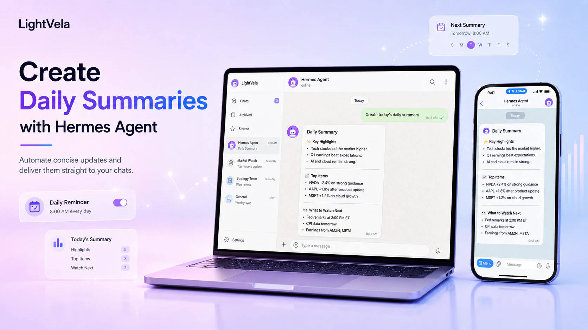
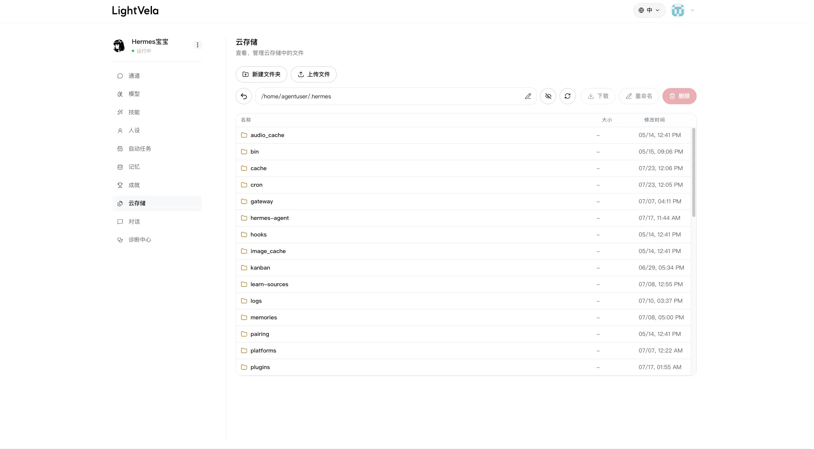
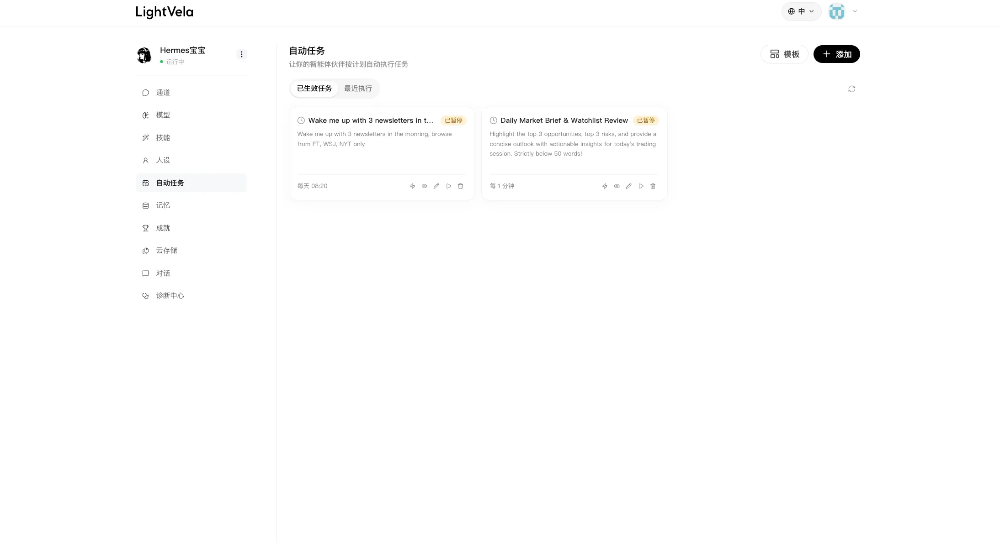

# วิธีสร้างสรุปรายวันด้วย Hermes เอเจนต์

## สรุป

**สรุปรายวันมีคุณค่าไม่ใช่จากความยาว แต่จากการมอบบริบทที่ถูกต้องให้คุณก่อนที่คุณจะถาม และวิธีการไปถึงนั้นคือการเปลี่ยนการตรวจสอบด้วยตนเองให้เป็นงานที่กำหนดเวลาไว้ล่วงหน้า** คุณต้องมีสี่สิ่ง: เอเจนต์คลาวด์ Hermes ที่มีการกำหนดค่าโมเดลแล้ว, ช่องทางที่เชื่อมต่อเพื่อตรอ้งรับผลลัพธ์, ทักษะเพิ่มเติมสำหรับการรวบรวมข้อมูล (ถ้ามี), และงานที่กำหนดเวลาไว้ (ซึ่งมีฟิลด์คือ ชื่อ, ตารางเวลา, คำสั่งงาน, ช่วงเวลาที่ใช้งานได้, และช่องทางการแจ้งเตือน) ความสำเร็จขึ้นอยู่กับคำสั่งงาน: เนื่องจากไม่มีใครอยู่เพื่อชี้แจงในขณะดำเนินงาน ข้อความแจ้งต้องมีเป้าหมายของตนเอง, ขอบเขตของงาน (ช่วงเวลาและจำนวนรายการสูงสุด), รูปแบบผลลัพธ์, และวิธีการเมื่อไม่มีสิ่งใดให้รายงาน ทดสอบข้อความแจ้งด้วยตนเองในแชทก่อน จากนั้นสร้างงานที่กำหนดเวลาไว้ และตรวจสอบผลลัพธ์หลังการทำงานครั้งแรกจริง



## ใครที่เหมาะกับสิ่งนี้

กรณีการใช้นี้เหมาะสำหรับผู้ที่สแกนอัปเดตจากโครงการ โน้ต ไฟล์ หรือการสนทนาที่เกิดขึ้นซ้ำ ๆ เป็นประจำและต้องการจุดเริ่มต้นที่สั้นลง สามารถเหมาะกับการสรุปข้อมูลส่วนตัวในตอนเช้า การทบทวนโครงการประจำวัน บันทึกการเรียนรู้ หรือรายการติดตามงานที่เน้นจุดสำคัญ

สรุปครั้งแรกที่ดีที่สุดมีวัตถุประสงค์ที่ชัดเจน "สรุปทุกอย่าง" มักจะกว้างเกินไป; "เน้นการเปลี่ยนแปลง การตัดสินใจ อุปสรรค และขั้นตอนถัดไปสำหรับโครงการนี้" จะง่ายต่อการประเมินและปรับปรุงมากกว่า

## ข้อกำหนดเบื้องต้น

- เอเจนต์ Hermes ที่กำลังทำงานและช่องทางที่เชื่อมต่อซึ่งคุณต้องการรับสรุป

- การกำหนดค่ารูปแบบที่ใช้งานได้หรือเครดิตทดลอง ใช้ดูที่ [Configure Models](../configuration/model.md) หาก Hermes ไม่สามารถตอบสนองได้

- แหล่งของบริบทที่ชัดเจน อาจเป็นเนื้อหาที่คุณวางในบทสนทนา ไฟล์ที่คุณจัดการใน Cloud Storage หรือข้อมูลที่ทักษะที่เชื่อถือได้และเกี่ยวข้องสามารถเข้าถึงได้

- การกำหนดตารางงานตามเวลาที่เลือกได้ หากคุณต้องการให้สรุปทำงานโดยไม่ต้องสั่งด้วยตนเอง

## ขั้นตอน / แนวคิดสำคัญ

### 1. กำหนดการตัดสินใจหนึ่งข้อที่บทสรุปควรช่วยคุณในการตัดสินใจ

เริ่มต้นด้วยการระบุช่วงเวลาที่สรุปสนับสนุน ตัวอย่างเช่น การตัดสินใจว่าจะทำงานอะไรก่อน ตรวจสอบว่ามีโครงการใดที่ถูกบล็อก หรือการตามงานหลังจากที่หายไปหนึ่งวัน

ให้ Hermes คำสั่งที่กำหนดทั้งรูปทรงของต้นฉบับและผลลัพธ์:

```text
When I share project updates, summarize them in four sections:
what changed, decisions made, blockers, and the three next actions.
Keep it under 250 words and flag anything urgent.
```

นี่จะเปลี่ยนคำขอทั่วไปให้เป็นรูปแบบที่สามารถทำซ้ำได้ ซึ่งคุณสามารถเปรียบเทียบได้วันต่อวัน

### 2. ทำให้วัสดุต้นฉบับมีความตั้งใจ

Hermes สามารถสรุปข้อมูลได้เฉพาะข้อมูลที่มันสามารถรับหรือเข้าถึงผ่านความสามารถที่คุณตั้งค่า สำหรับเวิร์กโฟลว์แบบแมนนวล ให้วางหรือส่งต่ออัปเดตที่เกี่ยวข้องลงในการสนทนาของคุณ สำหรับงานที่ใช้ไฟล์ ให้เก็บเอกสารให้อยู่ใน [Cloud Storage](../configuration/files.md) และบอก Hermes ว่าเอกสารหรือโฟลเดอร์ใดสำคัญสำหรับการตรวจสอบปัจจุบัน

หากคุณต้องการแหล่งข้อมูลภายนอก ให้เลือกสกิลที่เหมาะสมจากแหล่งที่เชื่อถือได้และยืนยันพฤติกรรมของมันก่อนใช้งาน [กำหนดค่าสกิล](../configuration/skill.md) อธิบายว่าสกิลสามารถขยาย Hermes เหนือการสนทนาปกติได้อย่างไร



### 3. ทดสอบผลลัพธ์ในการสนทนาปกติก่อน

ก่อนจะนัดหมายอะไร ให้ถาม Hermes สำหรับสรุปด้วยตนเอง ตรวจสอบว่าส่วนต่าง ๆ มีประโยชน์หรือไม่ น้ำเสียงกระชับเพียงพอหรือไม่ และรายละเอียดสำคัญหายไปหรือไม่

การปรับปรุงที่มีประโยชน์รวมถึง:

```text
Put deadlines first.
```

```text
Do not repeat completed work unless it affects a next action.
```

```text
End with one question I should answer before tomorrow.
```

หน้าต่าง [แชท](../configuration/agent-chat.md) เป็นสถานที่ที่ดีในการทดลองคำสั่งก่อนที่จะเปลี่ยนมันให้เป็นงานที่ทำซ้ำได้

### 4. กำหนดเวลาสำหรับเวอร์ชันที่ทำงานได้แล้ว

เมื่อพรอมต์ด้วยตนเองสร้างผลลัพธ์ที่คุณเชื่อถือ ให้สร้างงานที่กำหนดเวลา กำหนดเวลาที่เจาะจงและคำสั่งที่ชัดเจน จากนั้นเลือกช่องทางการแจ้งเตือนที่เชื่อมต่อถ้าคุณต้องการให้ผลลัพธ์ถูกส่งไปที่นั่น

```text
Every weekday at 6:00 PM, prepare a daily project summary from the
updates I shared today. Include changes, blockers, and the three most
important next actions. Send it as concise bullet points.
```

ตั้งค่านี้ใน [งานที่กำหนดเวลา](../configuration/automation.md) ตรวจสอบการทำงานไม่กี่ครั้งแรกและปรับข้อความหากสรุปมีความกว้างเกินไป ยาวเกินไป หรือขาดบริบทที่ถูกต้อง



## คำถามที่พบบ่อย

### Hermes สามารถสรุปข้อมูลใด ๆ โดยอัตโนมัติได้หรือไม่?

มีเฉพาะข้อมูลที่ Hermes สามารถรับได้ในการสนทนา เข้าถึงผ่านไฟล์และทักษะที่คุณได้กำหนดไว้ หรือได้รับผ่านเวิร์กโฟลว์ที่คุณตั้งขึ้น ให้ระบุแหล่งที่มาอย่างชัดเจนและใช้ทักษะที่เชื่อถือได้สำหรับการเข้าถึงภายนอกใด ๆ

### ทำไมสรุปของฉันถึงดูทั่วไปเกินไป?

คำแนะนำอาจกว้างเกินไป ตั้งชื่อผู้ชม แหล่งที่มา ช่วงเวลา และส่วนผลลัพธ์ การถามเกี่ยวกับการตัดสินใจ อุปสรรค และการดำเนินการถัดไป มักให้ผลลัพธ์ที่นำไปใช้ได้มากกว่าการขอสรุปทั่วไป

ฉันควรกำหนดเวลาสรุปทันทีหรือไม่?

ไม่ ใช้ทดสอบพรอมต์ด้วยตนเองก่อน เมื่อคุณสามารถระบุผลลัพธ์ที่ดีได้ การกำหนดเวลาไว้จะช่วยประหยัดเวลาโดยไม่ทำให้รูปแบบที่ไม่เป็นประโยชน์ถูกล็อก

### ถ้าสรุปยังไม่มาถึงจะทำอย่างไร?

ตรวจสอบสถานะงานที่กำหนดเวลาและช่องทางการแจ้งเตือน จากนั้นยืนยันว่า Hermes ยังคงสามารถตอบกลับในการสนทนาปกติได้ หากจำเป็น ให้ตรวจสอบ [การวินิจฉัย](../configuration/diagnostics.md) ก่อนสร้างงานอื่น

## ขั้นตอนถัดไป

- [คลาวด์สตอเรจ](../configuration/files.md) — จัดระเบียบไฟล์ที่สนับสนุนการทบทวนซ้ำได้

- [ปรับแต่งทักษะ](../configuration/skill.md) — เพิ่มความสามารถที่เชื่อถือได้เมื่อสรุปของคุณต้องการแหล่งข้อมูลเฉพาะ

- [งานตามกำหนดเวลา](../configuration/automation.md) — ส่งมอบสรุปที่คุณทดสอบแล้วตามกำหนดเวลา
