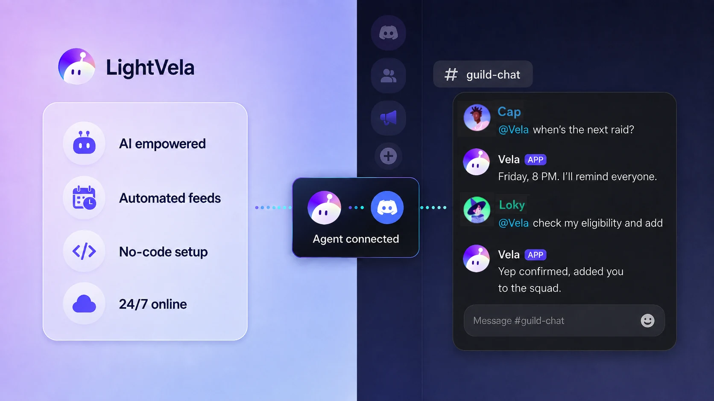
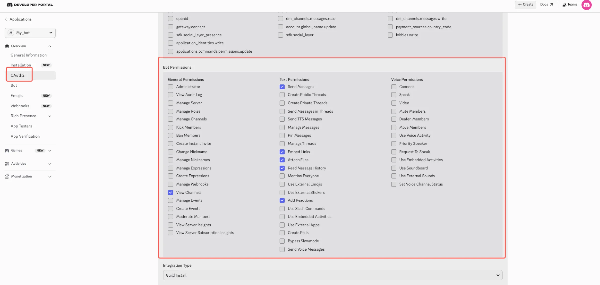

# พบกับ LightVela สำหรับ Discord: เอเจนต์ AI ของคุณ Discord บอทที่ให้บริการช่องของคุณ

## สรุป

**LightVela ช่วยให้คุณเชื่อมต่อเอเจนต์ Hermes ที่โฮสต์บนคลาวด์กับ Discord ให้บริบทชุมชนที่ได้รับการอนุมัติและขอบเขตการทำงาน และทำให้พร้อมสำหรับคำถามซ้ำ การเริ่มต้นใช้งาน และการสนับสนุนกิจกรรม** เส้นทางขั้นต่ำคือสร้างเอเจนต์ กำหนดคำสั่งของมัน เชื่อมต่อช่อง Discord เชิญบอท และทดสอบคำถามจริงในบทสนทนา Discord ที่รองรับ

ผลิตภัณฑ์เอเจนต์ร่วมล่าสุด เช่น [Claude Tag](https://www.anthropic.com/news/introducing-claude-tag) และ [Viktor](https://slack.com/marketplace/A0A2VN5TR5K-viktor) แสดงให้เห็นว่าทำไมเอเจนต์จึงสามารถมีประโยชน์มากขึ้นเมื่อมันทำงานในที่ที่กลุ่มสื่อสารอยู่แล้ว LightVela นำรูปแบบนั้นไปสู่ชุมชน Discord โดยไม่จำเป็นต้องให้คุณสร้างและโฮสต์แอปพลิเคชันบอทแยกต่างหากก่อน



## ใครเหมาะสำหรับสิ่งนี้และผลลัพธ์ที่คาดหวัง

กรณีการใช้งานนี้เหมาะสำหรับชุมชนเกม ชุมชนนักพัฒนา กลุ่มความสนใจ และเซิร์ฟเวอร์อีเวนต์ที่ต้องการผู้ช่วย AI ที่เชื่อถือได้ในพื้นที่การสนทนาที่พวกเขาใช้อยู่แล้ว

ผลลัพธ์ที่คาดหวังคือเอเจนต์ Discord ที่ได้รับการแจ้งข้อมูลอย่างครบถ้วน ซึ่งสามารถตอบคำถามที่ได้รับอนุมัติ ชี้สมาชิกไปยังช่องทางหรือข้อมูลกิจกรรมที่ถูกต้อง สนับสนุนการเริ่มต้นใช้งาน และส่งการเตือนที่กำหนดไว้เมื่อมีงานที่กำหนดเวลาที่เหมาะสม

มันไม่ใช่ตัวแทนในการแทนที่ผู้ดูแลระบบมนุษย์ การตัดสินใจที่เกี่ยวกับการควบคุมเนื้อหาอย่างละเอียดอ่อน การดำเนินการเกี่ยวกับบัญชี ข้อยุติข้อพิพาท และสิ่งใด ๆ ที่อยู่นอกขอบเขตความรู้ที่ได้รับอนุญาต ควรส่งต่อไปยังมนุษย์

## ข้อกำหนดเบื้องต้น

- เอเจนต์ LightVela Hermes ที่กำลังทำงานพร้อมโมเดลที่ตั้งค่าแล้ว

- บัญชี Discord และเซิร์ฟเวอร์ที่คุณมีสิทธิ์ในการเพิ่มบอท

- แหล่งข้อมูลที่ได้รับอนุมัติ เช่น กฎของเซิร์ฟเวอร์ คำถามที่พบบ่อย รายละเอียดกิจกรรม วัตถุประสงค์ของช่อง และผู้ติดต่อเมื่อมีการยกระดับปัญหา

- ขอบเขตที่ชัดเจนว่าสิ่งที่เอเจนต์สามารถตอบได้ สิ่งที่ต้องปฏิเสธ และเมื่อใดที่ควรส่งต่อให้ระดับสูงขึ้น

- มี [คู่มือการตั้งค่าช่องสัญญาณ Discord](../configuration/channel-discord.md) และ [คู่มือการตั้งค่าภารกิจตามกำหนด ⟦Scheduled Task⟧](../configuration/automation.md) สำหรับอ้างอิง

## ขั้นตอน

### 1. สร้างเอเจนต์ก่อนที่คุณจะเชิญบอท

เริ่มต้นด้วยบทบาทและผลลัพธ์ของเอเจนต์มากกว่าด้วยข้อมูลประจำตัว Discord
บอท Discord เป็นจุดเริ่มต้นเข้าสู่ Hermes ดังนั้นคำแนะนำและโมเดลที่ตั้งค่าใน LightVela จะกำหนดว่ามันทำงานอย่างไรหลังจากเชื่อมต่อแล้ว

จดคำถามที่พบบ่อยที่สุดของชุมชนและคำตอบที่มีประโยชน์ที่สุดสั้น ๆ สำหรับแต่ละคำถาม  
เช่น รายการหน้ากฎ ช่องทางสนับสนุน ตารางกิจกรรม กระบวนการสมัครสมาชิก และเส้นทางการรายงานไปยังผู้ดูแล

### 2. ให้เอเจนต์บริบทชุมชนที่ได้รับอนุมัติ

กำหนดค่าเอเจนต์ด้วยข้อมูลที่อนุญาตให้ใช้งานและขอบเขตที่ต้องปฏิบัติตาม  
คำสั่งเริ่มต้นที่มีประโยชน์อาจมีลักษณะดังนี้:

```text
You are the community assistant for this Discord server.

Answer questions using approved information.
Help members find the right channel or event details.
Be friendly and concise.
Escalate sensitive moderation issues to human moderators.
Never invent rules, announcements, or event times.
If the approved information does not answer a question, say that you do not know and point the member to a human moderator.
```

เก็บความชอบการทำงานที่ทนทานไว้ในบริบทที่ตั้งค่าไว้ของเอเจนต์  
เก็บตารางเวลาที่เปลี่ยนแปลง ประกาศ และวัสดุเกี่ยวกับกิจกรรมไว้ในเวิร์กโฟลว์ซึ่งสามารถตรวจสอบได้ก่อนที่เอเจนต์จะใช้งาน  
อย่าวางโทเค็นบอท รหัสผ่าน หรือข้อมูลส่วนบุคคลที่ไม่จำเป็นในบริบทระยะยาว

### 3. เชื่อมต่อ Discord และเชิญบอท

ใน LightVela ให้เปิดการตั้งค่าช่องและเลือก Discord สร้างหรือเลือกแอปพลิเคชัน Discord เพิ่มบอท สร้างโทเค็นของมัน และวางโทเค็นลงในบัตรการเชื่อมต่อ Discord

ใน Discord Developer Portal ให้เปิดใช้งาน Message Content Intent ซึ่งจำเป็นสำหรับการอ่านเนื้อหาข้อความ ใช้ชุดสิทธิ์และการอนุญาตของบอทที่เล็กที่สุดที่เซิร์ฟเวอร์ของคุณต้องการ เช่น การดูช่อง ส่งข้อความ และการอ่านประวัติข้อความ จากนั้นสร้างลิงก์เชิญและเพิ่มบอทไปยังเซิร์ฟเวอร์ที่ต้องการ

ทำตาม [Discord ขั้นตอนการตั้งค่า](../configuration/channel-discord.md) ทั้งหมดสำหรับกระบวนการอนุมัติและสิทธิ์ปัจจุบัน



### 4. ทดสอบเอเจนต์ด้วยคำถามของชุมชนจริง

หลังจากที่คอนโซลแสดง Discord ว่าเชื่อมต่อแล้ว ส่งคำถามตัวอย่างบางส่วนจากการสนทนา Discord ที่สนับสนุน ใช้คำถามที่ทดสอบทั้งคำตอบที่มีประโยชน์และความไม่แน่นอนที่ปลอดภัย:

```text
Where can I find the event schedule?

Which channel should I use for technical support?

I am new here. What should I read first?

What is the rule for an issue that is not covered in the FAQ?
```

ผลลัพธ์ที่คาดหวังไม่ใช่เพียงคำตอบที่คล่องแคล่ว เอเจนต์ควรใช้ข้อมูลที่ได้รับอนุมัติ รักษาคำตอบให้กระชับ หลีกเลี่ยงการสร้างกฎขึ้นเอง และยกระดับเมื่อคำถามต้องการผู้ดูแลระบบ

หากบอทไม่ตอบกลับ ให้ยืนยันก่อนว่าช่อง Discord แสดงสถานะเชื่อมต่อ, โมเดลพร้อมใช้งาน, บอทมีสิทธิ์ในการอ่านและส่งข้อความ และเปิดใช้งานเจตนารมณ์เนื้อหาข้อความแล้ว

### 5. เพิ่มการสนับสนุนแบบซ้ำเฉพาะหลังจากเส้นทางหลักทำงานได้

เมื่อการตอบคำถามมีความน่าเชื่อถือ ให้เพิ่มงานที่กำหนดเวลาแบบแคบสำหรับงานที่เกิดซ้ำ เช่น การเตือนการลงทะเบียน การนับถอยหลังกิจกรรม หรือสรุปของผู้ดูแลระบบ
LightVela งานที่กำหนดเวลาสนับสนุนการทำงานเพียงครั้งเดียว วันทำงานประจำ หรือช่วงเวลาที่กำหนด โดยสามารถระบุช่วงเวลาที่มีผลและช่องทางการแจ้งเตือนได้

ตัวอย่างเช่น คุณสามารถตั้งค่าได้ดังนี้:

```text
Every Thursday at 18:00, remind the event channel about Saturday's tournament.
Use only the approved schedule and rules.
Include the start time, time zone, registration deadline, and the channel for questions.
If any detail is missing, say which detail needs a moderator update instead of guessing.
```

เริ่มต้นด้วยการตั้งเตือนเพียงหนึ่งครั้งและตรวจสอบผลลัพธ์ก่อนที่จะเพิ่มงานที่กำหนดเวลาไว้เพิ่มเติม
ดู [งานที่กำหนดเวลา](../configuration/automation.md) สำหรับตารางเวลาและการตั้งค่าการแจ้งเตือนที่มีอยู่

## รายการตรวจสอบเชิงปฏิบัติ

| ขั้นตอน | การกระทำ | LightVela ส่วนประกอบ | ผลลัพธ์ที่คาดหวังหรือสัญญาณความล้มเหลว |
| --- | --- | --- | --- |
| กำหนด | เขียนบทบาทของชุมชน ข้อเท็จจริงที่ได้รับอนุมัติ และกฎการยกระดับ | คำสั่งของเอเจนต์ | ผู้ควบคุมสามารถอธิบายว่าเอเจนต์สามารถและไม่สามารถตอบอะไรได้ |
| เชื่อมต่อ | เพิ่มโทเค็น Bot Discord และเชิญบอทด้วยสิทธิ์ขั้นต่ำ | ช่อง Discord | Discord ปรากฏว่าเชื่อมต่อแล้วและบอทอยู่ในเซิร์ฟเวอร์ |
| ทดสอบ | ถามคำถาม FAQ ที่รู้จักและคำถามที่ไม่รู้จักหรือมีความละเอียดอ่อน | การสนทนา Discord | คำถามแรกได้รับคำตอบที่มีเหตุผลและคำถามที่สองถูกปฏิเสธหรือยกระดับ |
| ทำซ้ำ | เพิ่มการเตือนหรือสรุปหนึ่งรายการด้วยตารางเวลาที่จำกัด | งานตามกำหนดการ | ข้อความมาถึงในช่องการแจ้งเตือนที่เลือกตามเวลาที่คาดไว้ |
| ตรวจสอบ | ตรวจสอบคำตอบ ตารางเวลา และข้อมูลกิจกรรมที่เปลี่ยนแปลง | การจัดการเอเจนต์และงานตามกำหนดการ | กฎเก่าและประกาศถูกแก้ไขก่อนที่จะสร้างความสับสน |

## เอเจนต์ Discord ที่ใช้ร่วมกันสามารถช่วยในเรื่องอะไรได้บ้าง

### ตอบคำถามที่ทุกคนถาม

ทุกชุมชนซ้ำชุดคำถามเล็ก ๆ ชุดหนึ่ง:

- ตารางกิจกรรมอยู่ที่ไหน?

- ช่องทางไหนสำหรับการสนับสนุน?

- ฉันจะเข้าร่วมการแข่งขันได้อย่างไร?

- กฎของเซิร์ฟเวอร์อยู่ที่ไหน?

สมาชิกสามารถถามเอเจนต์ในบทสนทนา Discord ที่รองรับได้แทนการรอให้ผู้ดูแลออนไลน์ คำตอบจะคงที่เมื่อข้อมูลที่ได้รับการอนุมัติชัดเจน และเอเจนต์สามารถบอกว่าไม่ทราบเมื่อข้อมูลขาดหาย

### ช่วยจัดงานโดยไม่ต้องเป็นผู้จัดงาน

งานอีเวนต์สร้างคำถามเล็ก ๆ หลายข้อเกี่ยวกับการลงทะเบียน เขตเวลา การเตือนกฎ และการเปลี่ยนแปลงนาทีสุดท้าย เอเจนต์สามารถจัดการคำถามซ้ำ ๆ และส่งการเตือนที่ตั้งค่าไว้ ขณะที่ผู้จัดยังคงควบคุมข้อมูลต้นทางและตัดสินใจขั้นสุดท้าย

### มอบชั่วโมงแรกที่ดีกว่าให้กับสมาชิกใหม่

สมาชิกใหม่สามารถเริ่มด้วยคำถามง่ายๆ เช่น:

```text
I am new here. Where should I start?
```

เอเจนต์สามารถชี้ให้พวกเขาไปยังช่องทางที่ถูกต้อง อธิบายพื้นฐานของชุมชนที่ได้รับอนุมัติ และเสนอขั้นตอนถัดไปหนึ่งขั้น  
ซึ่งทำให้การติดต่อครั้งแรกมีประโยชน์โดยไม่ต้องขอเอเจนต์ตัดสินใจเรื่องการควบคุม

## เปรียบเทียบกับการเขียนโค้ดบอท Discord จากศูนย์

บอท Discord แบบกำหนดเองเป็นตัวเลือกที่เหมาะสมเมื่อคุณต้องการคำสั่งที่ปรับแต่งอย่างลึกซึ้งหรือเวิร์กโฟลว์ที่เฉพาะเจาะจงกับผลิตภัณฑ์  
ซึ่งหมายถึงการเป็นเจ้าของตรรกะของแอปพลิเคชัน ข้อมูลรับรอง การปรับใช้ และการบำรุงรักษาอย่างต่อเนื่อง  
LightVela เริ่มต้นด้วย Agent และช่วยให้คุณสามารถอธิบายพฤติกรรมของมันได้ในคอนโซล

| บอทที่มีรหัสมาตรฐาน | LightVela สำหรับ Discord |
| --- | --- |
| เขียนคำสั่งและตัวจัดการเหตุการณ์ | อธิบายสิ่งที่เอเจนต์ควรทำ |
| เก็บคำถามที่พบบ่อยและกฎต่างๆ ในโค้ดหรือฐานข้อมูล | ให้บริบทและขอบเขตที่ได้รับอนุมัติกับเอเจนต์ |
| สร้างตัวจัดกำหนดการสำหรับการเตือน | สร้างงานที่กำหนดเวลาผ่านคอนโซล |
| ปรับใช้การเปลี่ยนแปลงพฤติกรรม | อัปเดตคำแนะนำของเอเจนต์และตรวจสอบผลลัพธ์ |
| รักษาโครงสร้างพื้นฐานและตรรกะของบอท | มุ่งเน้นไปที่การดำเนินงานชุมชนและการดูแล |

นี่ไม่ได้ทำให้บอทที่สร้างเองทุกตัวไม่มีความจำเป็น มันให้ชุมชนมีวิธีปฏิบัติในการเปิดตัว Discord Agent ที่มีประโยชน์ก่อนการสร้างผลิตภัณฑ์บอททั้งหมด

## การตรวจสอบและขอบเขต

ตรวจสอบสถานการณ์ด้วยอย่างน้อยหนึ่งคำถามที่ทราบคำตอบ หนึ่งคำถามที่ขาดข้อมูล และหนึ่งคำถามที่เกี่ยวกับการดูแลเนื้อหาอย่างละเอียด  
ตรวจสอบว่าเอเจนต์ใช้คำตอบที่ได้รับอนุมัติ ยอมรับความไม่แน่นอน และยกระดับปัญหาแทนการประดิษฐ์คำตอบเองหรือไม่

เอกสารคู่มือการตั้งค่า Discord ครอบคลุมการอนุญาต Bot การโต้ตอบกับเซิร์ฟเวอร์และช่อง การเข้าถึงเนื้อหาข้อความ และข้อความเชิงรุกในระดับช่อง  
นอกจากนี้ยังระบุข้อจำกัดปัจจุบันเกี่ยวกับการสนับสนุนแชทกลุ่ม  
หากการเปิดตัวของคุณขึ้นอยู่กับการกล่าวถึงสมาชิกจำนวนมากหรือโหมดการสนทนาหลายผู้ใช้เฉพาะ ให้ยืนยันพฤติกรรมนั้นในเซิร์ฟเวอร์เป้าหมายก่อนการเปิดตัวสาธารณะ

ผู้ดูแลระบบมนุษย์ยังคงรับผิดชอบต่อการแบน รายงานการละเมิด ข้อพิพาท การเปลี่ยนแปลงนโยบาย และประกาศที่ยังไม่ได้เพิ่มในบริบทที่ได้รับอนุมัติ

## คำถามที่พบบ่อย

### ฉันจำเป็นต้องเขียนโค้ดบอท Discord ไหม?

ไม่สำหรับกรณีการใช้งานนี้
คุณกำหนดค่า Hermes ใน LightVela เชื่อมต่อช่อง Discord และเชิญ Bot ที่ได้ไปยังเซิร์ฟเวอร์ของคุณ
โค้ดที่กำหนดเองยังเหมาะสมสำหรับคำสั่งหรือกระบวนงานเฉพาะที่ LightVela ไม่สามารถให้ได้

### เอเจนต์สามารถตอบคำถามเกี่ยวกับกฎของเซิร์ฟเวอร์ได้หรือไม่?

ใช่ เมื่อกฎถูกรวมอยู่ในบริบทที่ได้รับอนุมัติและพรอมต์บอกให้มันไม่ประดิษฐ์หรือละเมิดกฎเหล่านั้น ให้มันชี้สมาชิกไปยังผู้ดูแลระบบมนุษย์เมื่อกฎไม่ชัดเจนหรือต้องระมัดระวังเรื่องที่ละเอียดอ่อน

### มันสามารถส่งการเตือนเหตุการณ์โดยอัตโนมัติได้หรือไม่?

ใช่ เอกสารของช่องทาง Discord ระบุว่าข้อความเชิงรุกได้รับการสนับสนุนในระดับช่องทาง ใช้ [งานที่กำหนดเวลา](../configuration/automation.md) เพื่อกำหนดตารางเวลา คำสั่งงาน ช่วงเวลาที่มีผล และช่องทางการแจ้งเตือน

### เอเจนต์ควรตัดสินใจในการควบคุมเนื้อหาหรือไม่?

ไม่ ใช้มันสำหรับการอธิบาย การจัดเส้นทาง การเตือนความจำ และสรุป ขณะที่ผู้ดูแลระบบมนุษย์ยังคงมีอำนาจเหนือการบังคับใช้และกรณีที่ละเอียดอ่อน

## สรุป

สร้างเอเจนต์ Hermes ให้บริบทชุมชนที่ได้รับการอนุมัติ เชื่อมต่อ Discord เชิญบอท และทดสอบด้วยคำถามจริงก่อนเพิ่มงานที่กำหนดเวลา  
ลำดับนี้จะเปลี่ยนเอเจนต์ AI ส่วนตัวให้กลายเป็นผู้ช่วยที่เป็นประโยชน์ต่อชุมชน ในขณะที่ยังคงควบคุมกฎ ระดับสิทธิ์ และขอบเขตการยกระดับให้คนจัดการได้

สำหรับเวอร์ชันที่มุ่งเน้นมากขึ้นของรูปแบบนี้ ดูได้ที่ [เสริมพลัง Discord Event Bot ของคุณด้วยความสามารถแบบเอเจนต์ AI](./discord-event-agent.md)
