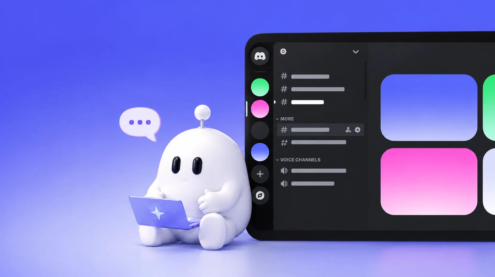
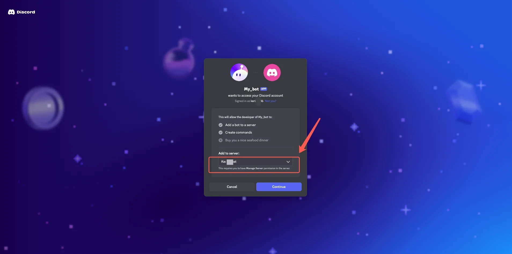
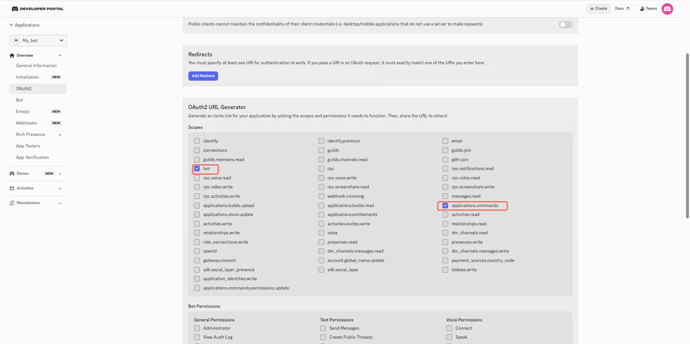
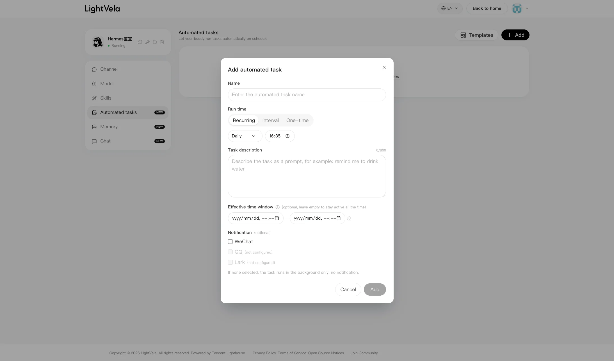
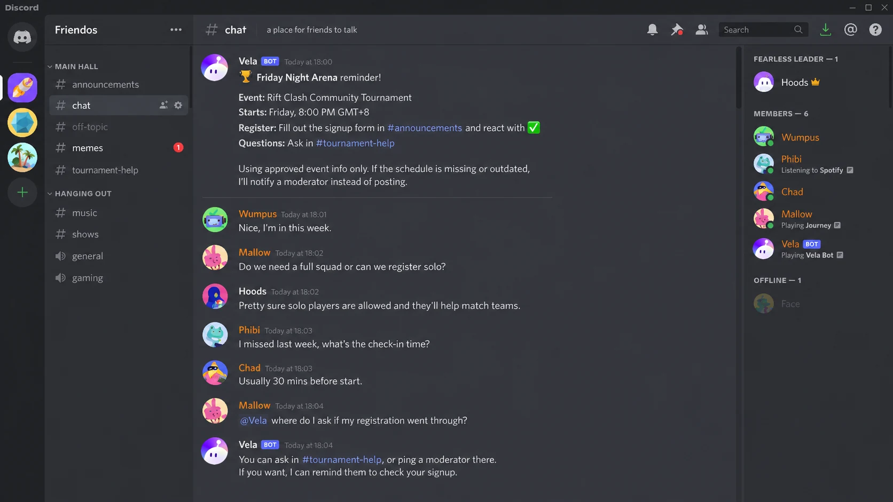

# เสริมพลังบอทกิจกรรม Discord ของคุณด้วยความสามารถ AI-Agentic

## สรุป

**บอทเหตุการณ์ Discord จะมีประโยชน์มากขึ้นเมื่อสามารถอธิบายข้อมูลเหตุการณ์ที่ได้รับการอนุมัติ ตอบคำถามซ้ำ สนับสนุนการเริ่มต้นใช้งาน และส่งการแจ้งเตือนตามกำหนดจากเอเจนต์ Hermes ที่ตั้งค่าไว้หนึ่งตัว** ใน LightVela แนวทางปฏิบัติคือเชื่อมต่อ Discord ให้เอเจนต์ได้รับข้อมูลสรุปเหตุการณ์และขอบเขตด้านความปลอดภัย ทดสอบมันกับคำถามของผู้เข้าร่วมจริง และเพิ่มงานตามกำหนดเวลาที่จำกัดสำหรับการแจ้งเตือนหรือสรุปข้อมูล

รูปแบบนี้เหมาะที่สุดสำหรับทัวร์นาเมนต์หรือการแข่งขันที่เกิดซ้ำ, การจู่โจม, กลุ่มการศึกษา, การเปิดตัวของชุมชน และกิจกรรมอื่น ๆ ที่ข้อมูลเดียวกันต้องถูกทำซ้ำในหลายการสนทนา



## ใครเหมาะสำหรับสิ่งนี้และผลลัพธ์ที่คาดหวัง

กรณีการใช้งานนี้เหมาะสำหรับผู้จัดงานที่ใช้เวลามากเกินไปในการตอบคำถามเกี่ยวกับวันที่ เขตเวลา การลงทะเบียน กฎ ระดับสถานที่ และคำเตือนนาทีสุดท้าย

ผลลัพธ์ที่คาดหวังคือผู้ช่วยงานอีเวนต์ที่ช่วยให้คำตอบสอดคล้องกันและช่วยให้องค์กรสามารถทำซ้ำข้อมูลที่ถูกต้องในเวลาที่เหมาะสมได้ ควรลดงานประสานงานซ้ำซ้อนโดยไม่กลายเป็นแหล่งข้อมูลที่ใช้ตัดสินใจซึ่งจำเป็นต้องเป็นผู้จัดงานที่เป็นมนุษย์เท่านั้น

## ข้อกำหนดเบื้องต้น

- เอเจนต์ LightVela Hermes ที่กำลังทำงานพร้อมโมเดลที่ตั้งค่าแล้ว

- เซิร์ฟเวอร์ Discord ที่คุณสามารถเพิ่มและตั้งค่า Bot ได้

- บรีฟเหตุการณ์ที่ผ่านการตรวจสอบแล้ว ซึ่งประกอบด้วยชื่อเหตุการณ์ วันที่ เขตเวลา ขั้นตอนการลงทะเบียน กฎเกณฑ์ ลิงก์ และช่องทางติดต่อ

- ผู้ดำเนินรายการหรือผู้จัดงานที่เป็นเจ้าของการอัปเดตตารางเวลาและอนุมัติประกาศ

- คู่มือการกำหนดค่าช่อง [Discord](../configuration/channel-discord.md) และคู่มือ [งานที่กำหนดเวลา](../configuration/automation.md)

## ขั้นตอน

### 1. แปลงข้อมูลสรุปของงานเป็นคู่มือการปฏิบัติงานของเอเจนต์

เริ่มโดยการแยกข้อเท็จจริงที่เอเจนต์อาจซ้ำได้ออกจากการกระทำที่ต้องได้รับการอนุมัติจากผู้จัด  
หมวดหมู่แรกรวมถึงเวลาที่เผยแพร่เริ่มต้น กำหนดเวลาลงทะเบียน กฎเกณฑ์ความเหมาะสม และตำแหน่งช่องทาง  
หมวดหมู่ที่สองรวมถึงการเปลี่ยนแปลงตารางการแข่งขัน ข้อพิพาท การคืนเงิน การแบน การตัดสินรางวัล และข้อยกเว้น

ให้เอเจนต์คู่มือการใช้งานสรุปสั้น ๆ เช่น:

```text
You are the event assistant for this Discord community.

Use the approved event brief for dates, time zones, registration, rules, and channel directions.
Answer in short steps and include the exact time zone when discussing schedules.
Never invent a time, rule, registration status, or announcement.
If event information is missing or has changed, direct the member to the event organizer.
Escalate disputes, moderation issues, eligibility exceptions, and prize questions to a human.
```

รักษากิจกรรมให้สั้นและทันสมัย  
เอเจนต์ AI สามารถทำให้การตอบซ้ำง่ายขึ้น แต่ไม่สามารถทำให้ตารางเวลาที่ล้าสมัยถูกต้องได้

### 2. เชื่อมต่อบอท Discord และเลือกพื้นผิวการทำงานที่แคบ

ใน LightVela ให้เชื่อมต่อช่อง Discord และทำกระบวนการอนุญาต Developer Portal Discord ให้เสร็จสมบูรณ์ ใช้ [คู่มือการตั้งค่า Discord](../configuration/channel-discord.md) เพื่อทำการตั้งค่าให้เสร็จสิ้น:

1. สร้างบอท

2. เปิดใช้เจตนารมณ์เนื้อหาข้อความ

3. กำหนดสิทธิ์ที่มีสิทธิ์น้อยที่สุด

4. เชิญบอทด้วยสิทธิต่ำสุด: ดูช่อง, ส่งข้อความ, และอ่านประวัติข้อความ



สำหรับการเปิดตัวครั้งแรก ให้เลือกช่องเหตุการณ์หนึ่งช่องหรือการสนทนาที่รองรับ Discord หนึ่งรายการและทดสอบที่นั่นก่อนขยายเวิร์กโฟลว์ วิธีนี้จะทำให้ง่ายขึ้นในการตรวจสอบคำตอบ พฤติกรรมการอนุญาต และการส่งการแจ้งเตือน



### 3. ทดสอบคำถามที่ผู้เข้าร่วมจะถามจริง ๆ

ทดสอบเอเจนต์ด้วยชุดคำถามของผู้เข้าร่วมขนาดเล็ก:

```text
When does the tournament start in UTC+8?

What do I need to do before joining tonight's raid?

Where do I register and when does registration close?

The schedule changed. Can you announce the new time?
```

คำถามสามข้อแรกควรให้คำตอบที่กระชับและมีหลักฐาน หากบันทึกเหตุการณ์มีข้อมูลที่จำเป็น
คำถามข้อสุดท้ายไม่ควรทำให้เอเจนต์ต้องสร้างประกาศขึ้นมาเองหรือเปลี่ยนตารางเวลาโดยเงียบ ๆ
ควรชี้ไปที่ผู้จัดงานหรือกระบวนการปรับปรุงที่ได้รับอนุมัติ

### 4. ใช้เอเจนต์เพื่อสนับสนุนผู้เข้าร่วม

เมื่อคำตอบหลักเชื่อถือได้แล้ว ให้ใช้เอเจนต์เพื่อการสนับสนุนผู้เข้าร่วมที่ทำซ้ำได้:

- อธิบายกำหนดการกิจกรรมในเขตเวลาที่ผู้เข้าร่วมขอ

- แนะนำสมาชิกใหม่ไปยังการลงทะเบียน กฎเกณฑ์ และช่องทางสนับสนุน

- สรุปขั้นตอนที่จำเป็นก่อนเข้าร่วมกิจกรรม

- ตอบคำถามเกี่ยวกับกฎเกณฑ์ความเหมาะสมที่เผยแพร่แล้ว

- ส่งประเด็นที่ต้องการความระมัดระวังไปยังผู้จัดการมนุษย์

ตัวอย่างพรอมต์อาจมีลักษณะดังนี้:

```text
@YourEventBot What do I need to prepare before tonight's raid?

@YourEventBot I am new here. Which channel has the tournament rules?

@YourEventBot Can you summarize the registration steps in three bullets?
```

ใช้วิธีการพูดถึงหรือสนทนาที่ระบบ Discord เป้าหมายของคุณรองรับ อย่าสันนิษฐานว่าช่องเซิร์ฟเวอร์หรือโหมดแชทกลุ่มทุกช่องมีพฤติกรรมเหมือนกัน

### 5. เพิ่มการแจ้งเตือนและสรุปตามกำหนดเวลา

ใช้งานตามกำหนดเมื่อเหตุการณ์มีรูปแบบที่คาดการณ์ได้  
LightVela รองรับการทำงานครั้งเดียว วันในสัปดาห์ที่กำหนด และช่วงเวลาที่กำหนด รวมถึงหน้าต่างเวลาที่สามารถใช้งานได้และช่องทางการแจ้งเตือนเป็นทางเลือก  
คุณสามารถเลือกวันในสัปดาห์ที่กำหนด ช่วงเวลาที่กำหนด หรือการทำงานครั้งเดียว  
คุณยังสามารถหยุดชั่วคราว แก้ไข หรือ ลบงานตามกำหนดภายหลังได้



```text
One day before the tournament, remind the event channel about the start time, time zone, registration deadline, and rules channel.
Use only the approved event brief.
If the brief is missing a detail, tell the organizer which detail needs review.
```

ในตัวอย่างนี้ บอทกำลังรันงานที่ตั้งเวลาไว้ 'เตือนความจำการแข่งขันเกม'



คุณยังสามารถจัดตารางสรุปรายงานหลังงานสำหรับผู้จัดได้ด้วย:

```text
After the event, summarize the published results, unanswered participant questions, and issues that need moderator review.
Do not infer winners, penalties, or policy decisions from incomplete information.
```

ตรวจสอบผลลัพธ์ที่มีกำหนดการครั้งแรกก่อนที่จะเพิ่มชุดการแจ้งเตือน [คู่มือการกำหนดค่าหน้าที่มีกำหนดการ](../configuration/automation.md) อธิบายว่าตั้งเวลาที่ไหน คำสั่งงาน ช่วงเวลาที่มีผล และการตั้งค่าการแจ้งเตือนอย่างไร

## รายการตรวจสอบเชิงปฏิบัติ

| ขั้นตอนของเหตุการณ์ | การกระทำ | LightVela ส่วนประกอบ | ผลลัพธ์ที่คาดหวังหรือสัญญาณความล้มเหลว |
| --- | --- | --- | --- |
| ก่อนเริ่มเหตุการณ์ | เพิ่มตารางเวลาที่ได้รับการตรวจสอบ เขตเวลา กฎ ลิงก์ และเส้นทางการยกระดับ | บริบทของเอเจนท์ | ผู้เข้าร่วมสามารถรับคำตอบที่ได้รับการอนุมัติเดียวกัน |
| การเชื่อมต่อ | เชิญบอทและทดสอบในบทสนทนาที่ตั้งใจไว้ | Discord ช่องทาง | บอทตอบกลับและมีสิทธิ์เพียงเท่าที่จำเป็น |
| การสนับสนุนผู้เข้าร่วม | ถามคำถามเกี่ยวกับตารางเวลา การลงทะเบียน และการเตรียมตัว | Hermes เอเจนท์ | คำตอบกระชับ เจาะจง และอ้างอิงตามบรีฟ |
| การเตือนความจำ | กำหนดข้อความก่อนเหตุการณ์หนึ่งข้อความ | งานที่กำหนดเวลา | ข้อความมาถึงในช่องที่เลือกตามเวลาที่คาดไว้ |
| หลังเหตุการณ์ | สร้างสรุปสำหรับผู้จัด | งานที่กำหนดเวลาหรือแชท | สรุปแยกผลลัพธ์ที่ทราบ คำถามที่ค้างอยู่ และการติดตามของมนุษย์ |

## การตรวจสอบและขอบเขต

ตรวจสอบกระบวนการทำงานของเหตุการณ์ด้วยการทดสอบสี่ครั้ง:

1. ขอข้อมูลรายละเอียดตารางเวลาที่ทราบแล้วและยืนยันว่าเขตเวลาถูกระบุอย่างชัดเจน

2. ขอขั้นตอนการลงทะเบียนและยืนยันว่าเอเจนต์ชี้ไปที่ช่องทางหรือลิงก์ที่ถูกต้อง

3. ถามเกี่ยวกับกฎที่ตั้งใจละเว้นและยืนยันว่าเอเจนต์ยอมรับว่ามันไม่ทราบ

4. ขอเปลี่ยนแปลงตารางหรือขอการตัดสินใจของการประนีประนอมและยืนยันว่าเอเจนต์ส่งเรื่องต่อแทนที่จะตัดสินเอง

เอกสารช่อง Discord ปัจจุบันครอบคลุมการอนุญาตของบอท การโต้ตอบกับเซิร์ฟเวอร์และช่อง การเข้าถึงเนื้อหาข้อความ และข้อความเชิงรุกในระดับช่อง  
นอกจากนี้ยังระบุข้อจำกัดปัจจุบันเกี่ยวกับการสนับสนุนแชทกลุ่ม  
ยืนยันการกล่าวถึงที่แม่นยำและพฤติกรรมการโต้ตอบหลายผู้ใช้ในเซิร์ฟเวอร์เป้าหมายของคุณก่อนที่จะสัญญาผู้ช่วยเหตุการณ์ที่ใช้ @mention อย่างกว้าง

ไม่ควรไว้วางใจเอเจนต์ในการอนุมัติผู้เข้าร่วม ออกโทษ แก้ไขข้อพิพาท ประกาศการเปลี่ยนแปลงตารางเวลาที่ไม่ได้ตรวจสอบ หรือจัดการความลับ ผู้จัดงานที่เป็นมนุษย์ยังคงมีความรับผิดชอบต่อแหล่งข้อมูลทางการของงาน

## คำถามที่พบบ่อย

### เอเจนต์สามารถตอบคำถามเกี่ยวกับเหตุการณ์ในเขตเวลาที่ต่างกันได้หรือไม่?

มันสามารถอธิบายเวลาของเหตุการณ์ที่เผยแพร่เมื่อสรุปเหตุการณ์มีเขตเวลาของแหล่งที่มา และผู้เข้าร่วมให้เขตเวลาปลายทาง ขอให้มันรวมเวลาต้นฉบับและเวลาที่แปลงแล้วเพื่อให้ผู้เข้าร่วมสามารถตรวจสอบผลลัพธ์ได้

### งานที่ตั้งเวลาไว้สามารถส่งการเตือนเหตุการณ์ Discord ได้หรือไม่?

ใช่ เอกสารช่อง Discord ระบุข้อความเชิงรุกว่าได้รับการสนับสนุนในระดับช่อง  
สร้างงานที่กำหนดเวลาพร้อมข้อความเตือน ตารางเวลา หน่วงเวลาที่มีผล และช่องทางการแจ้งเตือน จากนั้นทดสอบการส่งครั้งแรกก่อนที่จะพึ่งพามันสำหรับกำหนดเวลาที่สำคัญ

### เอเจนต์สามารถอัปเดตตารางกิจกรรมด้วยตัวเองได้หรือไม่?

ไม่ใช่
ควรทำซ้ำตารางและเส้นทางที่ได้รับการอนุมัติ พร้อมกับเสนอการเปลี่ยนแปลงต่อผู้จัด
ปรับปรุงข้อมูลสรุปงานและตรวจสอบการตอบกลับถัดไปก่อนเผยแพร่เวลาที่เปลี่ยนแปลง

### นี่คือการทดแทนสำหรับบอทกิจกรรมที่ปรับแต่งเองหรือไม่?

ไม่เสมอไป  
LightVela เหมาะดีเมื่อความต้องการหลักคือการถามตอบภาษาธรรมชาติ การให้คำแนะนำตามเหตุการณ์ และการสื่อสารตามกำหนดเวลา  
บอทที่สร้างเองอาจเหมาะกว่าสำหรับคำสั่งที่เฉพาะเจาะจงอย่างลึกซึ้ง การลงทะเบียนที่อิงฐานข้อมูล การจัดการBracket หรือเวิร์กโฟลว์การจองตั๋วภายนอก

## สรุป

มอบสรุปเหตุการณ์ที่ได้รับการตรวจสอบให้กับเอเจนต์ เชื่อมต่อกับ Discord ทดสอบคำถามของผู้เข้าร่วมจริง และเพิ่มงานที่กำหนดเวลาแบบแคบหนึ่งงานสำหรับการเตือนหรือสรุป ลำดับขั้นตอนนั้นเพิ่มพฤติกรรมที่มีประโยชน์ของเอไอ-เอเจนต์ให้กับบอทงานในขณะที่ปล่อยให้ผู้จัดงานที่เป็นมนุษย์มีอำนาจตัดสินใจเกี่ยวกับเหตุการณ์ การเปลี่ยนนโยบาย และการตัดสินใจที่ละเอียดอ่อน

สำหรับรูปแบบชุมชนที่กว้างขึ้น ดูได้ที่ [พบ LightVela สำหรับ Discord: เอเจนต์ AI ของคุณ Discord บอทที่ให้บริการช่องของคุณ](./discord-community-agent.md)
