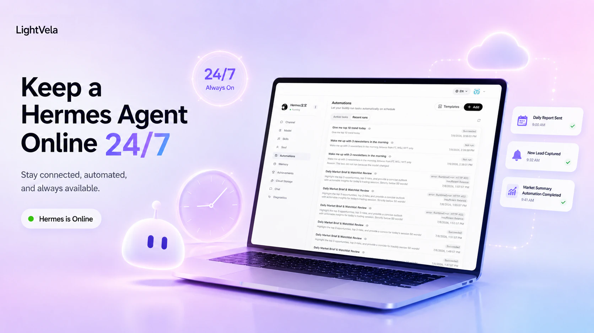
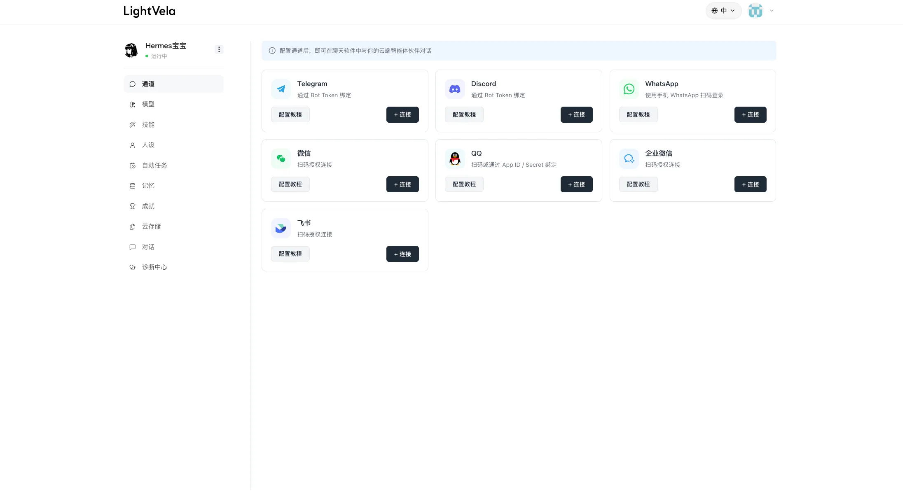
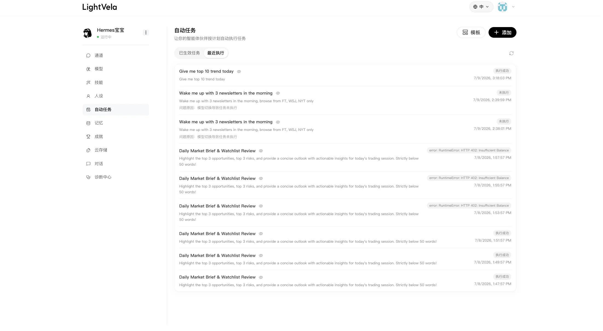

# วิธีทำให้เอเจนต์ Hermes ออนไลน์ตลอด 24 ชั่วโมง

## สรุป

**A Hermes Agent พร้อมให้บริการตลอด 24 ชั่วโมงเนื่องจากมันทำงานบนอินสแตนซ์คลาวด์แทนที่จะเป็นเครื่องของคุณเอง เมื่อมีการตั้งค่าโมเดลและอย่างน้อยหนึ่งช่องทางเรียบร้อยแล้ว มันจะใช้หน่วยความจำและพฤติกรรมแบบเดียวกันไม่ว่าคุณจะส่งข้อความจากจุดเชื่อมต่อใด** มีสามสิ่งที่ต้องพร้อมเพื่อความพร้อมใช้งานระยะยาวอย่างแท้จริง: โมเดลที่ตั้งค่าเรียบร้อยพร้อมโควต้าบัญชีที่ใช้ได้ (เครดิตทดลองใช้หมดจะทำให้ไม่ตอบกลับโดยเงียบๆ), อย่างน้อยหนึ่งช่องทางที่แสดงว่าเชื่อมต่ออยู่, และงานที่กำหนดเวลาเพื่อครอบคลุมงานที่ตั้งไว้ในขณะที่คุณไม่อยู่ อยาตัดสินความพร้อมใช้งานจากสถานะแผงควบคุมเพียงอย่างเดียว — ส่งข้อความจริงผ่านช่องทางจริง เมื่อมีสิ่งผิดพลาด ดูและส่งออกบันทึกล่าสุดใน Diagnostics (เลือกช่วงเวลา 1, 3, 6, 12, หรือ 24 ชั่วโมง) เพื่อหาสาเหตุ



## ใครที่เหมาะกับสิ่งนี้

ใช้รูปแบบนี้หากคุณต้องการผู้ช่วยที่คุณสามารถเข้าถึงได้จากโทรศัพท์ ช่องทีม หรือคอนโซลโดยไม่ต้องเปิดคอมพิวเตอร์ มันยังเหมาะสำหรับกิจวัตรที่กำหนดเวลา เช่น การบรีฟประจำวัน การเตือนความจำ หรือการตรวจสอบสถานะซ้ำ ๆ

การออนไลน์ไม่เหมือนกับการปล่อยทิ้งไว้โดยไม่มีใครดูแล คุณยังควรเลือกทักษะที่น่าเชื่อถือ ตรวจสอบคำสั่งซ้ำ และตรวจสอบว่าโมเดลและช่องทางยังคงทำงานตามที่คาดหวัง

## ข้อกำหนดเบื้องต้น

- เอเจนต์ Hermes ที่กำลังทำงานในคอนโซล LightVela ของคุณ [เริ่มต้นอย่างรวดเร็ว](../02-quickstart.md) ครอบคลุมการตั้งค่าบัญชีและการสร้างครั้งแรก

- การกำหนดค่ารูปแบบที่ใช้งานได้หรือเครดิตทดลองที่มีอยู่ Hermes ต้องการรูปแบบก่อนจึงสามารถสร้างคำตอบได้

- อย่างน้อยต้องมีช่องสัญญาณที่เชื่อมต่ออยู่หนึ่งช่อง เช่น Telegram, WhatsApp, Discord, Slack, หรือ WeChat เพื่อให้คุณมีวิธีที่ใช้งานได้ในการเข้าถึงมัน

- งานที่ทำซ้ำได้โดยเลือกเอง หากคุณต้องการให้ Hermes ทำมากกว่าแค่รอข้อความ

## ขั้นตอน / แนวคิดสำคัญ

### 1. ทำให้เอเจนต์สามารถเข้าถึงได้จากช่องทางที่คุณใช้งานจริง

เลือกช่องทางหนึ่งเป็นวิธีเริ่มต้นในการติดต่อ Hermes สำหรับการใช้งานส่วนตัว ตัวเลือกที่ดีที่สุดมักจะเป็นแอปที่คุณเช็คหลายครั้งต่อวันแล้ว เชื่อมต่อมัน ส่งข้อความทดสอบสั้น ๆ และตรวจสอบให้แน่ใจว่า Hermes ตอบกลับก่อนที่จะเพิ่มการตั้งค่าเพิ่มเติม

คำแนะนำโดยละเอียดมีให้สำหรับ [Telegram](../configuration/channel-telegram.md), [WhatsApp](../configuration/channel-whatsapp.md), [Discord](../configuration/channel-discord.md), [Slack](../configuration/channel-slack.md), และ [WeChat](../configuration/channel-wechat.md).



### 2. รักษาการกำหนดค่าที่ใช้งานให้ง่ายและมองเห็นได้

ชิ้นส่วนที่สำคัญคือโมเดลที่ใช้งาน ช่องทางที่เชื่อมต่อ ทักษะที่ติดตั้ง และความจำ คุณไม่จำเป็นต้องเปลี่ยนบ่อย แต่การรู้ว่าพวกมันอยู่ที่ไหนจะเป็นประโยชน์เมื่อคำตอบไม่มาหรือเมื่อภารกิจต้องการความสามารถใหม่

ใช้ [Configure Models](../configuration/model.md) เพื่อตรวจสอบโมเดลที่ใช้งานอยู่ และจดบันทึกผู้ให้บริการหรือสถานการณ์เครดิตทดลอง หากคุณติดตั้งทักษะ ให้เพิ่มเฉพาะทักษะที่จำเป็นสำหรับเวิร์กโฟลว์จริง และตรวจสอบพวกมันใน [Configure Skills](../configuration/skill.md)

### 3. ใช้ความจำเพื่อให้ผู้ช่วยต่อเนื่อง

ผู้ช่วยที่เปิดใช้งานตลอดเวลาจะมีประโยชน์มากขึ้นเมื่อมันไม่ได้เริ่มจากศูนย์ บอก Hermes เกี่ยวกับความชอบและบริบทการทำงานที่คุณต้องการนำไปใช้ในการสนทนาในอนาคต จากนั้นตรวจสอบบ่อยครั้งใน [การจัดการความจำ](../configuration/memory.md)

ตัวอย่างเช่น:

```text
Remember that I prefer updates in bullet points and that urgent work
should be labeled clearly.
```

สิ่งนี้ทำให้ข้อความที่ส่งมาจากอุปกรณ์หรือช่องทางที่รองรับต่าง ๆ สามารถสานต่อความสัมพันธ์ในการทำงานเดิมได้ต่อไป แทนที่จะเริ่มต้นใหม่จากหน้าว่าง

### 4. เพิ่มงานที่กำหนดเวลาล่วงหน้าเมื่อความพร้อมควรนำไปสู่การดำเนินการ

Hermes ออนไลน์สามารถรอข้อความของคุณได้ แต่การทำงานตามตารางเวลาขนาดเล็กช่วยให้มันเริ่มต้นกิจวัตรที่ทราบแล้วในเวลาที่เหมาะสม เริ่มต้นด้วยงานหนึ่งงานที่มีเงื่อนไขความสำเร็จที่ชัดเจน:

```text
Every weekday at 8:30 AM, prepare a short briefing with today’s
calendar priorities, open follow-ups, and the first action to take.
```

สร้างตารางเวลาใน [Scheduled Tasks](../configuration/automation.md), เลือกช่องทางการแจ้งเตือนถ้าเหมาะสม และตรวจสอบการทำงานไม่กี่ครั้งแรก หากผลลัพธ์กว้างเกินไป ให้ทำคำสั่งให้เฉพาะเจาะจงมากขึ้น แทนที่จะเพิ่มงานที่กำหนดเวลาอีกงานทันที



## คำถามที่พบบ่อย

### Hermes จำเป็นต้องให้แล็ปท็อปของฉันเปิดอยู่หรือไม่?

หมายเลข Hermes ทำงานในสภาพแวดล้อมคลาวด์ของ LightVela ดังนั้นคุณสามารถปิดอุปกรณ์ท้องถิ่นของคุณได้หลังจากที่เอเจนต์และช่องทางของมันถูกตั้งค่าเสร็จแล้ว

### ทำไม Hermes ถึงออนไลน์แต่ไม่ตอบ?

ตรวจสอบการเชื่อมต่อช่องทางและสถานะของโมเดลที่ใช้งานอยู่หรือเครดิตทดลองก่อน หากคุณเพิ่งเปลี่ยนการตั้งค่า ให้รอการอัปเดตเสร็จสมบูรณ์ จากนั้นส่งข้อความทดสอบง่าย ๆ อีกครั้ง หน้า [การวิเคราะห์ปัญหา](../configuration/diagnostics.md) สามารถช่วยในการบำรุงรักษาและบันทึกล่าสุดได้

### ฉันสามารถเชื่อมต่อหลายช่องทางได้หรือไม่?

ใช่ ช่องทางที่รองรับสามารถชี้ไปยังเอเจนต์ Hermes เดียวกันได้ พวกเขาแชร์พฤติกรรมและความจำของเอเจนต์เดียวกัน ดังนั้นให้เลือกช่องทางเริ่มต้นเพียงหนึ่งและเพิ่มช่องทางอื่นก็ต่อเมื่อสามารถตอบสนองความต้องการเข้าถึงจริง

### เอเจนต์ 24/7 ปลอดภัยต่อการทำงานอัตโนมัติหรือไม่?

ใช้คำสั่งและทักษะที่มีขอบเขตชัดเจนและเชื่อถือได้เท่านั้น เริ่มต้นด้วยขั้นตอนที่สามารถอ่านได้อย่างเดียวหรือมีความเสี่ยงต่ำ ตรวจสอบผลลัพธ์ และหลีกเลี่ยงการให้สิทธิ์งานที่ตั้งเวลาให้ทำสิ่งที่คุณไม่ต้องการให้ทำซ้ำโดยอัตโนมัติ

## ขั้นตอนถัดไป

- [งานที่กำหนดเวลา](../configuration/automation.md) — กำหนดเวลางานที่ควรเกิดขึ้นโดยไม่ต้องมีการสั่งงานด้วยมือ

- [การจัดการหน่วยความจำ](../configuration/memory.md) — รักษาค่ากำหนดที่มีประโยชน์ให้สามารถใช้งานได้ข้ามการสนทนา

- [Diagnostics](../configuration/diagnostics.md) — ตรวจสอบปัญหาช่องสัญญาณหรือโมเดลเมื่อ Hermes ไม่ตอบสนอง
