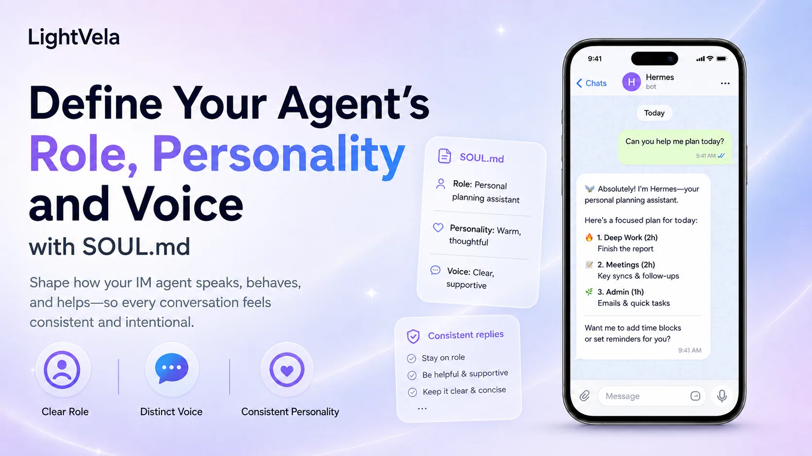

# วิธีการกำหนดบทบาท บุคลิกภาพ และเสียงของเอเจนต์ IM ด้วย SOUL.md

## สรุป

**ว่าเอเจนต์ IM รู้สึกเหมือน "คนเดิม" หรือไม่นั้น ขึ้นอยู่กับบุคลิกภาพ (persona) ของมัน ไม่ใช่ขึ้นอยู่กับช่องทางที่มันทำงานผ่าน `SOUL.md` จะถือบทบาท น้ำเสียง ลำดับความสำคัญ พฤติกรรม และข้อจำกัด และนี่คือไฟล์บุคลิกภาพหลักใน runtime ของ Hermes** บน LightVela คุณจะไม่เข้าถึงระบบไฟล์คลาวด์โดยตรง — ส่วน Persona ในหน้าการตั้งค่าของเอเจนต์มีสองจุดเริ่มต้นให้เลือก คือการสุ่มดึง persona หรือทำแบบสอบถามสั้น ๆ ตรวจสอบบทบาท น้ำเสียง และโน้ตพฤติกรรมของการ์ด persona แล้วเลือก Inject Persona เพื่อใช้งาน เขียนหลักการที่สามารถประเมินได้ แทนที่จะเป็นข้อเท็จจริงเฉพาะ: เช่น "เริ่มด้วยข้อสรุป" "ระบุความไม่แน่นอนอย่างชัดเจน" และ "ยืนยันก่อนส่งข้อความภายนอก" เป็นกฎ persona ในขณะที่ชื่อโปรเจกต์และพอร์ตจะอยู่ในความทรงจำระยะยาว หลังจากทำการ inject ให้ตรวจสอบน้ำเสียงและข้อจำกัดด้วยการสนทนาจริงหนึ่งครั้ง



## ใครที่เหมาะกับสิ่งนี้

คู่มือนี้สำหรับผู้ที่ต้องการมอบบทบาทที่มั่นคงให้กับเอเจนต์ IM เช่น ผู้ช่วยส่วนตัว คู่หูวิจัย เพื่อนเรียน หรือผู้ช่วยสื่อสารกับลูกค้าในชีวิตประจำวัน
หากคุณยังไม่ได้เลือกช่องทางส่งข้อความ ให้เริ่มจาก [วิธีเชื่อมต่อเอเจนต์ AI กับแพลตฟอร์มส่งข้อความ](./chinese-messaging-channels.md)

## ทำความเข้าใจกับสามชั้นบริบทก่อน

### `SOUL.md`: เอเจนต์คือใครและมันทำงานอย่างไร

`SOUL.md` เหมาะที่สุดสำหรับกฎบุคลิกภาพที่มั่นคง รวมถึงบทบาท น้ำเสียง ลำดับความสำคัญ พฤติกรรม และขอบเขต กฎต่าง ๆ เช่น "ให้ข้อสรุปก่อน" "ระบุความไม่แน่นอนอย่างชัดเจน" และ "ถามก่อนส่งข้อความไปข้างนอก" อยู่ที่นี่

### โปรไฟล์ผู้ใช้: คุณคือใครและคุณต้องการได้รับการปฏิบัติอย่างไร

โปรไฟล์ผู้ใช้นั้นเหมาะสำหรับภาษาของคุณ เขตเวลาของคุณ ตัวตน ของคุณ ประวัติ และความชอบในการสื่อสารของคุณ  
ตัวอย่างเช่น "ฉันอยู่ที่สิงคโปร์" "ใช้ภาษาอังกฤษโดยค่าเริ่มต้น" และ "แสดงกำหนดเวลาก่อน" มักเป็นความชอบของผู้ใช้ ไม่ใช่กฎตัวตนของเอเจนต์

### ความทรงจำระยะยาว: สิ่งที่คุณสร้างขึ้นร่วมกัน

ความทรงจำระยะยาวเหมาะที่สุดสำหรับสถานะโครงการ การตัดสินใจ และบริบทที่นำกลับมาใช้ได้จากงานที่คุณแบ่งปัน มันเติบโตผ่านการสนทนาที่ต่อเนื่องและสามารถตรวจสอบหรือจัดการความจุได้ใน [การจัดการความทรงจำ](../configuration/memory.md)

การผสมทั้งสามอย่างทำให้ตัวตนของเอเจนต์ ความชอบของผู้ใช้ และบริบทโครงการชั่วคราวรบกวนกันและกัน การแยกสิ่งเหล่านี้ออกจากกันทำให้บุคลิกภาพยังคงมีความมั่นคงในขณะที่การสนทนาปรับตัวเข้ากับผู้ใช้จริงและงานได้

## ข้อกำหนดเบื้องต้น

- เอเจนต์ LightVela Hermes ที่กำลังทำงานอยู่
  หากคุณยังไม่ได้สร้าง ให้เริ่มต้นด้วย [เริ่มต้นอย่างรวดเร็ว](../02-quickstart.md)

- โมเดลที่ถูกกำหนดค่าแล้วและมีช่องทางการสนทนาอย่างน้อยหนึ่งช่องทางที่พร้อมใช้งาน

- บทสรุปเกี่ยวกับบุคคลสั้น ๆ  
  ตัดสินใจว่าเอเจนต์ให้บริการใคร ทำหน้าที่หลักอะไร ควรสื่อสารอย่างไร และการกระทำใดที่ต้องมีการยืนยันอยู่เสมอ

## ขั้นตอน / แนวคิดสำคัญ

### 1. กำหนดเป้าหมายของบุคลิกภาพด้วยห้าคำถาม

ก่อนเลือกวิญญาณ ให้ตอบคำถามห้าข้อเหล่านี้:

- เอเจนต์คือใคร?

- มันช่วยใครบ้างเป็นหลัก?

- ปกติควรฟังดูอย่างไร?

- ควรทำอย่างไรเมื่อข้อมูลไม่แน่นอน?

- การกระทำภายนอกใดต้องได้รับการยืนยันก่อน?

เปลี่ยนคำตอบให้เป็นสรุปแผนงานแบบนี้:

```text
Role: A research assistant for personal projects
Audience: A user who wants reliable conclusions quickly
Voice: Concise, professional, friendly, conclusion first, evidence second
Behavior: Break down questions, flag uncertainty, and ask only one key question when needed
Boundaries: Never send external messages, change files, or take high-risk actions without confirmation
```

เทมเพลตนี้ช่วยคุณเลือกและปรับแต่งบุคลิกภาพ
มันไม่ได้หมายความว่า LightVela เปิดเผยตัวแก้ไขทั่วไปสำหรับไฟล์คลาวด์แบบใดก็ได้

### 2. บุคลิกภาพแบบเปิดในการตั้งค่าเอเจนต์

ในคอนโซล LightVela ให้เปิดการตั้งค่าของเอเจนต์เป้าหมาย Hermes และเลือก "บุคลิกภาพ"  
เว็บไซต์ระหว่างประเทศมีทั้งจุดเข้าใช้งาน "สุ่มจิตวิญญาณ" และ "ทดสอบบุคลิกภาพจิตวิญญาณ"

ใช้การจับสลากแบบสุ่มเพื่อสำรวจสไตล์บทบาทต่าง ๆ ใช้การทดสอบบุคลิกภาพเมื่อคุณต้องการวิญญาณที่เข้ากันได้ดีกับความชอบในการสื่อสารและพฤติกรรมของคุณ

ทบทวนบทบาท เสียง และคำอธิบายพฤติกรรมบนแต่ละการ์ด จากนั้นเลือกการ์ดที่ตรงกับแผนงานของคุณมากที่สุด

### 3. ฉีดวิญญาณที่เลือกเข้าไปใน `SOUL.md`

เลือกวิญญาณและคลิก "ฉีดวิญญาณ" LightVela จะเขียนวิญญาณที่เลือกไปยัง `SOUL.md` ของเอเจนต์ Hermes ปัจจุบันและเก็บสำรองก่อนแทนที่ไฟล์ที่มีอยู่

มีเพียงบุคลิกเดียวที่ทำงานสำหรับเอเจนต์ในแต่ละครั้ง หากคุณต้องการสลับบทบาท ให้ตรวจสอบขอบเขตของการ์ดใหม่ก่อนที่จะใส่มันอีกครั้ง

หลังจากการฉีดยาสำเร็จ กลับไปที่ช่อง IM ของคุณแล้วส่ง:

```text
/new
```

Hermes เอเจนต์อ่าน `SOUL.md` ใหม่เมื่อการสนทนาใหม่เริ่มต้น สิ่งนี้สำคัญเพราะการสนทนาที่มีอยู่แล้วอาจยังคงเก็บภาพรวมบุคคลก่อนหน้าอยู่

### 4. เพิ่มความชอบของผู้ใช้และข้อเท็จจริงที่ทนทานผ่านการสนทนา

อย่าใส่ข้อมูลทุกชิ้นลงใน `SOUL.md` ให้บุคลิกที่มั่นคงสั้น และปล่อยให้โปรไฟล์ผู้ใช้และความทรงจำระยะยาวจัดการเรื่องความชอบส่วนตัวและข้อเท็จจริงเกี่ยวกับโครงการ

ตัวอย่างเช่น บอก Hermes:

```text
Remember that I am in Singapore time and want a concise weekday plan at 8:00 AM, with deadlines listed first.
```

หรือ:

```text
Forget the Friday evening reminder preference I mentioned earlier. Do not schedule it again.
```

Hermes จัดการคำขอจดจำและลืมผ่านการสนทนา ใช้ [การจัดการหน่วยความจำ](../configuration/memory.md) เพื่อตรวจสอบเนื้อหาและความจุของหน่วยความจำและโปรไฟล์ผู้ใช้

### 5. ติดตั้งทักษะเฉพาะสำหรับงานจริง

บุคลิกภาพกำหนดวิธีการทำงานของเอเจนต์ แต่ไม่ได้เพิ่มความสามารถภายนอกโดยอัตโนมัติ  
หากคุณต้องการให้มันเรียกดู จัดระเบียบข้อมูล ค้นหาข้อมูล หรือทำงานที่เป็นรูปธรรมอื่น ๆ ให้ติดตั้งทักษะที่เหมาะสมและตรวจสอบแหล่งที่มาและสิทธิ์ก่อน

เริ่มต้นด้วย [การกำหนดทักษะ](../configuration/skill.md)  
ทักษะและบุคลิกภาพควรเสริมซึ่งกันและกัน ไม่ควรใช้ทักษะความเสี่ยงสูงเพื่อชดเชยขอบเขตบุคลิกภาพที่ไม่ชัดเจน

## ตรวจสอบให้แน่ใจว่าบุคลิกภาพกำลังใช้งานอยู่

หลังจากเริ่มการสนทนาใหม่ ให้ทำมากกว่าการขอการแนะนำตัวเอง ทดสอบอย่างน้อยสี่กรณีนี้:

```text
What is your current role, main job, and default voice?
```

```text
How do you respond when you are uncertain about a fact?
```

```text
If I ask you to send a message to an external service, what do you do first?
```

```text
Turn this material into conclusions, evidence, and questions that still need confirmation.
```

ตรวจสอบว่าเอเจนต์ยังคงรักษาบทบาท น้ำเสียง และขอบเขตความปลอดภัยได้หรือไม่ และว่ายังสามารถใช้บริบทที่เกี่ยวข้องจากโปรไฟล์ผู้ใช้และความทรงจำระยะยาวได้หรือไม่  
หากพฤติกรรมไม่เสถียร ให้ทำให้กฎบุคลิกภาพเรียบง่ายก่อนที่จะเลือกหรือใส่วิญญาณอีกตัวหนึ่ง

## คำถามที่พบบ่อย

### ฉันจำเป็นต้องแก้ไขคลาวด์ `SOUL.md` ด้วยตนเองหรือไม่?

โดยปกติไม่ใช่  
LightVela รายการบุคลิกภาพจะสร้างและฉีดวิญญาณ ดังนั้นการใช้งานทั่วไปไม่จำเป็นต้องทำงานโดยตรงกับระบบไฟล์บนคลาวด์

### การเปลี่ยน `SOUL.md` มีผลต่อทุกช่องทางการส่งข้อความหรือไม่?

มันส่งผลต่อพฤติกรรมระดับเอเจนต์สำหรับเอเจนต์ Hermes เดียวกัน หากเอเจนต์นั้นเชื่อมต่อกับ Telegram และ WhatsApp ทั้งสองช่องทางจะใช้บุคลิกภาพเดียวกันในการสนทนาใหม่ ในขณะที่แต่ละช่องทางยังคงมีการอนุญาต รูปแบบข้อความ และข้อจำกัดความสามารถของตัวเอง

### `SOUL.md` สามารถแทนที่ความทรงจำได้หรือไม่?

ไม่ใช่
`SOUL.md` ควรอธิบายตัวตนและกฎพฤติกรรมที่มั่นคง ในขณะที่หน่วยความจำควรเก็บข้อเท็จจริงที่เปลี่ยนแปลงได้ บริบทของโครงการ และประสบการณ์ที่ใช้ร่วมกัน

### สามารถเอเจนต์หนึ่งมีบุคลิกหลายบุคลิกที่ใช้งานได้พร้อมกันหรือไม่?

ปัจจุบัน เอเจนต์หนึ่งมีบุคลิกที่ใช้งานได้เพียงหนึ่งบุคลิกในแต่ละครั้ง หากคุณต้องการบทบาทที่แตกต่างกันอย่างสิ้นเชิง ให้สร้างเอเจนต์แยกต่างหาก แทนที่จะเขียนทับวิญญาณบนเอเจนต์เดียวซ้ำแล้วซ้ำเล่า

### ฉันควรส่ง `/new` เมื่อไหร่?

ส่ง `/new` ในช่อง IM หลังจากฉีดบุคลิกใหม่ สิ่งนี้ทำให้ชัดเจนว่า Soul ใหม่ควรถูกโหลดระหว่างการเริ่มต้นการสนทนา

## ขั้นตอนถัดไป

- [วิธีการกำหนดค่าเอเจนต์ Hermes ด้วยบุคลิกลักษณะเฉพาะใน Telegram](./telegram-persona-agent.md) - นำบุคลิกนี้ไปใช้กับการสนทนาแบบตัวต่อตัว Telegram

- [วิธีการกำหนดค่าเอเจนต์ Hermes ด้วยบุคลิกลักษณะเฉพาะใน WhatsApp](./whatsapp-persona-agent.md) - นำบุคลิกนี้ไปใช้กับการสนทนาแบบตัวต่อตัว WhatsApp

- [บุคลิกของเอเจนต์ Hermes มาจากไหน](../hermes-agent/10-persona-user-memory.md) - ทำความเข้าใจบุคลิก, ความชอบของผู้ใช้, และความจำระยะยาวในเชิงลึกมากขึ้น

- [Cloud Storage](../configuration/files.md) - จัดการวัสดุอ้างอิงและไฟล์งานที่เอเจนต์สามารถใช้ได้
