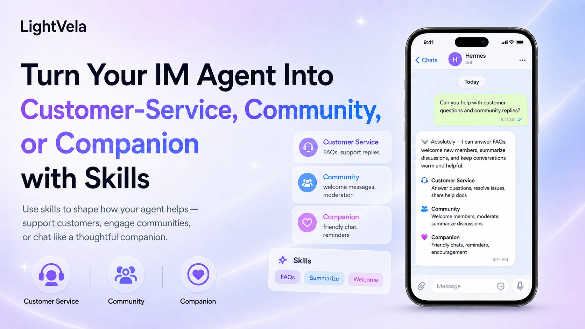

# วิธีเปลี่ยนเอเจนต์ IM ให้กลายเป็นผู้ช่วยด้านบริการลูกค้า ชุมชน หรือเพื่อนร่วมสนทนาพร้อมทักษะ

## สรุป

**การเปลี่ยนแปลงเอเจนต์ IM หนึ่งตัวให้กลายเป็นเอเจนต์สนับสนุน ผู้ช่วยชุมชน หรือเพื่อนร่วม AI ขึ้นอยู่กับการแบ่งแยกระหว่างทักษะและบุคลิก: ทักษะขยายสิ่งที่มันสามารถทำได้ ส่วน `SOUL.md` กำหนดว่าใครคือมันและอยู่ภายใต้ขอบเขตใดที่มันปฏิบัติการ** ทั้งสองอย่างจำเป็น — ทักษะโดยไม่มีบุคลิกจะให้คำตอบที่ไม่สอดคล้องกัน และบุคลิกโดยไม่มีทักษะจะขาดวิธีการที่ใช้ซ้ำได้ ใน LightVela ทักษะมาจากตลาดสาธารณะ Skills.sh และ ClawHub; วันนี้คุณติดตั้งหรือเอาออกโดยบอก Hermes ในการสนทนา (การติดตั้งผ่านแผงคอนโซลกำลังจะมาในเร็ว ๆ นี้) จากนั้นตรวจสอบความพร้อมใช้งานในแชท สามสถานการณ์แตกต่างกันหลัก ๆ ในการออกแบบขอบเขต: การสนับสนุนต้องการเงื่อนไขการยกระดับที่ชัดเจน ผู้ช่วยชุมชนต้องรู้ว่าเมื่อใดควรเงียบ และการใช้งานเป็นเพื่อนร่วมจะต้องมีหัวข้อที่ห้ามชัดเจน ทำงานผ่านรายการตรวจสอบความปลอดภัยก่อนการเปิดใช้งาน

## ใครที่เหมาะกับสิ่งนี้

คู่มือนี้สำหรับผู้ที่ได้เชื่อมต่อ Telegram, WhatsApp หรือช่องทางการสื่อสารอื่น และต้องการใช้เอเจนต์สำหรับกระบวนการทำงานที่ชัดเจน

มันมีประโยชน์อย่างยิ่งสำหรับหัวหน้าฝ่ายสนับสนุน ผู้ดูแลชุมชน และบุคคลที่ต้องการเพื่อนร่วมงาน AI ที่สามารถทำงานร่วมกับพวกเขาได้ในระยะยาว

## ข้อกำหนดเบื้องต้น

- เอเจนต์ LightVela Hermes ที่กำลังทำงานอยู่
  หากคุณยังไม่ได้สร้าง ให้เริ่มต้นด้วย [เริ่มต้นอย่างรวดเร็ว](../02-quickstart.md)

- ช่องทางการส่งข้อความที่สามารถจัดการบทสนทนาปกติได้แล้ว  
คุณสามารถเริ่มต้นด้วย [วิธีการกำหนดค่าเอเจนต์ Hermes ที่มีบุคลิกเฉพาะใน Telegram](./telegram-persona-agent.md) หรือ [วิธีการกำหนดค่าเอเจนต์ Hermes ที่มีบุคลิกเฉพาะใน WhatsApp](./whatsapp-persona-agent.md)

- คำนิยามเบื้องต้นของเวิร์กโฟลว์เป้าหมาย, การกระทำที่อนุญาต, และสถานการณ์ที่ต้องส่งต่อให้มนุษย์

- ทักษะที่เชื่อถือได้ที่เลือกจาก [Skills.sh](https://skills.sh/) หรือ [ClawHub](https://clawhub.ai/)

## เข้าใจขอบเขตระหว่างทักษะกับบุคลิกภาพ

ทักษะคือชุดความสามารถที่สามารถเรียกใช้งานได้ เช่น การท่องเว็บ การจัดระเบียบเนื้อหา สรุปประจำวัน หรือกระบวนงานเฉพาะด้าน

SOUL.md ดีกว่าสำหรับการอธิบายว่า Agent คือใคร พูดอย่างไร ตัดสินใจอย่างไร และการกระทำใดที่ต้องการการยืนยัน

โปรไฟล์ผู้ใช้และความทรงจำระยะยาวมีไว้สำหรับตัวตนของคุณ ความชอบ ข้อเท็จจริงที่ยืนยันแล้ว และบริบทที่ต่อเนื่อง

อย่านำสคริปต์ของลูกค้า กฎของกลุ่ม และสิทธิ์ที่มีความเสี่ยงสูงมารวมไว้ในคำอธิบายบุคลิกภาพเดียวโดยไม่มีการแบ่งแยก

## ขั้นตอน

### 1. กำหนดสถานการณ์หลักของเอเจนต์

สถานการณ์ที่แตกต่างต้องการการผสมผสานทักษะและขอบเขตความปลอดภัยที่แตกต่างกัน

| สถานการณ์ | เป้าหมายหลัก | ทิศทางทักษะ | ขอบเขตที่ต้องกำหนดก่อน |
|---|---|---|---|
| บริการลูกค้า | ตอบคำถามทั่วไปและส่งต่อคำร้องที่ซับซ้อน | การเรียกคืนความรู้, การจัดระเบียบตั๋ว, การค้นหาคำสั่งซื้อ | ยกระดับความไม่แน่นอนและไม่สัญญาการคืนเงินหรือเปลี่ยนคำสั่งซื้อโดยไม่ได้รับอนุญาต |
| ผู้ช่วยชุมชน | ต้อนรับสมาชิก, ตอบคำถามที่พบบ่อย, สรุปการสนทนา | การเรียกคืนเนื้อหา, สรุป, การเตือนตามกำหนดเวลา | หลีกเลี่ยงสแปม, ปกป้องข้อมูลสมาชิก, และไม่ตัดสินใจการดูแลสำหรับผู้ดูแลระบบ |
| ผู้ช่วย AI | ให้ความเป็นเพื่อนต่อเนื่อง, เตือนความจำ, และร่วมมือระยะยาว | การจัดระเบียบความจำ, การจัดตารางเวลา, การสร้างเนื้อหา | เคารพการปฏิเสธและความเป็นส่วนตัว, หลีกเลี่ยงพฤติกรรมสร้างการพึ่งพา, และระบุความไม่แน่นอน |

เริ่มต้นด้วยสถานการณ์หลักเพียงหนึ่งสถานการณ์ แทนที่จะติดตั้งทักษะหลายอย่างพร้อมกัน

### 2. เตรียมเอกสารอ้างอิงและบทสรุปบุคลิกภาพ

สำหรับการบริการลูกค้า จัดเตรียมคำถามที่พบบ่อยเกี่ยวกับผลิตภัณฑ์ ชั่วโมงให้บริการ เส้นทางการยกระดับ และรายละเอียดการติดต่อกับเจ้าหน้าที่

สำหรับการดำเนินงานของชุมชน ให้จัดเตรียมข้อความต้อนรับ คำถามที่พบบ่อย กฎของชุมชน และรูปแบบสรุป

สำหรับเพื่อนร่วมทาง AI ให้จดชื่อที่ต้องการ เสียง ระดับความริเริ่ม และหัวข้อที่ควรอยู่นอกขอบเขต

วางวัสดุอ้างอิงที่ Hermes ต้องปรึกษาใน [Cloud Storage](../configuration/files.md) และใส่กฎบุคลิกภาพที่มั่นคงลงใน SOUL.md ผ่าน [Personality and SOUL.md](./im-agent-persona-soul-md.md)

### 3. เลือกและติดตั้งสกิล

LightVela ปัจจุบันรองรับการถาม Hermes ให้ติดตั้งทักษะจาก Skills.sh หรือ ClawHub ผ่านการสนทนา

ส่งคำขอแบบนี้ในช่องที่เชื่อมต่อ:

กรุณาติดตั้งทักษะที่เหมาะสมสำหรับการจัดระเบียบคำถามที่พบบ่อยของบริการลูกค้าจาก Skills.sh หรือ ClawHub และอธิบายก่อนว่าต้องการสิทธิ์อะไรบ้าง

หากคุณรู้ชื่อทักษะแล้ว ให้ระบุอย่างชัดเจน:

กรุณาติดตั้ง [ชื่อทักษะ] ก่อน บอกฉันก่อนว่ามันจะอ่านอะไร จะเรียกบริการภายนอกใดบ้าง และสามารถส่งข้อความเชิงรุกได้หรือไม่

รายการติดตั้งทักษะแบบภาพของคอนโซลยังคงขึ้นอยู่กับสถานะของหน้าปัจจุบัน ดังนั้นดูที่ [ตั้งค่าทักษะ](../configuration/skill.md) สำหรับขั้นตอนการติดตั้งที่รองรับ

ทักษะความเสี่ยงสูงอาจขอการยืนยันขั้นที่สองก่อนการติดตั้ง

ก่อนยืนยัน ตรวจสอบแหล่งที่มาของทักษะ การอนุญาต การเรียก API ภายนอก และพฤติกรรมเชิงรุก

### 4. ตรวจสอบทักษะสำหรับสถานการณ์ของมัน

ทดสอบทักษะใหม่ในการสนทนาแบบตัวต่อตัวก่อนที่จะเปิดเผยต่อผู้ชมจำนวนมาก

สำหรับบริการลูกค้า ให้เริ่มด้วย:

ตอบคำถามนี้โดยใช้คำถามที่พบบ่อยที่เตรียมไว้ หากวัสดุไม่มีคำตอบ ให้กล่าวอย่างชัดเจนและแนะนำการส่งต่อให้มนุษย์

สำหรับผู้ช่วยชุมชน ให้เริ่มด้วย:

สรุปการสนทนานี้ไม่เกินห้าประเด็นและระบุคำถามที่ยังไม่มีข้อสรุป

สำหรับเพื่อน AI เริ่มด้วย:

ใช้เสียงที่ฉันตั้งค่าไว้เพื่อให้การเช็กอินสั้น ๆ สำหรับวันนี้ และอธิบายว่ารายละเอียดใดบ้างที่จะถูกเก็บไว้เป็นความทรงจำระยะยาว

ตรวจสอบว่าเอเจนต์ได้โทรหา Skill ที่คาดไว้ ใช้วัสดุอ้างอิงที่ถูกต้อง และหยุดเพื่ออธิบายข้อจำกัดเมื่อมันไม่แน่ใจหรือไม่

### 5. ใช้งานงานตามกำหนดเวลาสำหรับงานที่สามารถทำซ้ำได้

ข้อความต้อนรับ คำถามที่พบบ่อย สรุป และการเตือนสามารถใช้ตัวกระตุ้นที่แตกต่างกันได้

ใช้ [งานที่กำหนดเวลา](../configuration/automation.md) สำหรับงานที่ควรทำในเวลาที่กำหนด เช่น การส่งสรุปชุมชนประจำวันหรือเตือนทีมสนับสนุนเกี่ยวกับกรณีที่ยังไม่ได้รับการแก้ไข

ยืนยันวิธีการแจ้งเตือนและช่องทางเป้าหมายสำหรับงานที่กำหนดเวลาแต่ละงาน แทนที่จะสมมติว่าทุกช่องทางสามารถรับประเภทข้อความเชิงรุกเดียวกันได้

## คำแนะนำตามสถานการณ์

### ผู้ช่วยฝ่ายบริการลูกค้า

ให้ทักษะดึงข้อมูล จัดระเบียบบริบท และร่างคำตอบ ในขณะ SOUL.md ทำให้เอเจนต์มืออาชีพ ชัดเจน และรอบคอบ

สำหรับการคืนเงิน การเปลี่ยนแปลงราคา การตรวจสอบตัวตน การลบข้อมูล และการดำเนินการที่มีความเสี่ยงสูงอื่น ๆ ให้ร้องขอให้เจ้าหน้าที่อธิบายผลกระทบและรอการยืนยันจากมนุษย์

เมื่อเอกสารอ้างอิงไม่สมบูรณ์ ผู้ใช้กำลังเพิ่มระดับปัญหา หรือคำขออยู่นอกขอบเขตที่ได้รับอนุญาต ให้ส่งต่อแทนที่จะเดา

### ผู้ช่วยชุมชน

ให้ทักษะดึงคำถามที่พบบ่อย ดึงประเด็นการสนทนา และร่างข้อความเตือน ในขณะที่เอกสารสรุปบุคลิกภาพช่วยให้เอเจนต์สอดคล้องกับโทนของชุมชนและกฎของผู้ดูแลระบบ

การเข้าถึงกลุ่ม การเรียก @mention สิทธิ์ และการส่งข้อความขึ้นอยู่กับช่องทาง ดังนั้นควรอ่านเอกสารเกี่ยวกับช่องทางที่เกี่ยวข้องก่อนปรับตั้งค่ากระบวนการทำงาน

หากช่องทางเป้าหมายในปัจจุบันไม่รองรับการสนทนากลุ่ม ให้ตรวจสอบทักษะและเวิร์กโฟลว์เนื้อหาในการสนทนาแบบตัวต่อตัวแทนที่จะถือว่าบทความนี้เป็นการตั้งค่าการสนทนากลุ่มแบบสด

### เพื่อนร่วมทาง AI

ใช้ SOUL.md สำหรับสไตล์ความเป็นเพื่อนที่มั่นคง และใช้ความทรงจำและโปรไฟล์ผู้ใช้สำหรับความชอบที่ยืนยันแล้วและบริบทระยะยาว

การเตือนเชิงรุกควรมีความถี่ วิธีการหยุดชั่วคราว และชั่วโมงเงียบอย่างชัดเจน เพื่อให้ความริเริ่มไม่กลายเป็นการส่งข้อความไม่จำกัด

ถ้าคุณต้องการให้ Hermes เก็บความชอบไว้ ให้ขอมันจดจำความชอบนั้นในการสนทนา; ถ้าคุณไม่ต้องการให้เก็บไว้แล้ว ให้ขอมันลืมมัน

## รายการตรวจสอบความปลอดภัย

- ยืนยันแหล่งที่มาของทักษะ สิทธิ์การเข้าถึง และการพึ่งพาบริการภายนอกก่อนการติดตั้ง

- ใช้การสนทนาแบบตัวต่อตัวและเนื้อหาที่มีความเสี่ยงต่ำในระหว่างการทดสอบ

- ต้องการการยืนยันก่อนส่งข้อความไปภายนอก เปลี่ยนคำสั่ง ลบไฟล์ หรือดำเนินการอื่น ๆ ที่ไม่สามารถย้อนกลับได้

- เตรียมเส้นทางส่งต่อแบบมนุษย์สำหรับการทำงานของฝ่ายบริการลูกค้าและชุมชน

- ตรวจสอบหน่วยความจำ โปรไฟล์ผู้ใช้ และพื้นที่จัดเก็บข้อมูลบนคลาวด์เป็นระยะ และลบข้อมูลที่ไม่จำเป็นแล้ว

## คำถามที่พบบ่อย

### การติดตั้งทักษะจะเปลี่ยนบุคลิกของเอเจนต์อัตโนมัติหรือไม่?

ไม่

ทักษะช่วยขยายสิ่งที่เอเจนต์สามารถทำได้เป็นหลัก ในขณะที่บุคลิกภาพถูกกำหนดโดย SOUL.md และการกำหนดค่าที่เกี่ยวข้อง

คำแนะนำเกี่ยวกับทักษะและผลลัพธ์อาจส่งผลต่อสไตล์ของงานหนึ่งงาน แต่ไม่ควรแทนที่บทบาทและการกำหนดขอบเขตที่มั่นคงของคุณ

### ทักษะการบริการลูกค้าสามารถดำเนินการขอคืนเงินได้โดยตรงหรือไม่?

พิจารณาการกระทำประเภทนั้นเฉพาะเมื่อสิทธิ์ของระบบ กฎระเบียบทางธุรกิจ และข้อกำหนดการยืนยันจากมนุษย์ทั้งหมดชัดเจนแล้วเท่านั้น

โดยค่าเริ่มต้น ให้เอเจนต์ตรวจสอบนโยบาย ร่างคำแนะนำ และรอการยืนยันก่อนการดำเนินการ

### ผู้ช่วยชุมชนสามารถเข้าร่วมกลุ่ม Telegram ได้โดยตรงหรือไม่?

Telegram รองรับข้อความในกลุ่มหลังจากที่คุณปิดการตั้งค่าความเป็นส่วนตัวของกลุ่มใน BotFather แล้วเพิ่มบอทลงในกลุ่ม และกล่าวถึงมันด้วย `@bot_username`  
ดูที่ [วิธีใช้ Telegram ผู้ช่วยชุมชน AI ในกลุ่ม](./telegram-group-community-assistant.md) สำหรับการถาม-ตอบในกลุ่ม สรุปข้อความ และร่างการแจ้งเตือน

### ฉันควรใส่วัสดุอ้างอิงทั้งหมดลงในความจำหรือไม่?

ไม่

หน่วยความจำระยะยาวใช้สำหรับบริบทที่มั่นคงในปริมาณเล็ก ๆ ในขณะที่คำถามที่พบบ่อยเกี่ยวกับผลิตภัณฑ์ กฎของชุมชน และชุดข้อมูลอ้างอิงขนาดใหญ่ ควรเก็บใน [Cloud Storage](../configuration/files.md) หรืออ่านตามความต้องการโดย Skill

## ขั้นตอนถัดไป

- [กำหนดค่าทักษะ](../configuration/skill.md) - ทบทวนการติดตั้งทักษะ การตรวจสอบความถูกต้อง และคำแนะนำด้านความปลอดภัย

- [วิธีการกำหนดบทบาท บุคลิกภาพ และเสียงของเอเจนต์ IM ด้วย SOUL.md](./im-agent-persona-soul-md.md) - ออกแบบบุคลิกและขอบเขตพฤติกรรมที่มั่นคง

- [วิธีเชื่อมต่อเอเจนต์หนึ่งตัวกับ Telegram และ WhatsApp ในขณะที่ยังคงบุคลิกและความทรงจำระยะยาว](./multi-channel-personality-memory.md) - ขยายความสามารถเอเจนต์เดียวกันไปยังจุดเข้าหลายจุด

- [วิธีใช้ผู้ช่วยชุมชน AI กลุ่ม Telegram](./telegram-group-community-assistant.md) - ทำการตั้งค่าข้อความกลุ่มให้เสร็จสมบูรณ์และเตรียมทักษะสำหรับถาม-ตอบและสรุปของกลุ่ม
