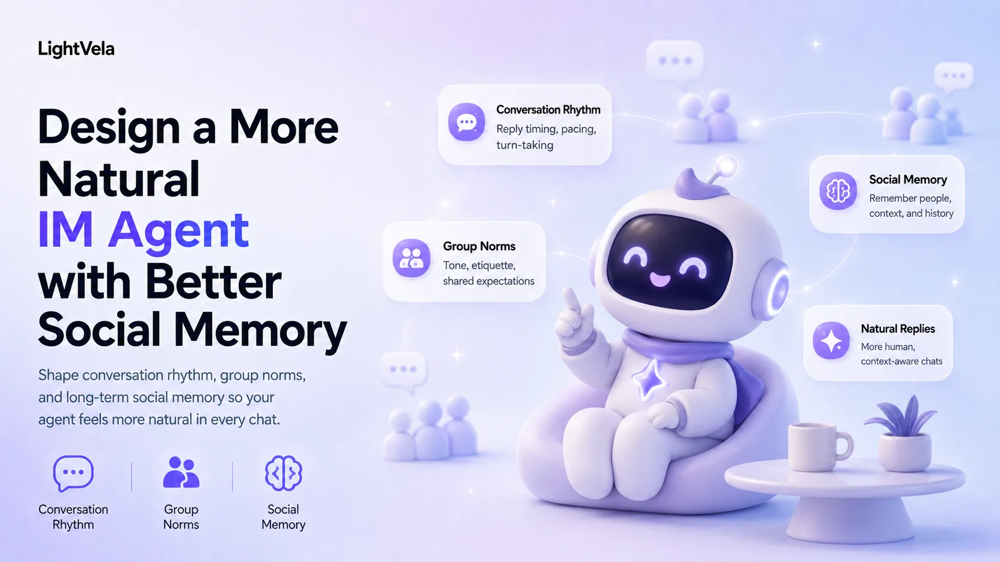

# วิธีการออกแบบเอเจนต์ IM ที่เป็นธรรมชาติมากขึ้น: จังหวะการสนทนา บรรทัดฐานของกลุ่ม และความทรงจำทางสังคมระยะยาว

## สรุป

**"สมจริงมากขึ้น" ไม่ได้หมายถึงการปลอมเป็นคนจริง แต่หมายถึงการรักษาพฤติกรรมที่มั่นคง เข้าใจได้ในการแสดงออก การตอบสนอง และความร่วมมือระยะยาว ซึ่งสามารถสรุปได้เป็นสามสิ่ง: จังหวะการสนทนา มาตรฐานของกลุ่ม และความทรงจำทางสังคมระยะยาว** จังหวะกำหนดว่าเมื่อใดควรตอบโดยสั้น ๆ เมื่อใดควรอธิบายเพิ่มเติม และเมื่อใดควรหยุดและรอการยืนยัน มาตรฐานของกลุ่มกำหนดวิธีการพูดในพื้นที่ร่วม วิธีการอ้างอิงบริบท และวิธีการเคารพขอบเขตของสมาชิก ความทรงจำทางสังคมระยะยาวกำหนดว่าควรเก็บบริบทของความสัมพันธ์ที่ได้รับการยืนยันไว้หรือไม่โดยไม่เปลี่ยนข้อความทุกข้อความให้เป็นบันทึกถาวร นำสิ่งเหล่านี้ไปใช้เป็นชั้น ๆ: จังหวะและมาตรฐานเป็นกฎระดับบุคลิกที่มั่นคง ในขณะที่ความทรงจำเก็บเฉพาะข้อเท็จจริงที่ได้รับการยืนยันและคงทน ใช้รายการตรวจสอบการสนทนาตามธรรมชาติในคู่มือนี้เพื่อตรวจสอบการออกแบบ

## ใครที่เหมาะกับสิ่งนี้

คู่มือนี้สำหรับผู้ที่ต้องการให้เอเจนต์ IM รู้สึกเป็นธรรมชาติและสอดคล้องมากขึ้นในขณะที่ยังคงความโปร่งใสและสามารถควบคุมได้

มันใช้ได้กับผู้ช่วยส่วนตัว, เพื่อนร่วมการศึกษา, คู่มือวิจัย, และทีมที่ออกแบบผู้ช่วยชุมชน

Telegram รองรับข้อความกลุ่มหลังจากที่คุณปิดความเป็นส่วนตัวของกลุ่มใน BotFather, เพิ่มบอทลงในกลุ่ม และกล่าวถึงมันด้วย `@bot_username`  
ความสามารถของกลุ่ม WhatsApp ยังคงขึ้นอยู่กับเอกสารของช่องนั้นเอง ดังนั้นให้ใช้ข้อกำหนดของกลุ่มเหล่านี้กับ Telegram หลังจากการตั้งค่าและตรวจสอบการรองรับก่อนใช้ช่องทางอื่น

## ตัดสินใจว่าสิ่งใดควรคงที่

แยกพฤติกรรมทนทานของเอเจนต์ออกเป็นสี่ชั้น:

| ชั้น | ความรับผิดชอบ | การตั้งค่าที่แนะนำ |
|---|---|---|
| บุคลิกภาพ | บทบาท เสียง หลักการ และขอบเขต | SOUL.md |
| ความชื่นชอบในความสัมพันธ์ | ชื่อ ภาษา ระดับรายละเอียด และนิสัยในการโต้ตอบ | โปรไฟล์ผู้ใช้ |
| ความจำทางสังคม | บริบทที่ยืนยันร่วมกัน พื้นหลังโครงการ และข้อตกลงที่กำลังดำเนินอยู่ | ความทรงจำ |
| จังหวะปัจจุบัน | บริบทการสนทนา ความยาว และความเร่งด่วนสำหรับงานนี้ | เซสชันปัจจุบันและคำสั่งงาน |

อย่าปล่อยให้อารมณ์ชั่วคราวหรือการตอบกลับโดยไม่ได้ตั้งใจเปลี่ยนแปลงบุคลิกภาพที่มั่นคง

อย่าบันทึกการทักทายทุกครั้ง ข้อความของสมาชิกกลุ่มทุกคน หรือการสรุปที่ยังไม่ได้ยืนยันเป็นความทรงจำทางสังคมระยะยาว

## ขั้นตอน

### 1. กำหนดบทบาทตามธรรมชาติโดยไม่เลียนแบบ

ใช้ [SOUL.md คู่มือบุคลิกภาพ](./im-agent-persona-soul-md.md) เพื่อกำหนดบทบาท เสียง ระดับความริเริ่ม และข้อจำกัดของเอเจนต์

เริ่มต้นด้วยข้อความสั้น ๆ แบบนี้:

คุณเป็นคู่มือวิจัยที่มั่นคง ตรงไปตรงมา และเป็นมิตร สรุปผลก่อน จากนั้นค่อยเพิ่มหลักฐานและรายละเอียดตามความจำเป็น เมื่อคำขอไม่ชัดเจน ให้ถามคำถามชี้แจงที่สำคัญที่สุดเพียงข้อเดียว จำความชอบระยะยาวที่ยืนยันแล้ว แต่ไม่บันทึกข้อมูลที่ละเอียดอ่อนหรือข้อสันนิษฐานที่ยังไม่ยืนยัน คุณเป็นผู้ช่วย AI ไม่อ้างว่าคุณเป็นมนุษย์หรือแสร้งว่ามีประสบการณ์จริงในโลกแห่งความเป็นจริง

สิ่งนี้ทำให้เสียงคงเส้นคงวาโดยไม่สร้างความไว้วางใจที่เข้าใจผิดผ่านตัวตนสมมติ

### 2. ออกแบบจังหวะการสนทนา

เริ่มต้นด้วยกฎเช่นนี้:

- ให้คำตอบโดยตรงในหนึ่งถึงสามประโยคสำหรับคำถามข้อเท็จจริงง่าย ๆ

- พูดซ้ำถึงเป้าหมายและแยกขั้นตอนรวมถึงความเสี่ยงก่อนเริ่มทำงานที่ซับซ้อน

- ถามเพียงคำถามที่สำคัญที่สุดเมื่อข้อมูลขาดหายไปแทนที่จะส่งแบบฟอร์มยาว

- ลดความยาวของการตอบเมื่อผู้ใช้บอกว่าพวกเขายุ่ง รีบ หรืออยากได้เฉพาะข้อสรุป

- ขยายเหตุผลเมื่อผู้ใช้ถามขอการอนุมาน บทเรียน หรือการทบทวนย้อนหลัง

- หยุดและรอการยืนยันก่อนทำการกระทำที่เป็นภายนอก รู้สึกอ่อนไหว หรือไม่สามารถย้อนกลับได้

ตรวจสอบจังหวะด้วยงานจริง:

บอกฉันเกี่ยวกับงานที่สำคัญที่สุดสามงานสำหรับวันนี้ในสามประโยค

ให้ฉันสรุปก่อน แล้วค่อยมาบอกว่าทำไมคุณถึงจัดอันดับแบบนี้

การกระทำนี้จะเปลี่ยนข้อมูลภายนอก ก่อนอื่นบอกฉันถึงผลกระทบและสิ่งที่ต้องได้รับการยืนยัน

ตรวจสอบว่าเอเจนต์เปลี่ยนความยาวของการตอบสนองตามงานและความต้องการของผู้ใช้หรือไม่ ในขณะที่ยังคงหลักการเดิมไว้

### 3. ใส่ความชอบในการมีความสัมพันธ์ในโปรไฟล์ผู้ใช้

โปรไฟล์ผู้ใช้เหมาะสำหรับภาษา ชื่อ เขตเวลา ระดับรายละเอียด และรูปแบบการทำงานทั่วไป

ตัวอย่างเช่น ผู้ใช้สามารถบอก Hermes ได้ว่า:

จำไว้ว่า ฉันชอบคำตอบที่กระชับ ตรงไปตรงมา และสรุปข้อสรุปก่อน

ความชอบในการมีความสัมพันธ์ควรปรับปรุงประสิทธิภาพการสื่อสาร ไม่ใช่กลายเป็นป้ายบ่งบอกบุคลิกภาพถาวรที่ผู้ใช้ไม่สามารถเปลี่ยนแปลงได้

เมื่อมีการเปลี่ยนแปลงความชอบ ให้ถาม Hermes เพื่ออัปเดตหรือลืมมัน แทนที่จะต้องแก้ไขไฟล์บุคลิกภาพซ้ำ ๆ

### 4. ออกแบบหน่วยความจำทางสังคมระยะยาว

ผู้สมัครระยะยาวที่ดี ได้แก่ บริบทโครงการที่ยืนยันแล้ว ข้อตกลงความร่วมมือที่ยั่งยืน ชื่อที่ต้องการที่มั่นคง และความชอบที่ได้รับการตรวจสอบซ้ำแล้วซ้ำเล่า

ตัวเลือกที่ไม่ดีในระยะยาว ได้แก่ รหัสผ่าน รหัสยืนยัน ข้อมูลการชำระเงิน รายละเอียดทางการแพทย์ การตัดสินทางจิตวิทยาที่ยังไม่ยืนยัน และการพูดคุยสั้น ๆ เพียงครั้งเดียว

ขอให้ Hermes จำหรือลืมรายการอย่างชัดเจน และทบทวนและทำความสะอาดเป็นระยะใน [การจัดการหน่วยความจำ](../configuration/memory.md)

ความทรงจำระยะยาวควรลดคำถามที่ซ้ำซ้อนโดยไม่พรากการควบคุมข้อมูลของผู้ใช้

### 5. จัดเตรียมกฎเกณฑ์ของกลุ่มสำหรับพื้นที่ที่ใช้ร่วมกัน

รองรับการส่งข้อความกลุ่ม Telegram  
หลังจากปิดการตั้งค่าความเป็นส่วนตัวของกลุ่ม เพิ่มบอทไปยังกลุ่ม และกล่าวถึงมันด้วย `@bot_username` ให้ใช้กฎเกณฑ์ของกลุ่มในการสนทนาสด

ก่อนใช้กลุ่ม ให้กำหนดอย่างน้อย:

- ว่า Bot จะตอบกลับเฉพาะหลังจากถูก @mention หรือคำสั่งที่ชัดเจนหรือไม่

- ว่าผู้ดูแลระบบต้องส่งข้อความต้อนรับสมาชิกใหม่หรือไม่

- ข้อจำกัดความถี่สำหรับคำถามที่พบบ่อย สรุป และการเตือนความจำ

- วิธีแยกสมาชิก ผู้ดูแลระบบ และข้อความที่ต้องส่งต่อให้มนุษย์

- ว่าสมาชิกส่งข้อความเข้าสู่หน่วยความจำที่ใช้ร่วมกันหรือไม่ และมีการป้องกันไม่ให้รั่วไหลไปยังสมาชิกอื่นอย่างไร

- วิธีที่ข้อพิพาท ข้อร้องเรียน คำแนะนำการควบคุม และเนื้อหาที่ต้องระมัดระวังถูกส่งต่อไปยังผู้ดูแลระบบ

บรรทัดฐานของกลุ่มเป็นของช่องทางและกฎการดำเนินการ และไม่ควรพึ่งพาเพียงคำสั่งของบุคลิกภาพเท่านั้น

### 6. ใช้งานงานตามกำหนดเวลาเพื่อควบคุมจังหวะเชิงรุก

ข้อความเชิงรุกจำเป็นต้องมีความถี่ที่ชัดเจน ช่วงเวลาที่กำหนด ช่องทางเป้าหมาย และวิธีการหยุดชั่วคราว

ใช้ [งานที่กำหนดเวลา](../configuration/automation.md) สำหรับการเตือนส่วนตัว สรุปภายใน หรือการตรวจสอบเป็นระยะ

ตั้งชั่วโมงเงียบสำหรับงานที่กำหนดไว้ทุกงาน และยืนยันว่าช่องทางเป้าหมายรองรับวิธีการส่งเชิงรุกที่เกี่ยวข้อง

อย่าสร้างความรู้สึกของความเป็นเพื่อนผ่านข้อความความถี่สูง และอย่าทำให้การแจ้งเตือนหยุดยาก

## รายการตรวจสอบการสนทนาแบบธรรมชาติ

- เอเจนต์ตอบคำถามที่แท้จริงของผู้ใช้ก่อนหรือไม่?

- มันปรับความยาวตามความซับซ้อนของงานหรือไม่?

- ได้ถามคำถามชี้แจงที่มีประโยชน์เมื่อจำเป็นหรือไม่?

- มันจำค่าความชอบที่ยืนยันแล้ว แทนที่จะเดาจิตวิทยาของผู้ใช้หรือไม่?

- มันยังชัดเจนอยู่หรือไม่ว่ามันคือปัญญาประดิษฐ์ แทนที่จะบ่งบอกถึงตัวตนจริงหรือประสบการณ์แบบออฟไลน์?

- มันอธิบายผลกระทบและรอการยืนยันก่อนการดำเนินการภายนอกหรือไม่?

- มันเคารพช่วงเวลาสงบ ปฏิเสธ และขอลืมหรือไม่?

## คำถามที่พบบ่อย

### การเป็นเหมือนจริงมากขึ้นหมายถึงการปกปิดว่าเอเจนต์เป็น AI หรือไม่?

ไม่

ภาษาแบบธรรมชาติ จังหวะที่มั่นคง และบริบทที่ต่อเนื่องสามารถปรับปรุงประสบการณ์ได้ แต่เอเจนต์ไม่ควรอ้างตัวว่าเป็นมนุษย์หรือสร้างประสบการณ์ในโลกจริง

### ฉันควรบันทึกทุกการสนทนาเป็นความทรงจำทางสังคมหรือไม่?

ไม่

เก็บเฉพาะข้อมูลที่ยืนยันแล้วซึ่งช่วยในการทำงานร่วมกันในอนาคต และตรวจสอบความจำและโปรไฟล์ผู้ใช้อย่างสม่ำเสมอ

### ตอนนี้ฉันสามารถใช้มาตรฐานกลุ่มใน Telegram และ WhatsApp ได้ไหม?

คุณสามารถใช้บรรทัดฐานของกลุ่มในคู่มือนี้กับข้อความกลุ่ม Telegram  
ปิดความเป็นส่วนตัวของกลุ่ม เพิ่มบอทเข้าสู่กลุ่ม และตรวจสอบบุคลิกภาพ จังหวะ คำถามที่พบบ่อย และการเตือนความจำโดยการกล่าวถึงมันด้วย `@bot_username`  
สำหรับ WhatsApp หรือช่องทางอื่น ๆ ให้ยืนยันขอบเขตการสนับสนุนกลุ่มของช่องทางนั้นก่อน

### ทำไมการตอบของเอเจนต์บางครั้งถึงยาวและบางครั้งถึงสั้น?

ความยาวของการตอบสนองสะท้อนถึงความซับซ้อนของงาน คำสั่งปัจจุบัน ผลลัพธ์ของโมเดล และความชอบของผู้ใช้

ตั้งค่าความชอบในโปรไฟล์ผู้ใช้ หรือระบุในการร้องขอปัจจุบันว่าคุณต้องการเพียงข้อสรุปหรือการสืบสรุปอย่างสมบูรณ์

## ขั้นตอนถัดไป

- [วิธีการกำหนดบทบาท บุคลิกภาพ และเสียงของเอเจนต์ IM ด้วย SOUL.md](./im-agent-persona-soul-md.md) - ทำให้บทบาท เสียง และขอบเขตมั่นคง

- [การจัดการหน่วยความจำ](../configuration/memory.md) - จัดการโปรไฟล์ผู้ใช้และหน่วยความจำระยะยาว

- [วิธีเปลี่ยนเอเจนต์ IM ให้กลายเป็นผู้ช่วยบริการลูกค้า ชุมชน หรือเพื่อนคู่คิดด้วยทักษะ](./im-agent-skill-scenarios.md) - ขยายการสนทนาแบบธรรมชาติด้วยความสามารถที่เป็นรูปธรรม.

- [วิธีการใช้ผู้ช่วยชุมชน AI กลุ่ม Telegram](./telegram-group-community-assistant.md) - ทำการตั้งค่าข้อความกลุ่มให้เรียบร้อยและนำมาตรฐานของกลุ่มไปใช้จริง
