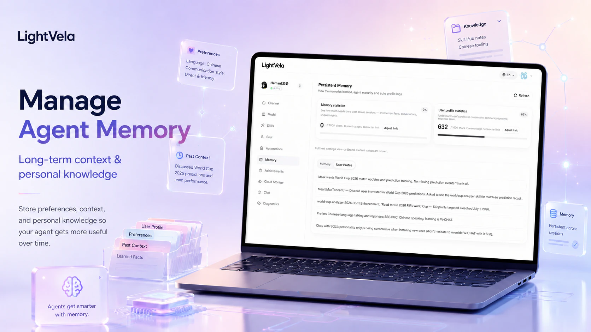
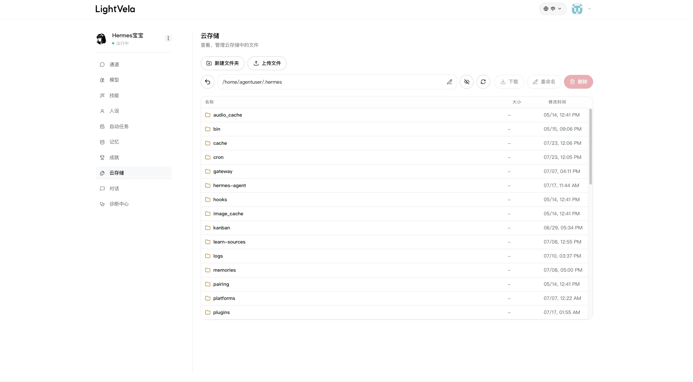
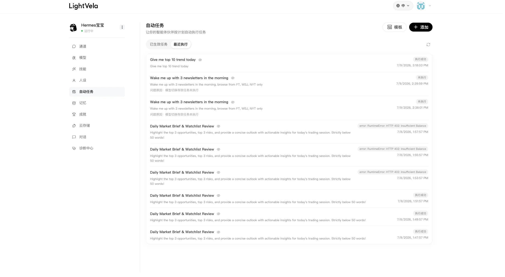

# วิธีจัดการหน่วยความจำระยะยาวและความรู้ส่วนตัวด้วยเอเจนต์

## สรุป

**ความรู้ส่วนบุคคลมีสองรูปแบบที่ต้องจัดการแยกกัน: ข้อมูลที่มั่นคงเกี่ยวกับตัวคุณและวิธีที่คุณทำงานควรอยู่ในหน่วยความจำระยะยาว ในขณะที่เอกสารบันทึก และวัสดุโครงการที่พัฒนาไปตามเวลา ควรอยู่ในคลาวด์ สตอเรจ** การจัดการทั้งสองอย่างเป็นหนึ่งเดียวจะทำให้คุณเสียความมั่นคงและความสามารถในการค้นหาในเวลาเดียวกัน บน LightVela หน่วยความจำจะช่วยรักษาบริบทระหว่างการสนทนา — หน้าหน่วยความจำของคอนโซลจะแสดงสิ่งที่ถูกเก็บไว้ในแท็บ Memory และ User Profile แยกกัน และให้คุณปรับขีดจำกัดความจุ ในขณะที่การเพิ่มและการลบส่วนใหญ่เกิดขึ้นผ่านการสนทนากับ Hermes คลาวด์สตอเรจคือพื้นที่ทำงานไฟล์ รองรับการอัปโหลด สร้าง จัดระเบียบ ดาวน์โหลด เปลี่ยนชื่อ และลบ โดยมีขีดจำกัด 1 GB ต่อไฟล์ กฎข้อหนึ่งที่ต้องยึดถือ: อย่าเขียนรหัสผ่าน คีย์ หรือข้อมูลที่ละเอียดอ่อนที่ไม่จำเป็นลงในหน่วยความจำระยะยาว



## ใครที่เหมาะกับสิ่งนี้

รูปแบบนี้เหมาะสำหรับคนที่ต้องการผู้ช่วยที่เข้าใจความชอบและงานที่ทำซ้ำโดยไม่ต้องบอกให้จำเอกสารทุกฉบับ มันมีประโยชน์สำหรับโครงการที่ดำเนินต่อเนื่อง งานวิจัยส่วนตัว บันทึกการเรียนรู้ งานลูกค้า และกระบวนการทำงานใดๆ ที่บริบทเดิมกลับมาอยู่บ่อยครั้ง

เป้าหมายไม่ได้อยู่ที่การสร้างคลังข้อมูลที่สมบูรณ์แบบ แต่คือการทำให้บริบทที่สำคัญหาง่ายและรักษา Hermes ให้สอดคล้องกับส่วนของมันที่ควรคงอยู่ต่อไป

## ข้อกำหนดเบื้องต้น

- เอเจนต์ Hermes ที่กำลังทำงาน และวิธีการสนทนากับมันผ่านคอนโซลหรือช่องทางที่เชื่อมต่อ

- ความเข้าใจพื้นฐานเกี่ยวกับสองสถานที่ที่ข้อมูลสามารถอยู่ได้: [การจัดการหน่วยความจำ](../configuration/memory.md) สำหรับบริบทระยะยาว และ [การจัดเก็บบนคลาวด์](../configuration/files.md) สำหรับไฟล์และโฟลเดอร์

- ชุดวัสดุขนาดเล็กที่คุณกลับมาใช้อย่างแท้จริง แทนที่จะเป็นคลังไฟล์ที่ยังไม่ได้กรองของทุกไฟล์ที่คุณมี

- ขอบเขตด้านความเป็นส่วนตัวที่ชัดเจนสำหรับสิ่งที่คุณต้องการให้ Hermes เก็บรักษาหรือทบทวน

## ขั้นตอน / แนวคิดสำคัญ

### 1. แยกบริบทที่มั่นคงออกจากวัสดุอ้างอิง

เก็บข้อเท็จจริงที่ควรกำหนดการสนทนาในอนาคตไว้ในความทรงจำ: สไตล์การเขียนที่คุณชอบ เขตเวลา บทบาทที่กำลังดำเนินอยู่ เป้าหมายที่เกิดซ้ำ หรือกฎเกณฑ์เกี่ยวกับวิธีที่คุณต้องการให้โครงการดำเนินไป หมั่นเปลี่ยนวัสดุ—บรีฟบันทึกการประชุม ร่าง และไฟล์งานวิจัย—ใน Cloud Storage อยู่เสมอ

ตัวอย่างเช่น คุณอาจบอก Hermes:

```text
Remember that I prefer research notes to separate facts, assumptions,
and open questions. Use that structure whenever we review a project.
```

ประเด็นไม่ได้อยู่ที่ทำให้ Hermes จดจำเอกสารต้นฉบับทุกฉบับเป็นความทรงจำ ประเด็นอยู่ที่ให้มันมีวิธีที่ยั่งยืนในการเข้าใจว่าคุณต้องการให้เอกสารเหล่านั้นถูกจัดการอย่างไร

### 2. จัดระเบียบไฟล์ที่คุณคาดว่าจะกลับมาดูอีก

สร้างโครงสร้างโฟลเดอร์ขนาดเล็กใน Cloud Storage ที่ตรงกับงานจริงของคุณ ใช้ชื่อที่มีความหมายและเก็บเนื้อหาที่เกี่ยวข้องไว้ด้วยกัน เช่น โฟลเดอร์หนึ่งสำหรับลูกค้า โปรเจค หลักสูตร หรือคำถามการวิจัย

เมื่อคุณต้องการความช่วยเหลือเกี่ยวกับไฟล์ บอก Hermes ว่าคุณกำลังพยายามทำอะไรและระบุเอกสารที่เกี่ยวข้อง ตัวอย่างเช่น:

```text
Help me prepare for this project review. Use the latest brief and my
meeting notes, then list unresolved decisions and questions.
```



### 3. ตรวจสอบความจำแทนที่จะสมมติว่ามันถูกต้องตลอดไป

เปิดการจัดการหน่วยความจำเป็นระยะเพื่อตรวจสอบแท็บหน่วยความจำและโปรไฟล์ผู้ใช้ โปรไฟล์ผู้ใช้คือภาพที่มั่นคงของตัวตนของคุณ; หน่วยความจำเก็บประสบการณ์และบริบทการทำงานที่มีประโยชน์จากความร่วมมือของคุณกับ Hermes

หากความชอบเปลี่ยนไป ให้บอกอย่างชัดเจนในการสนทนา:

```text
I no longer want long weekly updates. Please forget that preference
and keep weekly summaries to five bullets.
```

ความจำทำงานได้ดีที่สุดเมื่อมันทันสมัย ลบหรือแก้ไขบริบทที่อาจทำให้ Hermes ไปในทิศทางที่ผิด แทนที่จะเพิ่มคำสั่งที่ขัดแย้งกันเป็นครั้งที่สอง

### 4. เปลี่ยนความรู้ที่ทบทวนแล้วให้เป็นการสนทนาที่ใช้งานได้

ใช้หน้า [แชท](../configuration/agent-chat.md) หรือช่องทางที่เชื่อมต่อเพื่อเปลี่ยนเอกสารและความทรงจำให้กลายเป็นขั้นตอนถัดไปที่ชัดเจน ขอให้เปรียบเทียบ ร่างโครงร่าง ชุดคำถามเปิด หรือสรุปสำหรับการประชุมเฉพาะ ยิ่งผลลัพธ์ทันทีเฉพาะเจาะจงมากเท่าใด ก็จะยิ่งง่ายต่อการตรวจสอบว่า Hermes มีบริบทที่ถูกต้อง

หากการตรวจทานของคุณเป็นไปตามจังหวะที่ซ้ำ ๆ [งานที่กำหนดเวลา](../configuration/automation.md) สามารถเตือนคุณให้กลับไปดูโฟลเดอร์หรือเตรียมสรุปประจำได้ เริ่มต้นด้วยการเตือนหรือสรุปง่าย ๆ แทนการมอบหมายงานที่เปิดกว้างและไม่มีขอบเขตกว้าง



## คำถามที่พบบ่อย

### ความแตกต่างระหว่างหน่วยความจำและการเก็บข้อมูลบนคลาวด์คืออะไร?

ความจำเป็นบริบทที่ทนทานซึ่งช่วยให้ Hermes เข้าใจคุณและความร่วมมือที่กำลังดำเนินอยู่ของคุณ คลาวด์สตอเรจสำหรับไฟล์และโฟลเดอร์ที่คุณจัดการ ความจำควรบันทึกกฎและความชอบที่สำคัญ; ไฟล์ควรเก็บวัสดุพื้นฐาน

### Hermes จะถือว่าทุกไฟล์เป็นหน่วยความจำระยะยาวโดยอัตโนมัติหรือไม่?

ไม่ ใช้ความแตกต่างอย่างมีจุดมุ่งหมาย ใช้การจัดการหน่วยความจำสำหรับบริบทที่คงอยู่ และใช้การจัดเก็บข้อมูลบนคลาวด์เพื่อจัดระเบียบวัสดุที่คุณต้องการอ้างอิงในระหว่างงานเฉพาะ

### ฉันสามารถขอให้ Hermes ลืมบางสิ่งได้ไหม?

ใช่ บอก Hermes ว่าสิ่งใดไม่ควรถูกเก็บไว้แล้ว จากนั้นตรวจสอบความทรงจำหรือข้อมูลโปรไฟล์ผู้ใช้ที่เกี่ยวข้องหากคุณต้องการยืนยันการเปลี่ยนแปลง

### ฉันควรเก็บอะไรไว้ในหน่วยความจำก่อนดี?

เริ่มต้นด้วยการตั้งค่าที่เปลี่ยนคุณภาพของการสนทนาแทบทุกครั้ง: โซนเวลาของคุณ สไตล์การสื่อสาร บทบาท ความสำคัญที่กำลังดำเนินอยู่ และรูปแบบที่คุณชอบสำหรับงานที่เกิดซ้ำ

## ขั้นตอนถัดไป

- [การจัดการหน่วยความจำ](../configuration/memory.md) — ทบทวนบริบทระยะยาวและความสามารถ

- [Cloud Storage](../configuration/files.md) — จัดเก็บเอกสารที่เกี่ยวข้องกับงานที่กำลังดำเนินอยู่ให้เป็นระเบียบ

- [แชท](../configuration/agent-chat.md) — นำความทรงจำและวัสดุโครงการมาทำงานในบทสนทนาที่มีสมาธิ
