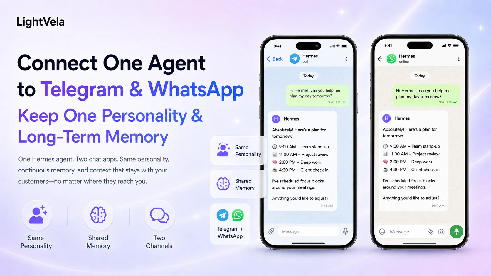

# วิธีเชื่อมต่อ Agent หนึ่งตัวกับ Telegram และ WhatsApp ในขณะที่ยังคงบุคลิกภาพและความทรงจำระยะยาวไว้

## สรุป

**Telegram และ WhatsApp สามารถทำหน้าที่เป็นสองจุดเข้าถึงไปยัง Hermes Agent ตัวเดียวกัน ตราบใดที่ทั้งสองช่องทางเชื่อมต่อกับ Agent เดียวกัน พวกเขาจะแชร์บุคลิกของ Agent ระดับเดียวกัน ทักษะ งานที่กำหนดเวลา และความทรงจำระยะยาว โดยไม่ต้องตั้งค่าการทำซ้ำต่อแพลตฟอร์ม** แต่คำว่า “รวมกัน” มีขอบเขตที่กำหนด: สิ่งที่แชร์คือทรัพยากรระดับ Agent ในขณะที่แต่ละช่องทางยังคงมีกระบวนการอนุมัติและขีดจำกัดข้อความของตัวเอง ดังนั้นการเชื่อมต่อทั้งสองจึงเป็นการผ่านการอนุมัติอย่างอิสระสองขั้นตอน วิธีที่ตรงที่สุดในการตรวจสอบการแชร์คือการระบุอะไรบางอย่างในช่องทางหนึ่งแล้วถามเกี่ยวกับสิ่งนั้นในช่องทางอื่น — คำตอบที่ถูกต้องจะพิสูจน์ว่าจุดเข้าถึงทั้งสองเชื่อมต่อไปยัง Agent ตัวเดียวกัน หลังจากเชื่อมต่อแล้ว ให้ยืนยันด้วยว่าการตอบกลับไปปรากฏในบทสนทนาที่คุณส่งข้อความไป ไม่ใช่บทสนทนาอื่น

## ใครที่เหมาะกับสิ่งนี้

คู่มือนี้สำหรับผู้ที่ต้องการสลับใช้งานแอปส่งข้อความหลายตัวในขณะที่ยังคงตัวตนผู้ช่วย AI หนึ่งเดียว

มันมีประโยชน์เมื่อคุณย้ายระหว่าง Telegram และ WhatsApp หรือเมื่อคุณต้องการจัดการผู้ช่วยส่วนตัว หุ้นส่วนการวิจัย หรือผู้ช่วยร่างเอกสารจากที่เดียว

## เข้าใจความหมายของ “เอเจนต์หนึ่งคน”

เอเจนต์หนึ่งคนไม่ได้หมายความว่าสองช่องทางจะแบ่งปันทุกส่วนของบันทึกการแชทสดแบบเรียลไทม์

จุดเข้าทั้งสองแชร์การกำหนดค่าระดับเอเจนต์และบริบทที่ทนทาน ในขณะเดียวกันการสนทนาปัจจุบันแต่ละรายการยังคงอยู่ในเซสชันช่องของตนเอง

ถ้าคุณต้องการให้ช่องทางอื่นทราบข้อเท็จจริงที่ยืนยันแล้ว ให้ถาม Hermes ให้จำมันและจากนั้นตรวจสอบจากจุดเข้าอื่น

บุคลิก ความจำระยะยาว และทักษะอยู่ในชั้นเอเจนต์ ในขณะที่โทเค็นบอท การอนุญาต QR จุดเข้าใช้งานการสนทนา และรูปแบบข้อความอยู่ในชั้นช่องทาง

## ข้อกำหนดเบื้องต้น

- เอเจนต์ LightVela Hermes ที่กำลังทำงานอยู่
  หากคุณยังไม่ได้สร้าง ให้เริ่มต้นด้วย [เริ่มต้นอย่างรวดเร็ว](../02-quickstart.md)

- การกำหนดค่ารูปแบบที่ทำงานได้หรือเครดิตทดลองใช้ที่มีอยู่

- บัญชี Telegram และบอทที่คุณสามารถใช้งานได้ตามปกติ

- บัญชี WhatsApp ที่คุณสามารถใช้งานได้ตามปกติ

- ความเข้าใจเกี่ยวกับการตั้งค่าข้อความกลุ่ม Telegram: ปิดการใช้งานความเป็นส่วนตัวของกลุ่มใน BotFather, เพิ่มบอทไปยังกลุ่ม แล้วเริ่มการสนทนากับ `@bot_username`
- ความเข้าใจว่า การสนับสนุนกลุ่ม WhatsApp ยังคงอยู่ภายใต้เอกสารช่องของตนเอง

## ขั้นตอน

### 1. เลือกเอเจนต์เป้าหมายหนึ่งตัว

เปิดคอนโซล LightVela และตัดสินใจว่าเอเจนต์ Hermes ตัวใดควรได้รับการเชื่อมต่อทั้ง Telegram และ WhatsApp

อย่าสร้างเอเจนต์หนึ่งตัวต่อหนึ่งช่องทาง เว้นแต่คุณต้องการให้มีบุคลิก ความทรงจำ และทักษะที่แตกต่างกันโดยตั้งใจ

### 2. เชื่อมต่อ Telegram

ทำตาม [กำหนดค่าช่อง - Telegram](../configuration/channel-telegram.md) เพื่อสร้างบอทและวางโทเค็น HTTP API ลงในการตั้งค่าช่อง Telegram สำหรับเอเจนต์เป้าหมาย

ส่งข้อความทดสอบใน Telegram ยืนยันว่าคอนโซลแสดงช่องทางว่าเชื่อมต่อแล้ว และยืนยันว่าการตอบกลับกลับไปยังบอทที่คาดไว้

หากคุณต้องการบุคลิกภาพ Telegram ที่โดดเด่นด้วย ดูที่ [วิธีการกำหนดค่าเอเจนต์ Hermes ที่มีบุคลิกภาพโดดเด่นใน Telegram](./telegram-persona-agent.md)

### 3. เชื่อมต่อ WhatsApp

ในการตั้งค่าช่องทางสำหรับ Hermes Agent เดียวกัน ให้เลือก WhatsApp และทำการอนุมัติ QR ให้เสร็จสมบูรณ์โดยทำตาม [กำหนดค่าช่องทาง - WhatsApp](../configuration/channel-whatsapp.md)

เปิดรายชื่อติดต่อบอทที่เกี่ยวข้องใน WhatsApp ส่งข้อความทดสอบ และยืนยันว่าการตอบกลับกลับมาเป็นปกติ

หากคุณต้องการบุคลิกภาพ WhatsApp ที่โดดเด่นด้วย ดูที่ [วิธีการกำหนดค่าเอเจนต์ Hermes ที่มีบุคลิกภาพโดดเด่นใน WhatsApp](./whatsapp-persona-agent.md)

### 4. กำหนดบุคลิกภาพระดับเอเจนต์หนึ่งตัว

เปิดส่วน “บุคลิกภาพ” ของเอเจนต์เป้าหมายและยืนยันว่าบทบาท เสียง ลำดับความสำคัญ และขอบเขตพฤติกรรมใน SOUL.md ใช้ได้กับทั้งสองช่องทาง

เนื่องจากบุคลิกภาพอยู่ที่ชั้นเอเจนต์ คุณไม่จำเป็นต้องกำหนดค่าสองสำเนาใน Telegram และ WhatsApp

หากคุณจำเป็นต้องเปลี่ยนบุคลิกภาพ ดูที่ [วิธีการกำหนดบทบาท บุคลิกภาพ และเสียงของเอเจนต์ IM ด้วย SOUL.md](./im-agent-persona-soul-md.md)

หลังจากการเปลี่ยนแปลง ให้เริ่มการสนทนาใหม่ในแต่ละช่องและทำการตรวจสอบตนเองอย่างรวดเร็วเพื่อยืนยันว่าบุคลิกใหม่กำลังทำงานอยู่

### 5. กำหนดค่าหน่วยความจำระดับเอเจนต์และโปรไฟล์ผู้ใช้

เปิด "Memory" ในคอนโซลและตรวจสอบว่าความจุของหน่วยความจำของเอเจนต์และโปรไฟล์ผู้ใช้ตรงกับเวิร์กโฟลว์ของคุณหรือไม่

Telegram และ WhatsApp ใช้ความทรงจำระยะยาวของเอเจนต์บนคลาวด์เดียวกัน ดังนั้นคุณไม่จำเป็นต้องป้อนตัวตน ภาษา และความชอบซ้ำสองครั้ง

ในทั้งสองช่องทาง คุณสามารถส่งได้:

จำไว้ว่าฉันต้องการให้การบรรยายสรุปรายวันแต่ละครั้งเริ่มด้วยข้อสรุปก่อน จากนั้นจึงให้สามประเด็นหลักของหลักฐาน

จากนั้นสลับไปยังช่องทางอื่นแล้วส่ง:

ใช้รูปแบบสรุปประจำวันที่ฉันตั้งไว้ก่อนหน้านี้และแสดงตัวอย่างสั้น ๆ ให้ฉันดู

หากช่องทางมีพฤติกรรมแตกต่างกัน ให้ยืนยันก่อนว่าช่องทางเหล่านั้นเชื่อมต่อกับเอเจนต์เดียวกัน จากนั้นตรวจสอบว่าการสนทนาปัจจุบันต้องการ /new หรือไม่

### 6. ติดตั้งทักษะที่ใช้ร่วมกันครั้งเดียว

ทักษะเป็นส่วนหนึ่งของการกำหนดค่าความสามารถของเอเจนต์ ดังนั้นคุณจึงไม่จำเป็นต้องติดตั้งหนึ่งตัวสำหรับ Telegram และอีกตัวสำหรับ WhatsApp

ขอให้ Hermes ติดตั้งทักษะผ่านการสนทนาในช่องทางใดก็ได้ จากนั้นขอให้มันอัปเดตรายการทักษะและตรวจสอบความถูกต้องของทักษะด้วยงานที่มีความเสี่ยงต่ำ

ดู [การกำหนดค่าทักษะ](../configuration/skill.md) สำหรับขั้นตอนโดยละเอียด และตรวจสอบแหล่งที่มาของทักษะ สิทธิ์ และการพึ่งพาบริการภายนอกก่อนยืนยันการติดตั้ง

### 7. ทดสอบความแตกต่างเฉพาะช่องทาง

รันพรอมต์เดียวกันในทั้งสองช่องทาง:

อธิบายบทบาทปัจจุบันของคุณและวิธีที่คุณจัดการกับความไม่แน่นอน

ใช้การตั้งค่าที่บันทึกของฉันเพื่อเปลี่ยนเนื้อหานี้ให้เป็นสามประเด็นสำคัญ

จากนั้นทดสอบพฤติกรรมที่เกี่ยวข้องกับช่องทาง เช่น ข้อความสื่อ ประกาศเตือนเชิงรุก หรือวิธีที่การติดต่อของบอทปรากฏ

บุคลิกภาพและความทรงจำระยะยาวควรคงที่ แต่รูปแบบข้อความ ความสามารถของสื่อ การอนุญาต และขีดจำกัดการส่งเชิงรุกอาจแตกต่างกัน

## โครงสร้างที่มีประโยชน์สำหรับเอเจนต์หนึ่งตัวและสองจุดเข้าถึง

    เอเจนต์ Hermes หนึ่งตัว
    ├── หนึ่ง SOUL.md
    ├── หน่วยความจำเอเจนต์และโปรไฟล์ผู้ใช้หนึ่งชุด
    ├── ชุดทักษะที่ติดตั้งแล้วหนึ่งชุด
    ├── ชุดงานที่กำหนดเวลาไว้หนึ่งชุด
    ├── จุดเริ่มต้น Telegram
    └── จุดเริ่มต้น WhatsApp

วิธีการแจ้งเตือนงานตามกำหนดเวลายังคงต้องมีช่องทางเป้าหมายที่ระบุอย่างชัดเจน

อย่าสมมติว่า Agent ร่วมทำให้ทุกการแจ้งเตือนถูกส่งไปยังทั้ง Telegram และ WhatsApp

## คำถามที่พบบ่อย

### สิ่งที่ฉันขอให้ Hermes จดจำใน Telegram จะปรากฏใน WhatsApp หรือไม่?

ใช่ เมื่อทั้งสองช่องทางเชื่อมต่อกับเอเจนต์ Hermes เดียวกันและข้อมูลถูกบันทึกลงในหน่วยความจำของเอเจนต์หรือตามโปรไฟล์ผู้ใช้

ข้อความทุกข้อความในการสนทนา Telegram ปัจจุบันจะไม่กลายเป็นคำบันทึก WhatsApp สดโดยอัตโนมัติ

### ทำไมสองช่องสัญญาณถึงไม่ฟังเหมือนกันเป๊ะ ๆ

รูปแบบข้อความของช่องทาง ความสามารถด้านสื่อ สถานะของเซสชัน และผลลัพธ์ของโมเดลสามารถมีผลต่อรายละเอียด

ตรวจสอบก่อนว่าทั้งสองช่องทางเชื่อมต่อกับเอเจนต์เดียวกัน จากนั้นส่ง /new เมื่อจำเป็นเพื่อให้ SOUL.md ใหม่โหลดเมื่อเริ่มการสนทนา

### ฉันสามารถปรับแต่งบุคลิกภาพที่แตกต่างกันสำหรับ Telegram และ WhatsApp ได้ไหม?

เมื่อทั้งสองช่องทางเชื่อมต่อกับเอเจนต์หนึ่งเอเจนต์จะใช้บุคลิกระดับเอเจนต์เดียวกันตามค่าเริ่มต้น

ถ้าคุณต้องการบทบาทและความทรงจำที่แตกต่างอย่างสิ้นเชิง ให้สร้างเอเจนต์ต่างหากและเชื่อมต่อช่องทางแยกกัน

### กลุ่ม WhatsApp สามารถแชร์หน่วยความจำกับ Telegram ได้หรือไม่?

เอกสาร WhatsApp ปัจจุบันระบุว่าการแชทกลุ่มไม่รองรับ
Telegram รองรับข้อความกลุ่มหลังจากคุณปิดการตั้งค่าความเป็นส่วนตัวของกลุ่ม เพิ่มบอทไปยังกลุ่ม และเริ่มการสนทนากับ `@bot_username`

การแชร์หลายช่องทางช่วยให้ชั้นเอเจนต์คงที่ แต่ไม่ได้เปลี่ยนเงื่อนไขการตั้งค่าหรือขอบเขตความสามารถของแต่ละช่องทาง

### งานที่ตั้งเวลาไว้จะส่งไปยังทั้งสองช่องโดยอัตโนมัติหรือไม่?

ไม่

เมื่อคุณสร้างหรื แก้ไขงานที่กำหนดเวลา ให้ยืนยันวิธีการแจ้งเตือนและช่องทางเป้าหมาย จากนั้นทดสอบผลลัพธ์การส่งแยกกัน

## ขั้นตอนถัดไป

- [วิธีที่ Hermes Agent เชื่อมต่อหลายช่องทางการส่งข้อความ](../hermes-agent/07-message-gateway.md) - เข้าใจความสัมพันธ์ระหว่างช่องทาง เกตเวย์ และชั้น Agent

- [การจัดการหน่วยความจำ](../configuration/memory.md) - ทบทวนการจัดการหน่วยความจำของเอเจนต์และโปรไฟล์ผู้ใช้

- [กำหนดค่าช่อง - Telegram](../configuration/channel-telegram.md) - การตั้งค่า Telegram Bot เสร็จสมบูรณ์

- [กำหนดค่าช่อง - WhatsApp](../configuration/channel-whatsapp.md) - ทำการอนุมัติ WhatsApp ให้เสร็จสิ้น
