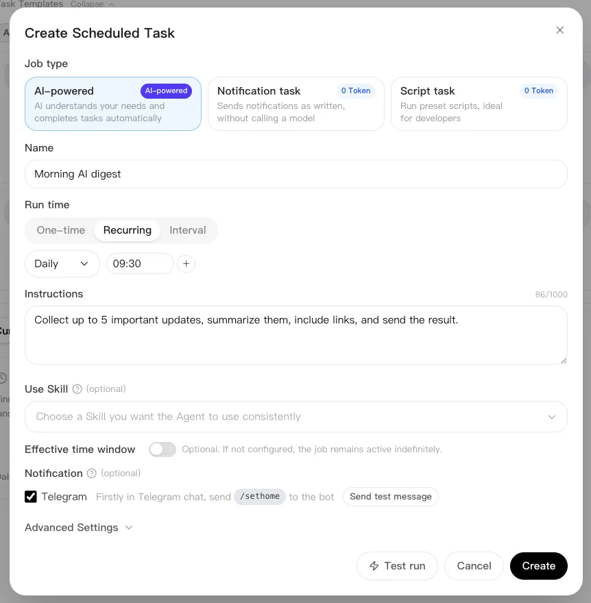
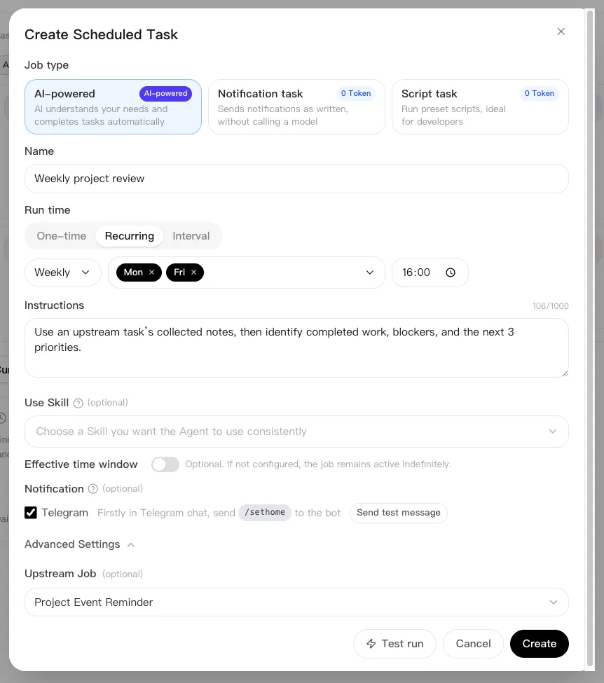
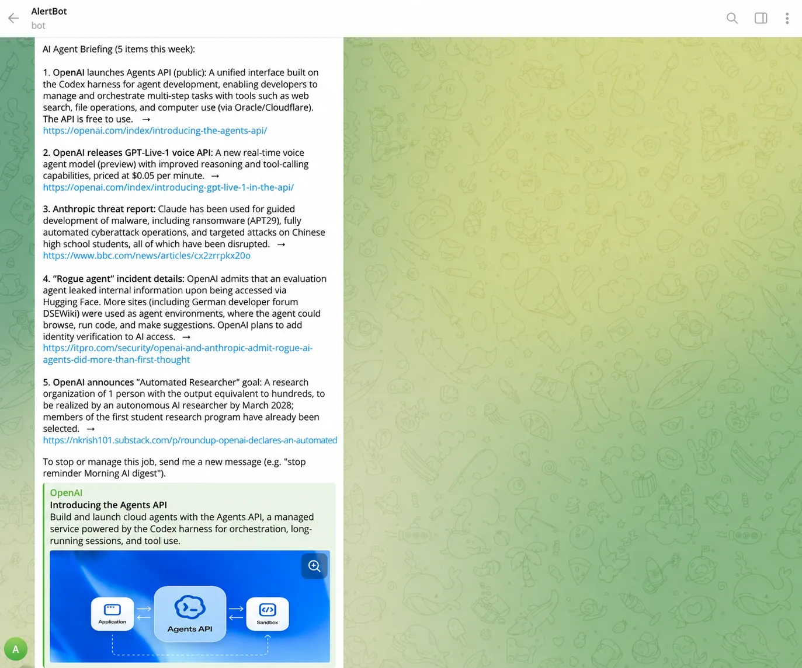
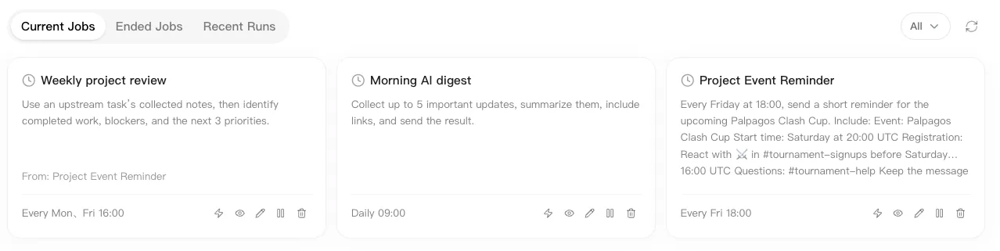

# การทำงานอัตโนมัติของงานเอเจนต์ด้วย LightVela

## สรุป

**งานของเอเจนต์จะรันเวิร์กโฟลว์ที่มีโมเดลสนับสนุนตามกำหนดเวลาและส่งผลลัพธ์ผ่านช่องทางที่เชื่อมต่อ** ใช้เพื่อทำงานที่ทำเป็นประจำ เช่น รายงานสรุปเช้า หรือการทบทวนโครงการรายสัปดาห์ กำหนดคำสั่ง กำหนดเวลา ทักษะทางเลือก และปลายทางการส่งมอบ

งานที่กำหนดเวลาเป็นแอปพลิเคชันที่เหมาะสมที่สุดสำหรับเอเจนต์ที่โฮสต์บนคลาวด์เนื่องจากสามารถทำงานได้ตลอด 24 ชั่วโมง 7 วันต่อสัปดาห์โดยไม่จำเป็นต้องมีคุณเข้ามาเกี่ยวข้อง  
สามารถใช้ได้เมื่อคุณมีปัญหาข้อมูลซ้ำ ๆ ที่สามารถปรับปรุงได้ด้วยเวิร์กโฟลว์ที่ทำซ้ำได้  
ผู้ใช้บางคนได้ใช้มันสำหรับสรุปข่าวสารเช้า ซึ่งเปลี่ยนอัปเดตที่กระจัดกระจายให้กลายเป็นบทสรุปสั้น ๆ บางคนยังสร้างการทบทวนโครงการประจำสัปดาห์ที่สรุปกิจกรรมล่าสุดเพื่อการประชุมติดตามผล

## ปัญหาที่พนักงานขายสามารถแก้ไขได้บ่อย

พวกเราส่วนใหญ่มีข้อมูลมากเกินไปอยู่แล้ว นอกจากนี้ ข้อมูลที่มีประโยชน์บางอย่างมาถึงในเวลาที่ไม่เหมาะสม ในรูปแบบที่ไม่เหมาะสม หรือโดยไม่มีบริบทเพียงพอ

- ลิงก์บางส่วนมาปรากฏในแชท
- การอัปเดตโครงการถูกฝังอยู่ในเอกสาร
- การตัดสินใจถูกกล่าวถึงเพียงครั้งเดียวแล้วก็ถูกลืม
- เมื่อคุณมีเวลาในการตรวจสอบทุกสิ่ง ข้อมูลนั้นก็ไม่เป็นประโยชน์แล้ว

ใน LightVela คุณสามารถกำหนดค่าหน้าที่ของ Agent ด้วยคำสั่ง ตารางเวลา ทักษะที่เลือกได้ ผลลัพธ์ของงานต้นน้ำ และช่องทางการส่งเอกสาร [เอกสารงานที่กำหนดเวลา](https://lightvela.ai/docs/configuration/automation?from=social_x) อธิบายรูปแบบการกำหนดเวลาที่ใช้ได้และตัวเลือกการกำหนดค่า

## กรณีที่ 1: เริ่มวันด้วยบรีฟที่มีประโยชน์

ทุกวันจันทร์ถึงศุกร์เวลา 9:30 น. งานเอเจนต์จะเปลี่ยนผลลัพธ์ล่าสุดจากแหล่งที่กำหนดหรือจากงานรวบรวมต้นน้ำให้เป็นการอัปเดตที่มีประโยชน์สามรายการ

พรอมต์:

> รวบรวมอัปเดตสำคัญสูงสุด 5 เรื่อง สรุปเนื้อหา รวมลิงก์ และส่งผลลัพธ์

กุญแจสำคัญคือการขอคำชี้แจงที่เน้นจุดเฉพาะ ไม่ใช่การสรุป “ทุกอย่าง” หากการเก็บรวบรวมข้อมูลและการสรุปเป็นงานแยกกัน ให้กำหนดเวลาการเก็บรวบรวมข้อมูลก่อน

## กรณีที่ 2: การทบทวนโครงการวันศุกร์

ทุกวันศุกร์ งานของเอเจนต์จะเปลี่ยนการอัปเดตโครงการล่าสุดให้เป็นบทสรุปสั้น ๆ

พรอมต์:

> ใช้บันทึกที่เก็บรวบรวมจากงานส่วนต้นน้ำ จากนั้นระบุงานที่ทำเสร็จแล้ว อุปสรรค และลำดับความสำคัญต่อไป 3 เรื่อง

ดำเนินการงานรวบรวมก่อนการทบทวน โดยเว้นเวลาสั้น ๆ เอเจนต์ไม่สามารถทดแทนการจัดการโครงการได้ มันสร้างจุดเริ่มต้นที่เชื่อถือได้สำหรับการสนทนาประจำสัปดาห์

## อัปเดตฉันโดยตรงในข้อความส่วนตัว

LightVela ช่วยให้คุณเชื่อมต่อเอเจนต์ของคุณกับ WhatsApp, Telegram, WeChat, Discord และอื่นๆ  
คุณสามารถเชื่อมต่อกับตัวใดตัวหนึ่ง หรือทั้งหมดพร้อมกันได้  
ในงานที่ตั้งเวลาไว้ คุณสามารถสลับการตั้งค่าการแจ้งเตือนของ IM ที่เกี่ยวข้องเพื่อกำหนดว่าจะให้แจ้งเตืองานไปยัง IM ของคุณหรือไม่

หลังจากสลับแล้ว เอเจนต์ของคุณจะทำงานของคุณให้เสร็จสมบูรณ์และอัปเดตคุณโดยตรงใน IM ของคุณ โดยไม่จำเป็นต้องเปิด LightVela หรือแอปอื่นใดโดยตรง

## การจัดการหลายงาน

คุณสามารถตั้งงานที่กำหนดเวลาได้มากเท่าที่คุณต้องการ หลังจากสร้างแล้ว คุณสามารถแก้ไข หยุดชั่วคราว และเรียกดูงานที่ผ่านมาได้ ด้วย LightVela เปลี่ยนเอเจนต์ส่วนตัว Hermes ของคุณให้เป็นเครื่องจักรที่มีประสิทธิภาพสูงซึ่งทำงานของคุณในขณะที่คุณไม่อยู่

