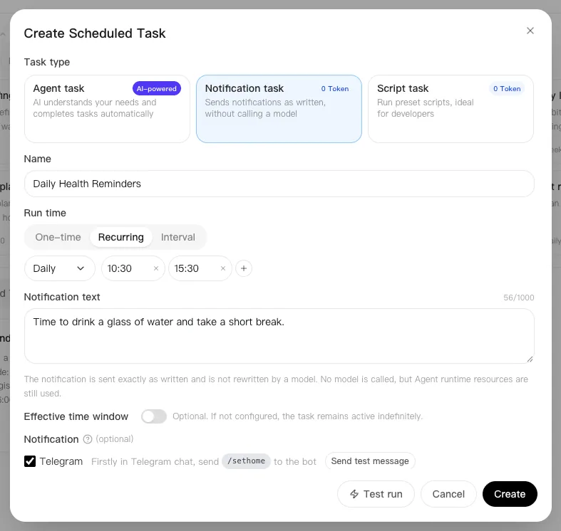
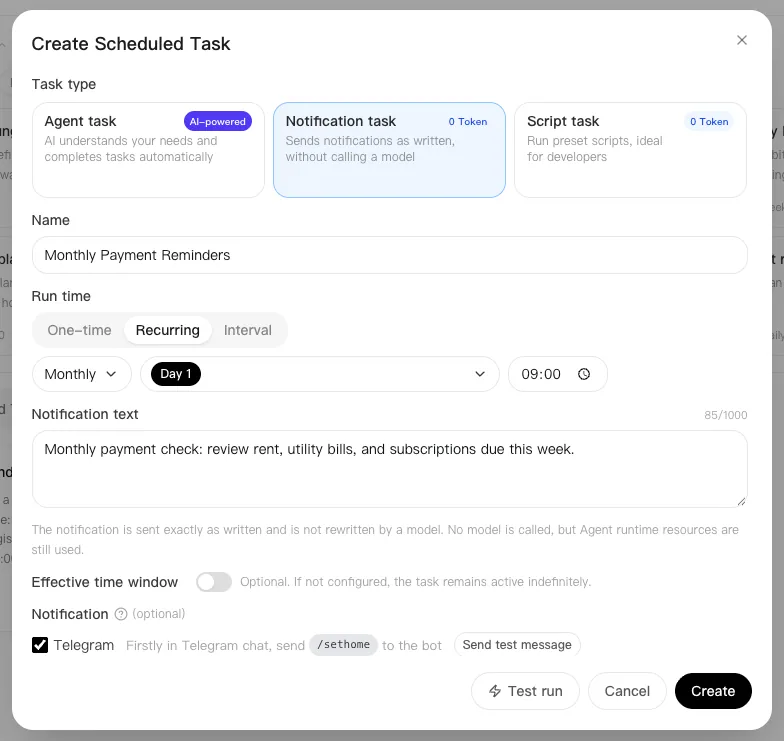
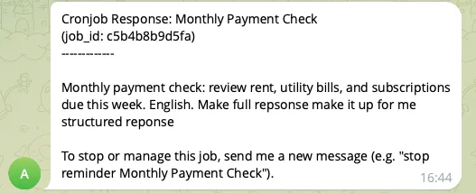
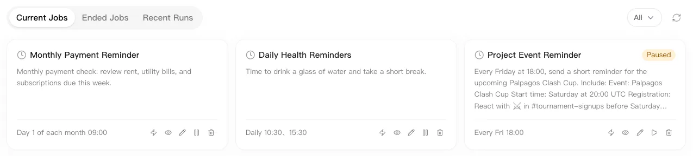

# การตั้งค่าหน้าที่แจ้งเตือนใน LightVela

## สรุป

**งานแจ้งเตือนส่งข้อความที่กำหนดไว้ตามตารางโดยไม่ต้องเรียกใช้โมเดล AI หรือใช้เครดิตโมเดล** ใช้งานสำหรับการเตือน เช่น การทานยา การชำระบิล และการต่ออายุการสมัครสมาชิก; ตั้งค่าข้อความ ตารางเวลา ช่วงเวลาที่มีผล และช่องทางการส่ง

งานแจ้งเตือนเป็นแอปพลิเคชันง่ายๆ สำหรับเอเจนต์ที่โฮสต์บนคลาวด์ เพราะมันสามารถส่งข้อความที่กำหนดล่วงหน้าได้ตามตารางเวลาโดยไม่ต้องเรียกใช้โมเดล AI  
สามารถใช้เมื่อคุณต้องการเตือนความจำให้อยู่ตรงเวลาที่เหมาะสม ผ่านช่องทางที่ถูกต้อง โดยใช้ข้อความที่คุณให้ไว้เป๊ะๆ  
ผู้ใช้ได้นำมาใช้สำหรับเตือนดื่มน้ำและทานยา; บางคนยังสร้างการแจ้งเตือนสำหรับค่าบริการและการต่ออายุการสมัครสมาชิกอีกด้วย

## ปัญหาที่พบบ่อยซึ่งการแจ้งเตือนสามารถแก้ไขได้

พวกเราส่วนใหญ่ไม่ลืมงานสำคัญเพราะเราไม่สนใจ
บางการกระทำเล็กๆ แต่จำเป็นก็ง่ายต่อการพลาดเมื่อมีงานยุ่ง

- คุณลืมดื่มน้ำระหว่างการทำงานเป็นเวลานาน
- การทานยาเกิดขึ้นช้ากว่ากำหนด
- การต่ออายุสมาชิกถูกฝังอยู่ในกล่องข้อความของคุณ
- การชำระบิลจำได้ก็หลังจากวันครบกำหนดแล้ว

ใน LightVela คุณสามารถกำหนดค่าหน้าที่การแจ้งเตือนด้วยข้อความ ตารางเวลา หน้าต่างเวลาที่มีผล และช่องทางการส่ง ข้อความจะถูกส่งตามที่เขียนโดยตรงโดยไม่เรียกใช้งานโมเดล ดังนั้นจะไม่ใช้โทเค็นของโมเดล [เอกสารงานตามกำหนดเวลา](https://lightvela.ai/docs/configuration/automation?from=social_x) อธิบายตัวเลือกการกำหนดเวลาและการแจ้งเตือนที่มีอยู่

## กรณีที่ 1: การเตือนสุขภาพประจำวันที่

ทุกวันเวลา 10:30 น. และ 15:30 น. งานแจ้งเตือนจะส่งการเตือนสั้น ๆ เดียวกัน

ข้อความ:

> ถึงเวลาที่จะดื่มน้ำสักแก้วและพักสั้น ๆ

กุญแจสำคัญคือการทำให้ข้อความสั้นและปฏิบัติได้ เนื่องจากข้อความไม่ได้ถูกส่งผ่านโมเดล การแจ้งเตือนจะไม่ถูกเขียนใหม่หรือเพิ่มบริบทเพิ่มเติม

## กรณีที่ 2: การเตือนการชำระเงินรายเดือน

ในวันแรกของทุกเดือน งานแจ้งเตือนจะเตือนให้คุณตรวจสอบการชำระเงินที่กำลังจะมาถึง

ข้อความ:

> การตรวจสอบการชำระเงินรายเดือน: ตรวจสอบค่าเช่า บิลค่าสาธารณูปโภค และการสมัครสมาชิกที่ต้องชำระในสัปดาห์นี้

การแจ้งเตือนทำให้การชำระเงินแต่ละครั้งมองเห็นได้ก่อนถึงกำหนด หากบิลต่าง ๆ มีวันครบกำหนดแตกต่างกัน ให้สร้างงานแยกแต่ละงานเพื่อให้การเตือนแต่ละครั้งมาถึงเมื่อมีประโยชน์

## อัปเดตฉันโดยตรงในข้อความส่วนตัว

LightVela ช่วยให้คุณเชื่อมต่อเอเจนต์ของคุณกับ WhatsApp, Telegram, WeChat, Discord และอื่น ๆ  
คุณสามารถเชื่อมต่อกับช่องทางเดียวหรือหลายช่องทางพร้อมกันได้  
ในงานที่กำหนดเวลา คุณสามารถสลับการตั้งค่าของแต่ละช่องทางที่กำหนดค่าไว้เพื่อกำหนดว่าจะส่งการแจ้งเตือนไปที่ใด

หลังจากสลับแล้ว, Hermes จะส่งการแจ้งเตือนที่ตรงไปยัง IM ของคุณโดยตรง คุณไม่จำเป็นต้องเปิด LightVela หรือแอปอื่นเพื่อดูการแจ้งเตือนนั้น

## การจัดการหลายงาน

คุณสามารถตั้งงานตามกำหนดเวลาได้มากเท่าที่คุณต้องการ  
หลังจากสร้างแล้ว คุณสามารถแก้ไขเนื้อหาและเวลาของงาน หยุดชั่วคราว และเรียกดูการทำงานที่ผ่านมาได้  
ด้วย LightVela เอเจนต์ส่วนตัว Hermes ของคุณสามารถรักษาตารางงานสำคัญได้ในขณะที่คุณมุ่งเน้นไปที่งานอื่น ๆ

