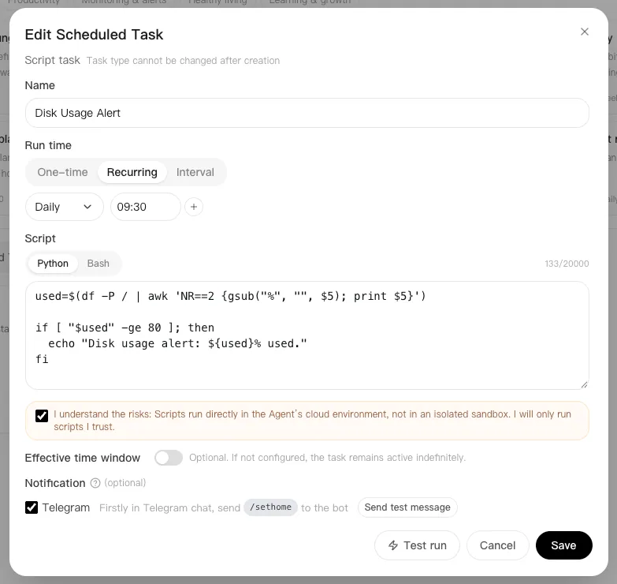
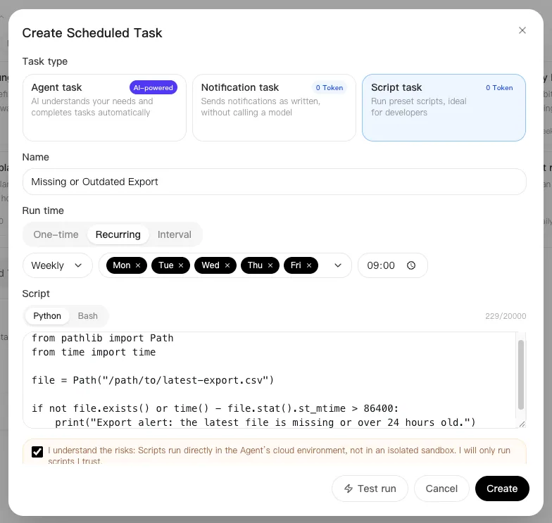
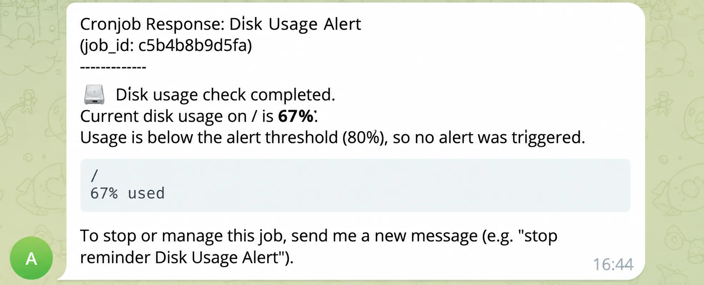
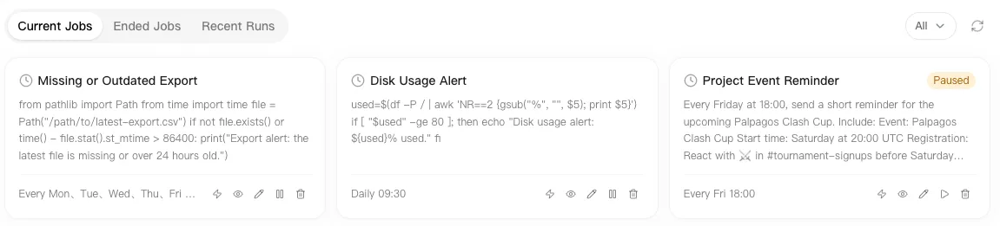

# การรันสคริปต์งานใน LightVela

## สรุป

**งานสคริปต์เรียกใช้งาน Bash หรือ Python ตามตารางเวลาที่กำหนดโดยไม่ต้องเรียกใช้โมเดล AI หรือใช้เครดิตของโมเดล** ใช้งานเพื่อการตรวจสอบที่คาดเดาได้ เช่น การใช้งานดิสก์หรือไฟล์ส่งออกที่หายไป; ตั้งค่าสคริปต์, ตารางเวลา, ช่วงเวลาที่มีผล และช่องทางการส่งมอบ

งานสคริปต์เป็นการประยุกต์ใช้ที่ใช้งานได้จริงสำหรับเอเจนต์ที่โฮสต์บนคลาวด์เนื่องจากสามารถรันสคริปต์ Bash หรือ Python ตามกำหนดเวลาโดยไม่ต้องเรียกใช้โมเดล AI  
สามารถใช้ได้เมื่อคุณมีการตรวจสอบระบบซ้ำ ๆ ที่มีกฎชัดเจนและสามารถทำนายได้  
ผู้ใช้ได้ใช้สคริปต์เหล่านี้สำหรับการแจ้งเตือนการใช้งานดิสก์ บางคนยังสร้างการตรวจสอบที่ตรวจจับไฟล์ที่หายไปหรือไฟล์ที่ล้าสมัยด้วย

## ปัญหาทั่วไปที่สคริปต์สามารถแก้ไขได้

ปัญหาระบบเล็ก ๆ หลายอย่างสามารถตรวจพบได้ด้วยการตรวจสอบง่าย ๆ อย่างไรก็ตาม การตรวจสอบเหล่านี้มักถูกลืมจนกว่าจะมีบางอย่างหยุดทำงาน

- การใช้งานดิสก์เพิ่มขึ้นโดยไม่สังเกต
- การส่งออกประจำวันหยุดสร้างไฟล์ใหม่
- ไฟล์สำรองกลายเป็นข้อมูลล้าสมัย
- ปัญหาถูกค้นพบหลังจากที่มันกระทบงานอื่น

ใน LightVela คุณสามารถกำหนดค่า Script task ด้วยโค้ด Bash หรือ Python, ตารางเวลา, หน่วงเวลาที่มีผล และช่องทางการส่ง งานนี้ไม่เรียกใช้โมเดล ดังนั้นจึงไม่ใช้โทเค็นของโมเดล [เอกสารงานที่ตั้งเวลาไว้](https://lightvela.ai/docs/configuration/automation?from=social_x) อธิบายตัวเลือกการตั้งเวลาและการแจ้งเตือนที่มีอยู่

## กรณีที่ 1: การแจ้งเตือนการใช้งานดิสก์

ทุกเช้า งานสคริปต์ Bash จะตรวจสอบพื้นที่ดิสก์ที่ใช้งานได้และจะแจ้งเฉพาะเมื่อการใช้งานถึง 80%

สคริปต์:

```bash
used=$(df -P / | awk 'NR==2 {gsub("%", "", $5); print $5}')

if [ "$used" -ge 80 ]; then
  echo "Disk usage alert: ${used}% used."
fi
```



หากการใช้งานดิสก์ต่ำกว่าขีดจำกัด สคริปต์จะไม่พิมพ์อะไรและจะไม่มีการส่งการแจ้งเตือน สิ่งนี้ทำให้การตรวจสอบตามปกติเงียบ เว้นแต่ว่ามีสิ่งที่ต้องได้รับความสนใจ

## กรณีที่ 2: การส่งออกที่หายไปหรือเก่าเกินไป

ทุกเย็นวันธรรมดา งานสคริปต์ Python จะตรวจสอบว่าไฟล์ส่งออกล่าสุดมีอยู่หรือไม่ และได้รับการอัปเดตภายใน 24 ชั่วโมงหรือไม่

สคริปต์:

```python
from pathlib import Path
from time import time

file = Path("/path/to/latest-export.csv")

if not file.exists() or time() - file.stat().st_mtime > 86400:
    print("Export alert: the latest file is missing or over 24 hours old.")
```



แทนที่เส้นทางตัวอย่างด้วยตำแหน่งที่ส่งออกจริง หากไฟล์มีอยู่และเป็นไฟล์ล่าสุด สคริปต์จะทำงานเสร็จโดยเงียบ ๆ โดยไม่ส่งข้อความที่ไม่จำเป็น

## อัปเดตฉันโดยตรงในข้อความส่วนตัว

LightVela ช่วยให้คุณเชื่อมต่อเอเจนต์ของคุณไปยัง WhatsApp, Telegram, WeChat, Discord และอื่น ๆ ผ่าน [การกำหนดค่าช่องทาง](https://lightvela.ai/docs/configuration?from=social_x)
คุณสามารถเชื่อมต่อกับหนึ่งหรือหลายช่องทางพร้อมกันได้
ในงานที่กำหนดเวลา คุณสามารถสลับแต่ละช่องทางที่กำหนดค่าไว้เพื่อกำหนดว่าสคริปต์แจ้งเตือนควรถูกส่งไปที่ใด



เมื่อสคริปต์สร้างเอาต์พุตมาตรฐานที่ไม่ว่าง Hermes จะส่งเอาต์พุตนั้นไปยัง IM ของคุณโดยตรง
หากสคริปต์ไม่พิมพ์อะไร งานจะเสร็จสมบูรณ์โดยไม่ส่งการแจ้งเตือน

## การจัดการหลายงาน

คุณสามารถตั้งค่าภารกิจที่กำหนดเวลาได้มากเท่าที่คุณต้องการ หลังจากสร้างแล้ว คุณสามารถแก้ไขสคริปต์และตารางเวลาของมัน หยุดชั่วคราว และเรียกดูการทำงานก่อนหน้านี้ได้ ทดสอบสคริปต์ทุกตัวก่อนกำหนดเวลามัน โดยเฉพาะเมื่อมันเข้าถึงไฟล์ที่สำคัญ



ด้วย LightVela เอเจนต์ส่วนตัว Hermes ของคุณสามารถจัดการการตรวจสอบที่คาดเดาได้อย่างต่อเนื่องในขณะที่คุณมุ่งเน้นไปที่งานอื่น ๆ
