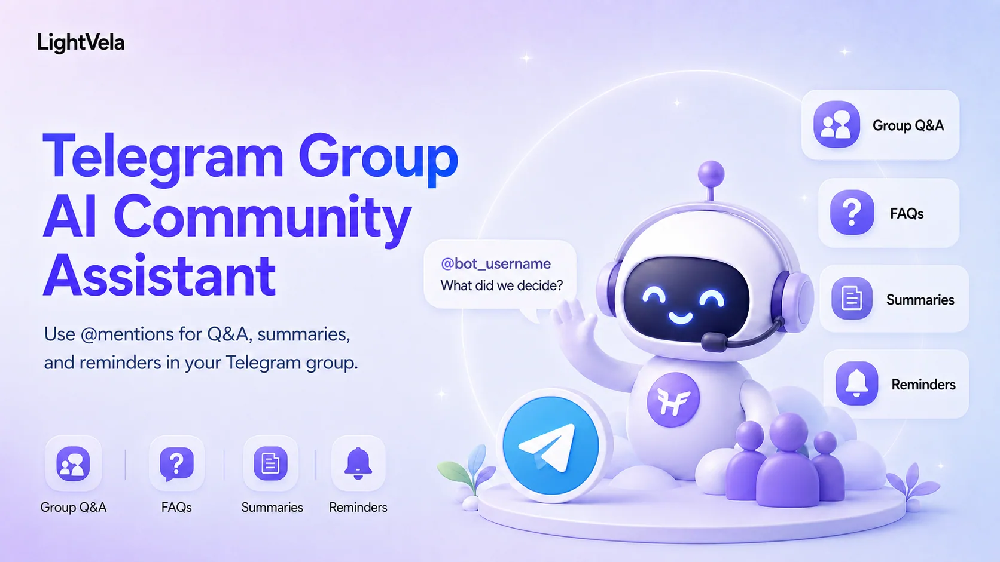

# วิธีใช้ผู้ช่วยชุมชน AI กลุ่ม Telegram: ถาม-ตอบ, สรุป และการเตือนความจำ

## สรุป

**LightVela รองรับข้อความกลุ่ม Telegram เมื่อคุณปิดใช้งานความเป็นส่วนตัวกลุ่มสำหรับบอทใน BotFather, เพิ่มบอทไปยังกลุ่ม, และเริ่มการสนทนาโดยการกล่าวถึงมันด้วย `@bot_username`.**
คู่มือนี้ครอบคลุมการตั้งค่าที่ได้รับการยืนยันนั้น และแสดงวิธีใช้ Hermes Agent เดียวกันสำหรับคำถาม-คำตอบในกลุ่ม, สรุป, และการเตือนโดยไม่ถือว่าการเข้าร่วมของสมาชิกที่ไม่ได้รับการยืนยันหรือการตอบกลับแบบเงียบในกลุ่มเป็นฟีเจอร์ที่ได้ตั้งค่าไว้.

## ก่อนที่คุณจะเริ่ม

คุณต้องมี Telegram Bot ที่เชื่อมต่อกับ Hermes Agent ของคุณผ่าน [ตั้งค่าช่องทาง - Telegram](../configuration/channel-telegram.md)  
คุณยังต้องมีสิทธิ์ในการเพิ่ม Bot นั้นไปยังกลุ่ม Telegram ที่คุณต้องการใช้

## เปิดใช้งานข้อความกลุ่ม Telegram

### 1. เปิด BotFather และเลือกบอทของคุณ

1. เปิด `@BotFather` ใน Telegram
2. ส่ง `/mybots`
3. เลือกบอทที่เชื่อมต่อกับเอเจนต์ Hermes ของคุณ

### 2. ปิดความเป็นส่วนตัวของกลุ่ม

1. เปิด "การตั้งค่าโบット"
2. เลือก "ความเป็นส่วนตัวของกลุ่ม"
3. เลือก "ปิด" หรือ "ปิดโหมดความเป็นส่วนตัว"

การตั้งค่านี้ช่วยให้บอทสามารถรับข้อความจากกลุ่มที่มีการกล่าวถึงมันได้

### 3. เพิ่มบอทไปยังกลุ่ม Telegram

1. เปิดกลุ่ม Telegram ที่คุณต้องการใช้
2. เลือก "เพิ่มสมาชิก" หรือการกระทำที่เทียบเท่าในการจัดการกลุ่ม
3. ค้นหา Bot โดยใช้ชื่อผู้ใช้และเพิ่มมันเข้าไปในกลุ่ม

### 4. กล่าวถึงบอทเพื่อทดสอบข้อความกลุ่ม

ส่งข้อความที่กล่าวถึงบอท เช่น `@bot_username summarize the discussion so far`

ผลลัพธ์ที่คาดหวังคือการตอบกลับของเอเจนต์ Hermes ในกลุ่มเดียวกันนั้น

## ขอบเขตของข้อความที่ผ่านการตรวจสอบ

| การโต้ตอบ | ขอบเขตที่บันทึกไว้ปัจจุบัน | วิธีการตรวจสอบ |
|---|---|---|
| การสนทนากลุ่ม | รองรับเมื่อบอทถูกเพิ่มเข้าไปในกลุ่ม, ความเป็นส่วนตัวของกลุ่มถูกปิด, และข้อความนั้นกล่าวถึงบอท | ส่ง `@bot_username hello` ในกลุ่มและยืนยันว่ามีการตอบกลับปรากฏที่นั่น |
| การสนทนาโดยตรง | รองรับผ่านบอท Telegram ที่เชื่อมต่อ | ส่งข้อความในแชทโดยตรงของบอทและยืนยันว่ามีการตอบกลับ |
| การต้อนรับสมาชิกอัตโนมัติหรือการตอบกลับโดยเฉยเมย | ยังไม่ได้กำหนดโดยคู่มือการตั้งค่านี้ | ตรวจสอบพฤติกรรมเหล่านี้แยกต่างหากก่อนนำไปใช้ในขั้นตอนการทำงาน |

## ใช้บอทเป็นผู้ช่วยชุมชน

หลังจากการทดสอบกลุ่มสำเร็จ ให้กำหนดบทบาทและขอบเขตของข้อมูลที่ชัดเจนกับ [SOUL.md คู่มือบุคลิกภาพ](./im-agent-persona-soul-md.md)  
เก็บคำสั่งกลุ่มให้อย่างชัดเจนเพื่อให้ผู้เข้าร่วมรู้ว่าเมื่อใดที่เอเจนต์ถูกขอให้ตอบสนอง

| เวิร์กโฟลว์ | ตัวอย่างกลุ่มคำสั่ง | ผลลัพธ์ที่ต้องตรวจสอบ |
|---|---|---|
| คำถามที่พบบ่อย | `@bot_username answer only from the prepared FAQ` | คำตอบใช้วัสดุที่เตรียมไว้หรือขอให้มนุษย์ช่วยต่ออย่างชัดเจน |
| สรุปการอภิปราย | `@bot_username summarize decisions, action items, owners, and open questions` | การตอบแยกการตัดสินใจที่ยืนยันแล้วออกจากรายการที่ยังไม่ได้ข้อสรุป |
| ร่างการเตือนความจำ | `@bot_username draft a reminder with time, audience, purpose, and cancellation method` | ตรวจสอบร่างก่อนใช้งานที่กำหนดเวลาใดๆ เพื่อส่งมัน |

สำหรับการดึงข้อมูล สรุป หรือเนื้อหาที่กำหนดเวลา ให้เลือกทักษะที่เชื่อถือได้และตรวจสอบสิทธิ์ของมันใน [กำหนดค่าทักษะ](../configuration/skill.md)  
ตรวจสอบงานที่กำหนดเวลาแยกต่างหากในช่องทางเป้าหมายที่รองรับก่อนที่จะพึ่งพามันสำหรับข้อความที่กำหนดเวลา

## ขอบเขตความปลอดภัยและการปฏิบัติการ

การปิดใช้งานความเป็นส่วนตัวของกลุ่มจะเปิดเส้นทางการส่งข้อความ Telegram  
มันไม่ได้แทนที่ความรับผิดชอบของคุณในการตั้งกฎของกลุ่ม หลีกเลี่ยงการแชร์ข้อมูลที่ละเอียดอ่อน และต้องยืนยันก่อนการดำเนินการที่มีความเสี่ยงสูงจากภายนอก  
กำหนดสมาชิกที่สามารถขอการดำเนินการที่ละเอียดอ่อน และยืนยันการอนุมัติก่อนที่เอเจนต์จะดำเนินการเหล่านั้น

## คำถามที่พบบ่อย

### ตอนนี้ฉันสามารถเพิ่มบอท LightVela Telegram เข้าไปในกลุ่มได้ไหม?

ใช่
ปิดการตั้งค่าความเป็นส่วนตัวของกลุ่มใน BotFather เพิ่มบอทเข้าไปในกลุ่ม และกล่าวถึงมันด้วย `@bot_username` เพื่อเริ่มการสนทนา

### การปิดความเป็นส่วนตัวของกลุ่มจะทำให้บอทตอบกลับในกลุ่มหรือไม่?

มันเป็นส่วนที่จำเป็นของการตั้งค่าที่มีการบันทึกไว้ หลังจากปิดการใช้งาน ให้เพิ่มบอทเข้าไปในกลุ่มและกล่าวถึงมันในข้อความทดสอบ

### คู่มือนี้ตั้งค่าข้อความต้อนรับอัตโนมัติสำหรับสมาชิกใหม่หรือไม่?

ไม่ใช่
คู่มือนี้บันทึกการสนทนากลุ่มที่เริ่มโดยการกล่าวถึงบอท
ตรวจสอบเหตุการณ์การเข้าร่วมสมาชิกและเวิร์กโฟลว์ต้อนรับอัตโนมัติแยกกันก่อนสัญญากับพวกเขาในชุมชน

### สามารถใช้กลุ่ม WhatsApp เป็นทางเลือกได้หรือไม่?

เอกสารช่องปัจจุบัน WhatsApp ยังคงระบุว่าการสนทนากลุ่มไม่สามารถใช้งานได้  
อย่าสมมติว่าการสนับสนุนข้อความกลุ่ม Telegram ขยายไปยัง WhatsApp

## ขั้นตอนถัดไป

- [กำหนดค่าช่อง - Telegram](../configuration/channel-telegram.md) - เชื่อมต่อบอทและทำซ้ำขั้นตอนการตั้งค่าข้อความกลุ่ม

- [วิธีการกำหนดบทบาท บุคลิกภาพ และเสียงของเอเจนต์ IM ด้วย SOUL.md](./im-agent-persona-soul-md.md) - กำหนดบทบาทและขอบเขตของผู้ช่วย
