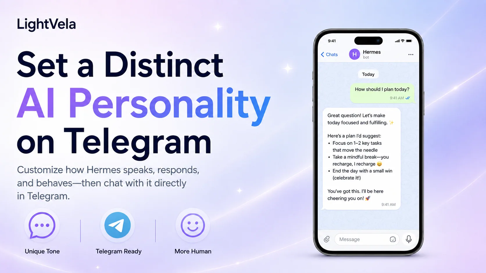

# วิธีการปรับแต่งเอเจนต์ Hermes ให้มีบุคลิกเฉพาะตัวใน Telegram

## สรุป

**Telegram เป็นเพียงจุดเริ่มต้น สิ่งที่กำหนดวิธีการพูดของเอเจนต์ วิธีการทำงาน และสิ่งที่มันจะไม่ทำ คือบุคลิกภาพและบริบทระยะยาวของมัน** กระบวนการมีสองส่วน: ก่อนอื่น เชื่อมต่อเอเจนต์ Hermes กับ Telegram ตามคำแนะนำของช่องทาง (สร้างบอตด้วย BotFather เพื่อรับโทเค็น เชื่อมต่อในคอนโซล และยืนยันว่ามันแสดงว่าเชื่อมต่อเรียบร้อย) จากนั้นใช้ส่วน Persona ในหน้าการตั้งค่าของเอเจนต์เพื่อเลือกบทบาท น้ำเสียง และชุดข้อจำกัดที่มั่นคง และฉีดเข้าไป รักษาให้สามชั้นแยกกัน: persona ถือหลักการพฤติกรรมที่ยั่งยืน, ความชอบของผู้ใช้ถือวิธีที่คุณต้องการให้ปฏิบัติต่อคุณ, และความทรงจำระยะยาวถือข้อเท็จจริงที่ยืนยันแล้วและพื้นหลังโครงการ Telegram รองรับข้อความกลุ่มหลังจากคุณปิด Group Privacy ใน BotFather เพิ่มบอตลงในกลุ่ม และเริ่มต้นการสนทนากับ `@bot_username`



## ใครที่เหมาะกับสิ่งนี้

คู่มือนี้สำหรับผู้ที่ต้องการเอเจนต์ Hermes ที่มีบุคลิกสม่ำเสมอใน Telegram ตลอดเวลา เหมาะอย่างยิ่งสำหรับผู้ช่วยส่วนตัว, คู่หูวิจัย, เพื่อนร่วมศึกษา, หรือผู้ช่วยประจำวันใดๆ ที่ควรสื่อสารในลักษณะที่คาดเดาได้

Telegram รองรับการสนทนาโดยตรงและข้อความกลุ่มที่กล่าวถึงบอทที่เชื่อมต่อหลังจากปิดการใช้งานความเป็นส่วนตัวของกลุ่มแล้ว
หากคุณต้องการเชื่อมต่อ Telegram ให้เริ่มจาก [กำหนดค่าช่อง - Telegram](../configuration/channel-telegram.md)

## ข้อกำหนดเบื้องต้น

- เอเจนต์ LightVela Hermes ที่กำลังทำงานอยู่
  หากคุณยังไม่ได้สร้าง ให้เริ่มต้นด้วย [เริ่มต้นอย่างรวดเร็ว](../02-quickstart.md)

- การกำหนดค่าโมเดลที่ใช้งานได้หรือเครดิตทดลองที่มีอยู่
  หาก Hermes ยังไม่สามารถตอบได้ ให้ทำ [กำหนดค่าโมเดล](../configuration/model.md) ให้เสร็จ

- บัญชี Telegram และ Bot เชื่อมต่อโดยการทำตาม [กำหนดค่าช่อง - Telegram](../configuration/channel-telegram.md)

- แนวคิดเบื้องต้นเกี่ยวกับบทบาทที่คุณต้องการให้ผู้ช่วยทำ
  อาจเป็นผู้ช่วยวิจัยที่กระชับ คู่ศึกษาที่อดทน หรือผู้ช่วยเตือนความจำที่เน้นการปฏิบัติ

## ขั้นตอน / แนวคิดสำคัญ

### 1. เชื่อมต่อ Hermes เอเจนต์กับ Telegram

เปิด Agent Hermes เป้าหมายในคอนโซล LightVela ไปที่ "Channels" และเลือก Telegram  
ทำตาม [Configure Channel - Telegram](../configuration/channel-telegram.md) เพื่อสร้างบอท วางโทเค็น HTTP API และส่งข้อความทดสอบ

ยืนยันว่า Telegram ปรากฏว่าเชื่อมต่อในคอนโซลและว่า Bot ได้รับการตอบกลับจาก Agent Hermes
ตรวจสอบช่องทางก่อนเพื่อให้ปัญหาในภายหลังสามารถแยกออกจากปัญหาการกำหนดค่าบุคลิกภาพได้ง่ายขึ้น

### 2. อธิบายว่าคุณต้องการให้เอเจนต์ทำงานอย่างไร

บุคลิกที่โดดเด่นนั้นมากกว่าชื่อหรือตัวคำกล่าวติดปาก ก่อนที่จะกำหนดมัน ให้เขียนบทบาท น้ำเสียง รูปแบบการทำงาน และขอบเขตที่คุณต้องการให้คงที่

ใช้บรีฟสั้นแบบนี้เป็นจุดเริ่มต้น:

```text
You are my research assistant. Help me break down questions, compare reliable sources, and write clear conclusions.
Give the conclusion first, then the key evidence. State uncertainty instead of presenting guesses as facts.
Use a professional, direct, friendly tone. Do not be performatively cute, and do not invent certainty.
Ask for confirmation before sending messages, changing files, or taking other external actions.
```

เอกสารสรุปนี้ช่วยให้คุณเลือกวิญญาณที่เหมาะสมและให้ภาษาสำหรับปรับปรุงพฤติกรรมของเอเจนต์หลังจากที่ Telegram เชื่อมต่อแล้ว

### 3. เลือกและฉีดวิญญาณจากบุคลิกภาพ

เปิดการตั้งค่าของเอเจนต์เป้าหมายแล้วเลือกส่วน "บุคลิกภาพ" คุณสามารถเลือก "สุ่มจิตวิญญาณ" หรือ "ทดสอบบุคลิกภาพของจิตวิญญาณ" จากนั้นตรวจสอบคำอธิบายบนการ์ดแต่ละใบ

เลือกวิญญาณที่ตรงกับบทบาทมากที่สุดแล้วคลิก "ฉีดวิญญาณ" LightVela จะเขียนบุคลิกที่เลือกไปยัง `SOUL.md` ของ Hermes เอเจนต์ปัจจุบันและสำรองข้อมูลก่อนที่จะแทนที่การตั้งค่าที่มีอยู่

ถ้าเอเจนต์มีวิญญาณอีกตัวอยู่แล้ว การฉีดวิญญาณใหม่จะทำให้ตัวตนที่ใช้งานอยู่ถูกแทนที่  
ตรวจสอบบทบาท เสียง และขอบเขตของการ์ดก่อนยืนยันการแทนที่

### 4. เริ่มการสนทนาใหม่ใน Telegram

หลังจากวิญญาณถูกฉีด กลับไปที่แชท Telegram แล้วส่ง:

```text
/new
```

Hermes เอเจนต์อ่าน `SOUL.md` ใหม่เมื่อเริ่มการสนทนาใหม่
หากคุณดำเนินการสนทนาเก่าโดยไม่ส่ง `/new` การสนทนานั้นอาจยังคงใช้ภาพรวมบุคลิกเก่าที่มีอยู่

เมื่อการสนทนาใหม่เริ่มขึ้น ให้ถามเพื่อทำการตรวจสอบตนเองอย่างรวดเร็ว:

```text
In three sentences, explain your current role, what you can help me with, and what you will not do for me.
```

### 5. ปรับเสียงให้สอดคล้องกับงานจริง

อย่าตัดสินบุคลิกภาพเพียงแค่ถามว่า 'คุณคือใคร?' ใช้งานบางอย่างที่คุณส่งจริงในชีวิตประจำวัน เช่น:

```text
Turn this research material into conclusions, evidence, and questions that still need confirmation.
```

```text
I have three deadlines today. Rank them by risk, then give me a concise plan.
```

```text
This request would send content to an external service. What would you do first?
```

ตรวจสอบว่าเอเจนต์รักษาน้ำเสียงที่คาดไว้ แจ้งความไม่แน่นอน และเคารพขอบเขตรอบการกระทำภายนอกหรือไม่ หากเป็นความชอบเฉพาะของผู้ใช้ เช่น ภาษา โซนเวลา หรือรูปแบบสรุป ให้ถาม Hermes เพื่อจำแทนที่จะเปลี่ยนความชอบทุกอย่างให้กลายเป็นกฎของบุคลิกภาพ

## บุคลิกภาพ ความชอบของผู้ใช้ และความทรงจำทำงานร่วมกันอย่างไร

`SOUL.md` เหมาะที่สุดสำหรับบทบาทที่มั่นคงของเอเจนต์ เสียง ความสำคัญ และขอบเขตพฤติกรรม  
โปรไฟล์ผู้ใช้เหมาะที่สุดสำหรับตัวตนของคุณ ภาษา เขตเวลา และความชอบในการสื่อสาร  
ความจำระยะยาวเหมาะที่สุดสำหรับข้อเท็จจริงที่กำหนดไว้ สถานะโครงการ และบริบทที่สามารถนำกลับมาใช้ซ้ำจากงานที่คุณแชร์

สำหรับคำอธิบายที่ลึกกว่า โปรดอ่าน [บุคลิกภาพของเอเจนต์ Hermes มาจากไหน](../hermes-agent/10-persona-user-memory.md) และ [การจัดการหน่วยความจำ](../configuration/memory.md)

## คำถามที่พบบ่อย

### บอท Telegram มีบุคลิกของตัวเองหรือไม่?

บุคลิกภาพเป็นของเอเจนต์ Hermes ที่เชื่อมต่อกับ Telegram ไม่ใช่โทเค็น BotFather  
หากเอเจนต์ Hermes เดียวกันเชื่อมต่อกับช่องทางที่รองรับอื่น ๆ ช่องทางเหล่านั้นจะใช้บุคลิกและบริบทถาวรในระดับเอเจนต์เดียวกัน

### `/new` ลบความจำหรือไม่?

ไม่ใช่
`/new` เริ่มการสนทนาใหม่เพื่อให้ `SOUL.md` ใหม่ถูกโหลดเมื่อเริ่มเซสชัน
มันไม่ได้ลบความทรงจำระยะยาวของเอเจนต์หรือโปรไฟล์ผู้ใช้

### ฉันสามารถเพิ่ม Telegram Bot เข้าไปในกลุ่มได้ไหม?

ใช่  
ใน BotFather ส่ง `/mybots` เลือกบอท จากนั้นเปิด "การตั้งค่าบอท" → "ความเป็นส่วนตัวของกลุ่ม" และปิดโหมดความเป็นส่วนตัว  
เพิ่มบอทไปยังกลุ่มและเริ่มการสนทนาด้วย `@bot_username`  
ดู [การตั้งค่าช่อง - Telegram](../configuration/channel-telegram.md) สำหรับการตั้งค่าแบบสมบูรณ์

### การเปลี่ยนโมเดลจะทำให้เอเจนต์สูญเสียบุคลิกภาพหรือไม่?

โดยปกติไม่ใช่ โมเดล บุคลิกของเอเจนต์ และความจำระยะยาวเป็นชั้นการกำหนดค่าที่แยกจากกัน แม้ว่าการเปลี่ยนโมเดลจะสามารถเปลี่ยนการให้เหตุผล การใช้เครื่องมือ และรายละเอียดเล็กๆ น้อยๆ ของสไตล์การตอบสนองได้

## ขั้นตอนถัดไป

- [วิธีการตั้งค่าเอเจนต์ Hermes ที่มีบุคลิกเฉพาะตัวใน WhatsApp](./whatsapp-persona-agent.md) - นำบุคลิกเอเจนต์เดียวกันไปใช้กับการสนทนา 1-ต่อ-1 WhatsApp

- [วิธีการกำหนดบทบาท บุคลิกภาพ และเสียงของเอเจนต์ IM ด้วย SOUL.md](./im-agent-persona-soul-md.md) - เข้าใจขอบเขตระหว่างจิตวิญญาณ บุคลิกภาพ และความทรงจำระยะยาว

- [กำหนดค่าช่องทาง - Telegram](../configuration/channel-telegram.md) - ทำตามขั้นตอนการเชื่อมต่อบอท Telegram ให้ครบถ้วน

- [กำหนดทักษะ](../configuration/skill.md) - ขยายบุคลิกภาพที่มั่นคงด้วยความสามารถในการทำงานที่เป็นประโยชน์
