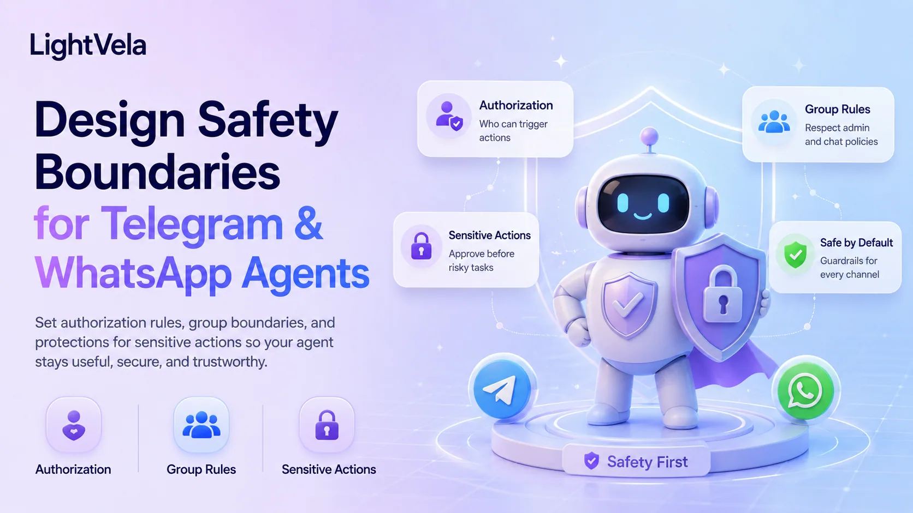

# วิธีการออกแบบขอบเขตความปลอดภัยสำหรับเอเจนต์ Telegram และ WhatsApp: การอนุญาต กฎของกลุ่ม และการกระทำที่ละเอียดอ่อน

## สรุป

**ขอบเขตความปลอดภัยของเอเจนต์ไม่ได้ถูกกำหนดโดยโมเดลเพียงอย่างเดียว** แต่สร้างขึ้นจากสี่ชั้น: ข้อมูลรับรองช่องทาง ขอบเขตการสนทนา นโยบายหน่วยความจำ และกฎสำหรับการดำเนินการภายนอก ขอบเขตที่ชัดเจนช่วยให้คุณตอบคำถามสี่ข้อได้โดยเด็ดขาด — ใครสามารถเข้าถึงเอเจนต์นี้ ข้อความใดที่ได้รับการประมวลผล เนื้อหาใดที่ห้ามส่ง และการกระทำใดที่ต้องได้รับการยืนยันก่อน แนวทางสำคัญ: ข้อมูลรับรองเป็นข้อมูลที่ละเอียดอ่อนและห้ามใส่ลงในบริบทระยะยาวหรือวางลงในการสนทนา; นโยบายหน่วยความจำต้องหลีกเลี่ยงการเปลี่ยนข้อมูลที่ละเอียดอ่อนให้กลายเป็นบันทึกถาวร; และสิ่งใดที่ส่งออกภายนอกหรือไม่สามารถย้อนกลับได้ต้องมีขั้นตอนยืนยัน Telegram รองรับข้อความกลุ่มหลังจากคุณปิดความเป็นส่วนตัวกลุ่มใน BotFather, เพิ่มบอทเข้ากลุ่ม และเริ่มการสนทนากับ `@bot_username` การสนับสนุนกลุ่ม WhatsApp ยังคงขึ้นอยู่กับเอกสารช่องทางของตนเอง ดำเนินการตามรายการตรวจสอบความปลอดภัยก่อนเปิดใช้งานจริง

## ใครที่เหมาะกับสิ่งนี้

คู่มือนี้สำหรับผู้ใช้แต่ละคน ผู้ดูแลฝ่ายสนับสนุน และผู้ดูแลทีมที่เชื่อมต่อเอเจนต์ IM กับการทำงานประจำวัน

มันมีประโยชน์สำหรับทีมที่ต้องการกำหนดขอบเขตการอนุญาต ขอบเขตข้อมูล และขั้นตอนการดำเนินการความเสี่ยงสูงก่อนเชื่อมต่อบอทหรือบัญชี WhatsApp

## สี่ชั้นของเขตความปลอดภัย

| ชั้น | คำถามที่ต้องตอบ | การควบคุมทั่วไป |
|---|---|---|
| การอนุญาต | ใครสามารถเชื่อมต่อและใช้เอเจนต์นี้ได้? | โทเค็นบ็อต, บัญชีที่ได้รับอนุญาตด้วย QR, บันทึกการเชื่อมต่อ, สิทธิ์บัญชี |
| การสนทนา | การสนทนาใดบ้างที่จะถูกประมวลผลและตอบกลับ? | ขอบเขตข้อความโดยตรง, Telegram ความเป็นส่วนตัวของกลุ่มและการทริกเกอร์ @mention, ขอบเขตที่อนุญาต |
| ข้อมูล | เนื้อหาใดบ้างที่สามารถอ่านหรือเก็บรักษาได้? | การลบคำที่ละเอียดอ่อน, การจัดเก็บบนคลาวด์, หน่วยความจำ, โปรไฟล์ผู้ใช้, นโยบายการลบ |
| การกระทำ | การกระทำใดบ้างที่สามารถทำงานอัตโนมัติได้? | สิทธิ์น้อยที่สุด, การยืนยันจากมนุษย์, บันทึกการตรวจสอบ, การส่งต่อให้มนุษย์ |

เริ่มต้นด้วยขอบเขตที่เล็กที่สุดที่มีประโยชน์ และขยายสิทธิ์เฉพาะเมื่อการใช้งานจริงต้องการ

## ขั้นตอน

### 1. ยืนยันเป้าหมายการอนุญาตสำหรับแต่ละช่องทาง

Telegram เชื่อมต่อผ่านโทเค็นบอท ในขณะที่ WhatsApp เชื่อมต่อผ่านการอนุมัติ QR

ก่อนเชื่อมต่อ ให้ยืนยันความสัมพันธ์ระหว่าง Bot, บัญชี WhatsApp และเอเจนต์เป้าหมาย Hermes และป้อนข้อมูลรับรองเฉพาะในการตั้งค่าช่องทาง LightVela ที่เกี่ยวข้องเท่านั้น

Telegram โทเค็นบอท, WhatsApp เซสชันการเข้าสู่ระบบ, รหัสยืนยันตัวตน และข้อมูลประจำตัวอื่น ๆ ต้องไม่ถูกส่งในแชททั่วไปหรือเขียนลงในเอกสาร, ตั๋ว, หรือที่เก็บข้อมูล

บอท Telegram หรือหมายเลข WhatsApp เดียวกันโดยทั่วไปไม่ควรถูกผูกกับเอเจนต์ Hermes หลายตัว เพื่อให้ผู้คนสามารถบอกได้ว่าเอเจนต์ใดได้รับข้อความ

หลังจากเชื่อมต่อแล้ว ส่งข้อความทดสอบความเสี่ยงต่ำ ยืนยันว่าการตอบกลับส่งกลับไปยังผู้ติดต่อที่คาดไว้ และตรวจสอบรายการช่องทางที่เชื่อมต่อในคอนโซล

### 2. จำกัดขอบเขตของช่องทางให้ตรงกับความสามารถในปัจจุบัน

Telegram รองรับข้อความกลุ่ม  
ปิดการตั้งค่าความเป็นส่วนตัวของกลุ่มใน BotFather, เพิ่มบอทไปยังกลุ่ม, และเริ่มการสนทนาด้วย `@bot_username`  
WhatsApp ยังคงอยู่ภายใต้ขอบเขตการสนับสนุนกลุ่มในเอกสารช่องของมันเอง

การปิดใช้งานความเป็นส่วนตัวของกลุ่ม Telegram จำเป็นสำหรับการตั้งค่าการส่งข้อความ แต่เพียงอย่างเดียวไม่ได้ทำให้การใช้กลุ่มปลอดภัย
กำหนดกลุ่มที่อนุญาต ผู้ดูแล สมาชิก พฤติกรรมการ @mention และข้อจำกัดอัตราการส่งข้อความก่อนใช้เวิร์กโฟลว์

ก่อนใช้กลุ่ม ควรยืนยันด้วยว่าข้อความของสมาชิกจะเข้าสู่หน่วยความจำร่วมหรือไม่ และข้อมูลของสมาชิกหนึ่งจะถูกป้องกันไม่ให้แสดงต่อสมาชิกคนอื่นอย่างไร

### 3. กำหนดขอบเขตของเนื้อหาข้อความ

อย่าส่งรหัสผ่าน กุญแจ API โทเค็นการเข้าถึง รหัสยืนยัน ข้อมูลการชำระเงิน รายละเอียดตัวตนเต็มรูป ข้อมูลทางการแพทย์ หรือข้อมูลส่วนตัวของลูกค้าที่ไม่จำเป็นไปยังเอเจนต์

หากต้องมีการพูดคุยกรณีธุรกิจจริง ให้ลบชื่อ หมายเลขโทรศัพท์ ที่อยู่ หมายเลขคำสั่งซื้อ และข้อมูลอื่น ๆ ที่สามารถระบุบุคคลหรือองค์กรได้

ใช้กฎข้อบังคับที่เข้มงวดยิ่งขึ้นในช่องทางการทำงานร่วมกันแบบหลายคนและภายนอก เนื่องจากข้อความอาจมองเห็นได้โดยสมาชิกหลายคน ถูกส่งต่อ หรือเก็บไว้นานขึ้น

### 4. เก็บหน่วยความจำและไฟล์ให้อยู่ในขอบเขตที่จำเป็นขั้นต่ำ

วางกฎบทบาท เสียง และขอบเขตที่มั่นคงใน [SOUL.md การกำหนดค่าบุคลิกภาพ](./im-agent-persona-soul-md.md)

รักษาความชอบที่ยืนยันแล้วและบริบทการทำงานร่วมกันที่ยั่งยืนผ่าน [การจัดการหน่วยความจำ](../configuration/memory.md)

เก็บวัสดุผลิตภัณฑ์ คำถามที่พบบ่อยเกี่ยวกับการสนับสนุน และไฟล์อ้างอิงขนาดใหญ่ใน [Cloud Storage](../configuration/files.md) แทนการใส่ข้อความแชทดิบทุกข้อความลงในหน่วยความจำระยะยาว

ตรวจสอบหน่วยความจำ โปรไฟล์ผู้ใช้ และที่เก็บข้อมูลบนคลาวด์เป็นประจำ และลบข้อมูลที่ไม่จำเป็นอีกต่อไปหรือไม่ควรเก็บรักษาไว้

### 5. ตั้งค่าธรณีในการยืนยันสำหรับการกระทำที่ละเอียดอ่อน

การกระทำที่โดยปกติควรต้องได้รับการยืนยันจากมนุษย์ได้แก่:

- ส่งข้อความภายนอกหรือเผยแพร่เนื้อหา

- การเปลี่ยนแปลงคำสั่งซื้อ ราคา การสมัคร การอนุญาต หรือรายละเอียดบัญชี

- การคืนเงิน การชำระเงิน การตรวจสอบตัวตน หรือพันธะทางกฎหมาย

- การลบไฟล์ หน่วยความจำ ข้อมูลผู้ใช้ หรือข้อมูลอื่น ๆ ที่ไม่สามารถกู้คืนได้

- การรันคำสั่งที่มีผลต่อสภาพแวดล้อมการผลิตหรือระบบของบุคคลที่สาม

เอเจนต์สามารถอ่านเอกสาร จัดระเบียบความเสี่ยง และร่างข้อเสนอได้ก่อน แต่ควรอธิบายผลกระทบ เป้าหมาย และความสามารถในการย้อนกลับก่อนการดำเนินการ และรอการยืนยันอย่างชัดเจน

อย่าถือคำถามของผู้ใช้เป็นการอนุญาตให้ดำเนินการใด ๆ

### 6. เพิ่มขอบเขตสำหรับทักษะและงานที่กำหนดเวลา

ก่อนติดตั้งทักษะ ให้ตรวจสอบแหล่งที่มา สิทธิ์ การใช้งาน API ภายนอก การเข้าถึงไฟล์ และความสามารถในการส่งข้อความเชิงรุก

ทดสอบทักษะใหม่ในการสนทนาแบบตัวต่อตัวกับเนื้อหาที่มีความเสี่ยงต่ำก่อนที่จะขยายการใช้งาน

ทุกงานที่กำหนดไว้ต้องมีตารางเวลาที่ชัดเจน ช่วงเวลาที่ใช้งาน วิธีการแจ้งเตือน ช่องทางเป้าหมาย และวิธีการหยุดชั่วคราว

สำหรับข้อความเชิงรุก WhatsApp ให้พิจารณาหน้าต่างการสนทนาและแม่แบบข้อความด้วย แทนที่จะสันนิษฐานว่าข้อความธรรมดาจะถูกส่งตลอดเวลา

### 7. ความล้มเหลวในการออกแบบและการส่งงานของมนุษย์

เมื่อเอเจนต์สงสัย ไม่สามารถอ้างอิงเอกสารของตนได้ ได้รับเนื้อหาที่ละเอียดอ่อน พบว่าไม่มีความชัดเจนเกี่ยวกับการอนุญาต หรือพบการร้องเรียน ควรหยุดการทำงานอัตโนมัติและส่งต่อให้มนุษย์ดำเนินการ

บันทึกการส่งงานควรรวมถึงตัวกระตุ้น เนื้อหาที่ดำเนินการแล้ว การกระทำที่ยังไม่เสร็จสมบูรณ์ และขั้นตอนถัดไปที่แนะนำ

หากข้อมูลการรับรองอาจถูกเปิดเผย หยุดใช้ช่องทางที่ได้รับผลกระทบและเพิกถอน รีเซ็ต หรือให้สิทธิ์ใหม่ผ่านขั้นตอนของแพลตฟอร์ม

## รายการตรวจสอบความปลอดภัยก่อนเปิดตัว

- บัญชี Telegram Bot หรือ WhatsApp ถูกกำหนดให้กับ Agent เดียวหรือไม่?

- คุณยืนยันหรือไม่ว่าข้อมูลรับรองไม่ปรากฏในแชท เอกสาร โค้ด หรือบันทึก

- คุณได้ปิดการตั้งค่าความเป็นส่วนตัวของกลุ่ม, เพิ่มบอทเข้าไปในกลุ่ม, และยืนยันข้อความกลุ่ม Telegram ด้วย `@bot_username` แล้วหรือยัง?

- คุณได้กำหนดแล้วหรือยังว่าความทรงจำอาจเก็บอะไรไว้ ไฟล์ใดบ้างที่สามารถเข้าถึงได้ และการลบทำงานอย่างไร?

- การกระทำที่ละเอียดอ่อน ข้อความภายนอก และการเปลี่ยนแปลงที่ไม่สามารถย้อนกลับได้ ต้องการการยืนยันหรือไม่?

- ทักษะและงานที่กำหนดไว้มีสิทธิ์ขั้นต่ำ ช่องทางเป้าหมายที่ชัดเจน และวิธีการหยุดชั่วคราวหรือไม่?

- คุณมีขั้นตอนสำหรับข้อมูลประจำตัวที่รั่วไหล ข้อความที่ส่งผิด และการส่งต่อโดยมนุษย์หรือไม่?

## คำถามที่พบบ่อย

### Telegram และ WhatsApp สามารถใช้มาตรการความปลอดภัยเดียวกันได้หรือไม่?

พวกเขาสามารถแบ่งปันหลักการได้ แต่ความแตกต่างของช่องทางยังคงสำคัญ

ทั้งสองควรปกป้องข้อมูลประจำตัว จำกัดเนื้อหาที่ละเอียดอ่อน และต้องมีการยืนยันสำหรับการกระทำที่มีความเสี่ยงสูง ในขณะที่การอนุญาต ขีดจำกัดข้อความเชิงรุก และรูปแบบข้อความต้องได้รับการยืนยันแยกต่างหาก

### การปิดโหมดความเป็นส่วนตัวของบอท Telegram จะทำให้การใช้งานกลุ่มปลอดภัยหรือไม่?

ไม่จำเป็นต้องเป็นเช่นนั้น

การปิดโหมดความเป็นส่วนตัวเป็นสิ่งที่จำเป็นสำหรับการตั้งค่าการส่งข้อความกลุ่ม Telegram ซึ่งจะอนุญาตให้บอทรับข้อความกลุ่มที่มีการกล่าวถึงบอทได้ แต่ไม่ได้มาแทนที่กฎของกลุ่ม การปกป้องข้อมูลที่ละเอียดอ่อน หรือการยืนยันก่อนทำการที่มีความเสี่ยงสูง

### เอเจนต์สามารถลบความทรงจำหรือไฟล์โดยอัตโนมัติได้หรือไม่?

การลบ การเขียนทับ และการกระทำอื่นๆ ที่ไม่สามารถย้อนกลับได้ ควรต้องการการยืนยันและคำอธิบายเกี่ยวกับเป้าหมายและผลกระทบ

แม้แต่คำขอลืมแบบสนทนาก็ควรระบุข้อมูลที่ต้องการให้ชัดเจน แทนที่จะถูกตีความว่าเป็นคำขอลบครั้งใหญ่

### เจ้าหน้าที่บริการลูกค้าสามารถคืนเงินหรือเปลี่ยนคำสั่งซื้อได้โดยตรงหรือไม่?

มันไม่ควรเป็นค่าเริ่มต้น

เว้นแต่จะมีการอนุญาตของระบบ ผู้มีอำนาจอนุมัติ กระบวนการยืนยัน และข้อกำหนดการตรวจสอบอย่างชัดเจน ให้เอเจนต์ร่างข้อเสนอแนะและส่งกรณีไปให้มนุษย์

### ถ้าฉันไม่รู้ว่าข้อมูลนั้นเป็นข้อมูลที่ละเอียดอ่อนหรือไม่ล่ะ?

แก้ไขข้อความก่อน หรือไม่ก็อย่าส่งมัน

ใช้ข้อมูลสมมติในการขอเทมเพลต กระบวนการทำงาน หรือคำแนะนำด้านความปลอดภัย แทนการส่งข้อมูลรับรองจริงหรือข้อมูลส่วนตัวของลูกค้า

## ขั้นตอนถัดไป

- [กำหนดค่าช่อง - Telegram](../configuration/channel-telegram.md) - ตรวจสอบการตั้งค่า Telegram บอทและขอบเขตข้อความปัจจุบัน

- [กำหนดค่าช่องทาง - WhatsApp](../configuration/channel-whatsapp.md) - ตรวจสอบการอนุญาต WhatsApp และข้อจำกัดการส่งข้อความเชิงรุก

- [วิธีเชื่อมต่อเอเจนต์หนึ่งกับ Telegram และ WhatsApp พร้อมกับการรักษาบุคลิกภาพและความทรงจำระยะยาว](./multi-channel-personality-memory.md) - ทำความเข้าใจขอบเขตของการกำหนดค่าเอเจนต์ที่ใช้ร่วมกัน

- [กำหนดค่าทักษะ](../configuration/skill.md) - ตรวจสอบสิทธิ์ของทักษะและการแจ้งเตือนการติดตั้งที่มีความเสี่ยงสูง.
