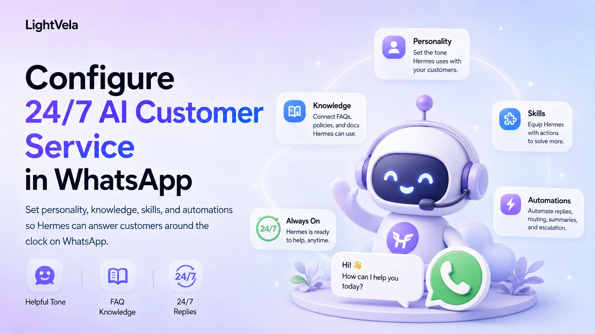

# วิธีการตั้งค่า AI สำหรับบริการลูกค้า 24/7 ใน WhatsApp: บุคลิก ความรู้ ทักษะ และงานที่กำหนดเวลา

## สรุป

**WhatsApp สามารถทำหน้าที่เป็นจุดเข้าหนึ่งต่อหนึ่งระหว่างลูกค้าและเอเจนต์ Hermes ซึ่งมีประโยชน์สำหรับการตอบคำถามซ้ำๆ การเก็บข้อมูลความต้องการของลูกค้า และร่างคำตอบ แต่คำว่า "24/7" ที่นี่หมายถึงสามารถตอบกลับได้เมื่อใดก็ได้ที่บริการกำลังทำงาน แบบจำลองพร้อมใช้งาน และช่องทางเชื่อมต่ออยู่ — ไม่ใช่การรับประกันบริการต่อเนื่องหรือ SLA การสนับสนุนจากมนุษย์** ข้อจำกัดที่สองก็สำคัญไม่แพ้กัน: การส่งข้อความเชิงรุกบน WhatsApp ยังคงอยู่ภายใต้หน้าต่างการสนทนา ข้อความเทมเพลต และการตั้งค่าช่องทาง ดังนั้นการแจ้งเตือนอัตโนมัติจะต้องออกแบบแยกจากการสนทนาที่ลูกค้าเริ่มขึ้น ไม่ควรสมมติว่าสามารถส่งได้ตามต้องการ สร้างขึ้นด้วยสี่ชั้นตามลำดับ: บุคลิกตั้งค่าเสียงและเงื่อนไขการยกระดับ ความรู้เก็บคำถามที่พบบ่อย ทักษะเพิ่มขั้นตอนที่ใช้ซ้ำได้ และงานที่กำหนดเวลาจัดการสรุปที่กำหนดไว้

## ใครที่เหมาะกับสิ่งนี้

คู่มือนี้สำหรับผู้ที่ต้องการปรับใช้เอเจนต์สนับสนุนส่วนบุคคล ผู้ช่วยข้อมูลผลิตภัณฑ์ หรือผู้ช่วยคัดแยกหลังการขายใน WhatsApp

มันมีประโยชน์เป็นพิเศษสำหรับทีมที่ต้องการภาษาสนับสนุนที่สอดคล้องกัน คำถามที่พบบ่อยที่สามารถดูแลรักษาได้ การตอบกลับที่ซ้ำกันน้อยลง และเส้นทางการส่งต่อที่ชัดเจนสำหรับคำขอที่ซับซ้อน

## ข้อกำหนดเบื้องต้น

- เอเจนต์ LightVela Hermes ที่กำลังทำงานอยู่
  หากคุณยังไม่ได้สร้าง ให้เริ่มต้นด้วย [เริ่มต้นอย่างรวดเร็ว](../02-quickstart.md)

- การกำหนดค่ารูปแบบที่ทำงานได้หรือเครดิตทดลองใช้ที่มีอยู่

- บัญชี WhatsApp ที่ใช้งานได้เชื่อมต่อโดยการติดตาม [กำหนดค่าช่องทาง - WhatsApp](../configuration/channel-whatsapp.md)

- วัสดุของผลิตภัณฑ์ ชั่วโมงให้บริการ เส้นทางการยกระดับ และรายละเอียดการติดต่อของบุคคล

- คำจำกัดความที่ชัดเจนของการกระทำที่ต้องการการดำเนินการหรือการยืนยันโดยมนุษย์

## เข้าใจห้าชั้นของการบริการลูกค้า 24/7

| ชั้น | ความรับผิดชอบ | สถานที่ที่เหมาะสม |
|---|---|---|
| บุคลิกภาพ | บทบาท น้ำเสียง ลำดับความสำคัญ และขอบเขตการให้บริการ | SOUL.md หรือ [บุคลิกภาพ](./im-agent-persona-soul-md.md) |
| ความรู้ | คำถามที่พบบ่อยเกี่ยวกับผลิตภัณฑ์ นโยบาย ชั่วโมงการให้บริการ และเส้นทางการยกระดับ | ไฟล์อ้างอิงใน [คลาวด์สตอเรจ](../configuration/files.md) |
| ทักษะ | การดึงข้อมูล การจัดระเบียบ การร่าง และการกระทำที่เป็นรูปธรรมอื่น ๆ | [ทักษะ](../configuration/skill.md) |
| ความจำ | การยืนยันความชอบของลูกค้าและบริบทการทำงานร่วมที่ยั่งยืน | [การจัดการความจำ](../configuration/memory.md) |
| งานที่กำหนดเวลา | การตรวจสอบตามกำหนด การแจ้งเตือนภายใน และการแจ้งเตือนเชิงรุก | [งานที่กำหนดเวลา](../configuration/automation.md) |

อย่าวางฐานความรู้ผลิตขนาดใหญ่ลงในบุคลิก และอย่านำเนื้อหาของลูกค้าที่ยังไม่ได้ยืนยันมาเก็บเป็นความทรงจำระยะยาว

## ขั้นตอน

### 1. เชื่อมต่อและตรวจสอบการสนทนาแบบตัวต่อตัว WhatsApp

ในการตั้งค่าช่องทางของ Agent Hermes ให้เลือก WhatsApp และทำการอนุมัติ QR โดยการปฏิบัติตาม [กำหนดค่าช่องทาง - WhatsApp](../configuration/channel-whatsapp.md)

เปิดรายชื่อติดต่อที่เกี่ยวข้องใน WhatsApp และส่งข้อความทดสอบ จากนั้นยืนยันว่าคอนโซลแสดงช่องทางว่าเชื่อมต่อแล้วและว่าได้รับการตอบกลับตามปกติ

ช่องทาง WhatsApp ปัจจุบันไม่รองรับการสนทนาเป็นกลุ่ม ดังนั้นกระบวนการบริการลูกค้านี้จึงออกแบบมาสำหรับการสนทนาระหว่างลูกค้าและเจ้าหน้าที่แบบตัวต่อตัว

### 2. เขียนคำแนะนำลักษณะบุคลิกภาพของฝ่ายบริการลูกค้า

ใช้ [SOUL.md คู่มือบุคลิกภาพ](./im-agent-persona-soul-md.md) เพื่อกำหนดตัวตน น้ำเสียง ลำดับการตอบ และขอบเขตการยกระดับของผู้ช่วยสนับสนุน

เริ่มต้นด้วยข้อความสั้น ๆ แบบนี้:

คุณเป็นผู้ช่วยฝ่ายสนับสนุนผลิตภัณฑ์ของเรา ให้ข้อสรุปที่สำคัญที่สุดแก่ลูกค้าก่อน ตามด้วยขั้นตอนที่จำเป็น ตอบกลับเฉพาะจากข้อมูลผลิตภัณฑ์ที่ยืนยันแล้ว และแนะนำการส่งต่อให้เจ้าหน้าที่มนุษย์อย่างชัดเจนเมื่อไม่แน่ใจ อย่าสัญญาการคืนเงิน การเปลี่ยนแปลงราคา การตรวจสอบตัวตน การลบข้อมูล หรือผลลัพธ์ที่มีความเสี่ยงสูงอื่น ๆ ก่อนส่งเนื้อหาไปยังระบบภายนอกหรือทำการเปลี่ยนแปลง อธิบายผลกระทบและรอการยืนยันจากเจ้าหน้าที่มนุษย์

รักษาหลักการบริการที่มั่นคงในบุคลิกภาพ และรักษาคำตอบของผลิตภัณฑ์ที่ชัดเจนในไฟล์อ้างอิงที่สามารถดูแลรักษาได้

### 3. จัดระเบียบฐานความรู้สำหรับการสนับสนุน

เตรียมอย่างน้อยหมวดหมู่เหล่านี้:

- คำถามที่พบบ่อยเกี่ยวกับผลิตภัณฑ์และแผน

- ชั่วโมงการให้บริการ ความคาดหวังในการตอบสนอง และรายละเอียดการติดต่อของบุคคล

- นโยบายเกี่ยวกับการคืนเงิน การยกเลิก การอัปเกรด และเหตุการณ์ต่างๆ

- ข้อผิดพลาดทั่วไปและขั้นตอนการแก้ไขปัญหา

- คำขอที่ต้องส่งต่อให้มนุษย์ดำเนินการและข้อมูลที่ต้องรวบรวมก่อนการส่งต่อ

แบ่งเนื้อหาออกเป็นไฟล์หัวข้อที่สามารถดูแลรักษาได้และวางไว้ใน [Cloud Storage](../configuration/files.md)

ทดสอบวัสดุด้วยคำสั่งที่มีความเสี่ยงต่ำ:

ตอบคำถามนี้เฉพาะจากเอกสารสนับสนุนที่เตรียมไว้เท่านั้น หากเอกสารไม่มีคำตอบ ให้ระบุว่าข้อมูลใดขาดหายไปและแนะนำให้ส่งต่อให้มนุษย์

### 4. ติดตั้งและตรวจสอบความถูกต้องของทักษะที่จำเป็น

หากคุณต้องการการค้นคืนความรู้ การจัดการตั๋ว การค้นหาเว็บ หรือการสร้างเนื้อหา ให้เลือกทักษะที่เชื่อถือได้จาก [Skills.sh](https://skills.sh/) หรือ [ClawHub](https://clawhub.ai/)

ก่อนที่จะขอให้ Hermes ติดตั้งมันผ่าน WhatsApp ให้ถามว่า Skill อ่านอะไร บริการภายนอกใดบ้างที่มันเรียกใช้ และมันสามารถส่งข้อความเชิงรุกได้หรือไม่

ทักษะที่มีความเสี่ยงสูงอาจขอการยืนยันเพิ่มเติมก่อนการติดตั้ง ดังนั้นโปรดตรวจสอบสิทธิ์และแนวทางความปลอดภัยใน [กำหนดค่าทักษะ](../configuration/skill.md)

หลังการติดตั้ง ทดสอบร่างเอกสาร สรุป และการดึงข้อมูล FAQ ก่อนอนุญาตให้สกิลใด ๆ ดำเนินการคืนเงิน ลบข้อมูล หรือส่งเนื้อหาลูกค้าที่ยังไม่ได้ตรวจสอบ

### 5. ตั้งค่าความชอบของลูกค้าและความจำที่ทนทาน

เฉพาะข้อมูลที่ได้รับการยืนยันแล้วและเป็นประโยชน์ต่อการให้บริการในอนาคตเท่านั้นที่ควรบันทึกลงในหน่วยความจำหรือโปรไฟล์ผู้ใช้

ตัวอย่างได้แก่ ความชื่นชอบในการใช้ภาษาอังกฤษที่ยืนยันแล้ว ความชื่นชอบในการตอบกลับแบบสรุปก่อน หรือสถานะของกรณีการสนับสนุนที่กำลังดำเนินอยู่ซึ่งลูกค้าได้ยืนยันแล้ว

รหัสผ่าน รหัสยืนยัน รายละเอียดการชำระเงิน ข้อมูลประจำตัวเต็มรูปแบบ และข้อมูลที่ละเอียดอ่อนที่ไม่จำเป็น ไม่ควรบันทึกเป็นหน่วยความจำระยะยาว

ถาม Hermes ในการสนทนาเพื่อจดจำหรือทำให้ลืมความชอบ และตรวจสอบหน้าการ [จัดการหน่วยความจำ](../configuration/memory.md) ในคอนโซลเป็นระยะ ๆ

### 6. กำหนดค่าหน้าที่ตามกำหนดเวลาและข้อความเชิงรุก

งานที่เหมาะสำหรับกำหนดเวลาได้แก่ การเตือนงานภายใน การตรวจสอบกรณีที่ยังไม่แก้ไข และสรุปการให้บริการรายวัน

กำหนดตารางเวลา ช่วงเวลาที่ทำงาน และวิธีการแจ้งเตือนใน [Scheduled Tasks](../configuration/automation.md)

ข้อความเชิงรุก WhatsApp อาจถูกจำกัดโดยหน้าต่างการสนทนาหรือเทมเพลตข้อความที่ได้รับอนุมัติ ดังนั้นอย่าสมมติว่าข้อความปกติสามารถส่งได้เสมอไปเมื่อผู้ใช้ยังไม่ได้เริ่มการสนทนา

ใช้หมายเลขทดสอบก่อนเพื่อยืนยันการจัดส่ง เนื้อหา และเส้นทางการจัดการภายในเมื่อการแจ้งเตือนไม่สำเร็จ

### 7. จัดการส่งต่อให้มนุษย์

เมื่อคำขอเกี่ยวข้องกับการคืนเงิน การชำระเงิน การตรวจสอบตัวตน ข้อผูกพันทางกฎหมาย การร้องเรียนที่ถูกยกระดับ หรือเอกสารอ้างอิงที่หายไป เจ้าหน้าที่สนับสนุนควรหยุดเดาและส่งต่อไปยังบุคคลจริง

ข้อความส่งต่อควรประกอบด้วยข้อเท็จจริงที่ทราบ ข้อมูลที่ขาดหาย ขั้นตอนถัดไปที่แนะนำ และว่าลูกค้าจำเป็นต้องทบทวนปัญหาหรือไม่

ทบทวนตัวอย่างการสนทนาทุกวัน โดยมุ่งเน้นไปที่การอ้างอิงที่ผิด การสัญญาที่เกินจริง การจัดการข้อมูลที่ละเอียดอ่อน และข้อความเชิงรุกที่ซ้ำกัน

## คำสั่งตอบสนองการสนับสนุนที่ใช้ซ้ำได้

1. ให้ข้อสรุปโดยตรง

2. อ้างอิงวัสดุหรือขั้นตอนที่เกี่ยวข้องมากที่สุด

3. อธิบายข้อจำกัด ค่าใช้จ่าย เวลา หรือข้อมูลที่จำเป็น

4. ระบุอย่างชัดเจนว่าเมื่อใดที่ต้องมีการส่งต่อให้มนุษย์

5. ดำเนินการกระทำภายนอกก็ต่อเมื่อได้รับอนุญาตและยืนยันแล้วเท่านั้น

## คำถามที่พบบ่อย

### 24/7 หมายความว่า WhatsApp จะตอบกลับทันทีเสมอหรือไม่?

ไม่

เอเย่นต้องกำลังทำงาน โมเดลต้องพร้อมใช้งาน ช่อง WhatsApp ต้องเชื่อมต่ออยู่ และการส่งข้อความเชิงรุกอาจถูกจำกัดโดยหน้าต่างการสนทนาและเทมเพลตข้อความ

### ทีมบริการลูกค้า WhatsApp สามารถจัดการแชทกลุ่มได้หรือไม่?

เอกสารช่อง WhatsApp ปัจจุบันระบุว่าห้องแชทกลุ่มไม่รองรับและรองรับเฉพาะการสนทนาแบบ 1 ต่อ 1 เท่านั้น

หากคุณต้องการบริการลูกค้าแบบกลุ่ม ให้ยืนยันก่อนว่าช่องทางเป้าหมายอื่นมีเอกสารสนับสนุนกลุ่มอย่างชัดเจน แทนที่จะสรุปว่ามีการสนับสนุนกลุ่มจากพฤติกรรมแบบ 1 ต่อ 1

### วัสดุสนับสนุนควรเก็บในหน่วยความจำหรือใน Cloud Storage?

คำถามที่พบบ่อยเกี่ยวกับผลิตภัณฑ์ นโยบาย และคอลเลกชันอ้างอิงขนาดใหญ่ควรเก็บไว้ใน Cloud Storage

หน่วยความจำและโปรไฟล์ผู้ใช้เหมาะสมกับปริมาณเล็กน้อยของความชอบของลูกค้าที่คงที่ ข้อเท็จจริงที่ยืนยันแล้ว และบริบทการทำงานร่วมกันที่ยั่งยืน

### ทักษะสามารถส่งข้อความไปยังลูกค้าโดยอัตโนมัติได้หรือไม่?

ก็ต่อเมื่อความสามารถของช่องทาง การอนุญาตทางธุรกิจ แบบข้อความตัวอย่าง และกฎการตรวจสอบโดยมนุษย์ชัดเจนเท่านั้น

โดยค่าเริ่มต้น ให้ทักษะสร้างร่างหรือการเตือนภายใน จากนั้นให้มนุษย์ยืนยันว่าควรส่งอะไร

## ขั้นตอนถัดไป

- [กำหนดค่าช่องทาง - WhatsApp](../configuration/channel-whatsapp.md) - ทำการเชื่อมต่อ 1 ต่อ 1 ของ WhatsApp ให้สมบูรณ์

- [วิธีเปลี่ยนเอเจนต์ IM ให้กลายเป็นผู้ช่วยด้านบริการลูกค้า ชุมชน หรือเพื่อนร่วมทางด้วยทักษะ](./im-agent-skill-scenarios.md) - เลือกและยืนยันทักษะด้านบริการลูกค้า

- [วิธีการกำหนดบทบาท บุคลิกภาพ และเสียงของเอเจนต์ IM ด้วย SOUL.md](./im-agent-persona-soul-md.md) - กำหนดบุคลิกภาพการสนับสนุนและขอบเขตพฤติกรรม

- [งานที่กำหนดเวลา](../configuration/automation.md) - กำหนดการเตือนความจำภายในและสรุปที่กำหนดเวลา
