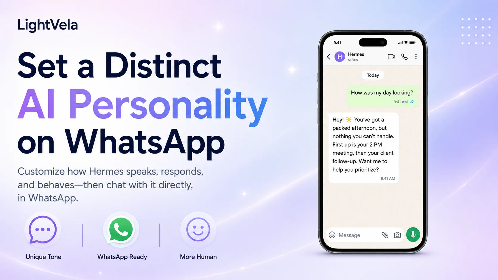

# วิธีการปรับแต่งเอเจนต์ Hermes ด้วยบุคลิกที่โดดเด่นใน WhatsApp

## สรุป

**WhatsApp ส่งข้อความ; บทบาท น้ำเสียง ข้อจำกัด และบริบทระยะยาวของเอเจนต์มาจากการตั้งค่าใน LightVela — การเปลี่ยนจุดเริ่มต้นไม่เปลี่ยนตัวตนของมัน** เชื่อมต่อช่องทาง WhatsApp ก่อน (อนุมัติตามคู่มือช่องทางและยืนยันว่าคอนโซลแสดงว่ากำลังเชื่อมต่อ) จากนั้นใช้ส่วน Persona ในหน้าการตั้งค่าของเอเจนต์เพื่อเลือกและฉีด Persona ที่เหมาะกับการส่งข้อความส่วนตัว การเตือนความจำ หรือการสนทนากับลูกค้า หากเอเจนต์นี้เผชิญหน้าผู้บริโภคหรือเอเจนต์ ให้ระบุชื่อผู้ชมอย่างชัดเจนใน Persona และเพิ่มน้ำเสียงแบรนด์ ขอบเขตที่สามารถจัดการ และเงื่อนไขในการส่งต่อไปยังมนุษย์ หลังจากเชื่อมต่อแล้ว ส่งข้อความทดสอบและยืนยันว่าการตอบกลับไปถึงการสนทนาที่คาดหวัง หากไม่มีข้อความใดมาถึง ให้ตรวจสอบว่าโมเดลถูกตั้งค่าหรือไม่ เครดิตทดลองหมดหรือไม่ และช่องทางแสดงว่ากำลังเชื่อมต่อหรือไม่



## ใครที่เหมาะกับสิ่งนี้

คู่มือนี้สำหรับคนที่ต้องการเอเจนต์ Hermes ที่มีเสียงสม่ำเสมอและบริบทการทำงานที่เป็นประโยชน์ใน WhatsApp  
มันทำงานได้ดีเป็นพิเศษสำหรับการช่วยเหลือส่วนบุคคล การเตือนความจำประจำวัน การจัดระเบียบข้อมูล และสถานการณ์ 1 ต่อ 1 อื่น ๆ ที่สไตล์การสนทนาควรคงที่และสามารถคาดเดาได้

WhatsApp ปัจจุบันมีวัตถุประสงค์หลักสำหรับการสนทนาแบบตัวต่อตัว หากคุณยังไม่ได้เชื่อมต่อ WhatsApp ให้เริ่มต้นด้วย [ตั้งค่าช่อง - WhatsApp](../configuration/channel-whatsapp.md)

## ข้อกำหนดเบื้องต้น

- เอเจนต์ LightVela Hermes ที่กำลังทำงานอยู่
  หากคุณยังไม่ได้สร้าง ให้เริ่มต้นด้วย [เริ่มต้นอย่างรวดเร็ว](../02-quickstart.md)

- การกำหนดค่าโมเดลที่ใช้งานได้หรือเครดิตทดลองที่มีอยู่
  หาก Hermes ยังไม่สามารถตอบได้ ให้ทำ [กำหนดค่าโมเดล](../configuration/model.md) ให้เสร็จ

- บัญชี WhatsApp ที่สามารถรับข้อความยืนยันตัวตนได้ โดยได้รับอนุญาตผ่าน [ตั้งค่าช่องทาง - WhatsApp](../configuration/channel-whatsapp.md)

- บทสรุปบุคลิกสั้น ๆ  
ตัดสินใจว่าเอเจนต์ให้บริการใคร ช่วยแก้ปัญหาอะไร เสียงของมันควรเป็นแบบใด และการกระทำใดที่ต้องได้รับการยืนยันจากคุณเสมอ

## ขั้นตอน / แนวคิดสำคัญ

### 1. เชื่อมต่อช่อง WhatsApp ก่อน

เปิดเอเจนต์Hermesที่ต้องการในคอนโซลLightVela ไปที่ "ช่องทาง" และเลือก WhatsApp  
ทำตาม [กำหนดค่าช่องทาง - WhatsApp](../configuration/channel-whatsapp.md) ผ่านการอนุมัติทางโทรศัพท์ รหัสยืนยัน หรือการสแกน QR จากนั้นส่งข้อความทดสอบ

ยืนยันว่า WhatsApp ปรากฏว่าเชื่อมต่อแล้วในคอนโซล และว่า Hermes เอเจนต์ตอบกลับใน WhatsApp  
หากช่องทางยังไม่เชื่อมต่อ ให้แก้ไขปัญหาการอนุญาต โมเดล หรือเครดิตก่อนปรับบุคลิกภาพ

### 2. เขียนบทสรุปบทบาทสำหรับบริบท WhatsApp

WhatsApp การสนทนามักจะสั้นกว่าและเกิดขึ้นทันทีมากกว่า และสามารถผสมคำขอส่วนตัวและคำขอด้านงานในกระทู้เดียวกันได้  
พร้อมกับการบรรยายว่าเอเจนต์คือใคร ให้กำหนดความยาวของการตอบกลับ พฤติกรรมในการชี้แจง และขอบเขตรอบการกระทำที่มีความเสี่ยงสูง

เริ่มต้นด้วยบทสรุปบทบาทแบบนี้:

```text
You are my everyday WhatsApp assistant.
Help me organize to-dos, follow-ups, and short messages, but do not take external actions without my confirmation.
Use a concise, natural, friendly tone by default. Use short sections when an explanation is needed instead of sending one long block.
If my request is missing a time, person, or goal, ask the single most important clarifying question first.
```

หากเอเจนต์ WhatsApp ให้บริการลูกค้าหรือทีม ให้เปลี่ยนคำว่า "ของฉัน" เป็นกลุ่มเป้าหมายที่ตั้งใจ และเพิ่มสไตล์ของแบรนด์ ขอบเขตที่รองรับ และเงื่อนไขสำหรับการส่งคำร้องขอไปยังมนุษย์

### 3. เลือกและฉีดวิญญาณจากบุคลิกภาพ

เปิดการตั้งค่าของเอเจนต์เป้าหมายแล้วเลือกส่วน "บุคลิกภาพ"
คุณสามารถสุ่มเลือกวิญญาณหรือใช้แบบทดสอบบุคลิกภาพเพื่อหาคู่ที่ใกล้เคียงมากขึ้น

ตรวจสอบบทบาท เสียง และคำอธิบายพฤติกรรมบนการ์ด เลือกการ์ดนั้น แล้วคลิก "ฉีดวิญญาณ" LightVela เขียนวิญญาณที่เลือกไปยัง `SOUL.md` ของเอเจนต์ Hermes ปัจจุบัน และเก็บสำรองก่อนที่จะเปลี่ยนบุคลิกก่อนหน้า

มีจิตวิญญาณเพียงหนึ่งเดียวที่ทำงานสำหรับเอเจนต์ในแต่ละครั้ง หากคุณฉีดจิตวิญญาณใหม่ WhatsApp จะตอบโดยใช้บุคลิกภาพใหม่ในการสนทนาใหม่ ดังนั้นให้เปรียบเทียบบทบาทเก่าและใหม่ก่อนยืนยัน

### 4. เริ่มการสนทนาใหม่ใน WhatsApp

หลังจากที่จิตวิญญาณถูกฉีดเข้าไป ให้ส่งข้อความนี้ในบทสนทนา WhatsApp:

```text
/new
```

นี่ช่วยให้ Hermes Agent อ่าน `SOUL.md` ใหม่เมื่อเริ่มการสนทนาใหม่ หากการสนทนาเก่ายังคงเหมือนเดิม ให้ยืนยันว่า `/new` ถูกส่งสำเร็จก่อนทดสอบต่อ

ใช้การตรวจสอบตัวเองสั้น ๆ เพื่อตรวจสอบผลลัพธ์:

```text
Explain who you serve, your default reply style, and what you do when a request would send a message outside this chat.
```

### 5. ปรับจังหวะ WhatsApp ให้ตรงกับข้อความจริง

ใน WhatsApp บุคลิกภาพที่มีประโยชน์ไม่ได้หมายถึงเพียงแค่การฟังดูเหมือนตัวละครเฉพาะเท่านั้น แต่ยังรวมถึงความยาวของข้อความ การจัดกลุ่ม และเวลาที่จะถามคำถามติดตามผลด้วย

ทดสอบมันด้วยข้อความสามประเภท:

```text
Turn this content into three messages I could send to a colleague.
```

```text
Remind me to follow up on this tomorrow at 3 PM, and first tell me what information you plan to record.
```

```text
This request might trigger an external action. List the risks and what you need me to confirm first.
```

หากการตอบกลับยาวเกินไป ให้บันทึกค่าการตั้งค่าล่วงหน้า เช่น "เก็บการตอบกลับเริ่มต้นให้อยู่ภายใต้สามส่วนสั้น ๆ"  
หากเอเจนต์ต้องการบริบทโครงการที่เสถียร ให้ใช้ความสามารถ [การจัดการหน่วยความจำ](../configuration/memory.md) เพื่อเก็บข้อเท็จจริงที่ควรใช้ต่อไป

## แยกบุคลิกออกจากเวิร์กโฟลว์ด้านการบริการลูกค้า

บุคลิกภาพกำหนดบทบาทและเสียงที่เอเจนต์ใช้ ทักษะกำหนดว่าเอเจนต์สามารถทำงานเฉพาะใดได้หรือไม่ งานที่กำหนดเวลากำหนดเวลาเริ่มต้นทำงานโดยเชิงรุก หน่วยความจำและโปรไฟล์ผู้ใช้กำหนดบริบทระยะยาวที่ควรเก็บไว้

ตัวอย่างเช่น บุคลิกที่อบอุ่นของการบริการลูกค้าไม่ได้หมายความว่าจะสามารถค้นหาคำสั่งซื้อ ค้นหาฐานความรู้ หรือดำเนินการขอคืนเงินได้โดยอัตโนมัติ ความสามารถเหล่านั้นต้องการการกำหนดค่ารูปแบบ ทักษะ ไฟล์อ้างอิง และขอบเขตการดำเนินการที่ชัดเจน

สำหรับคำอธิบายเชิงลึกเกี่ยวกับขอบเขตระหว่างบุคลิกภาพ ความชอบของผู้ใช้ และความทรงจำระยะยาว โปรดอ่าน [แหล่งที่มาของบุคลิกภาพของเอเจนต์ Hermes](../hermes-agent/10-persona-user-memory.md)

## คำถามที่พบบ่อย

### ควรมีหมายเลข WhatsApp หนึ่งหมายเลขแมปไปยังเอเจนต์ Hermes หนึ่งตัวหรือไม่?

โดยทั่วไปแล้ว หมายเลข WhatsApp หนึ่งหมายเลขควรถูกผูกกับเอเจนต์ Hermes หนึ่งตัว  
หากคุณต้องการบทบาทที่แตกต่างกันหลายบทบาท ให้ใช้หมายเลข WhatsApp แยกต่างหากและเอเจนต์ Hermes แยกต่างหาก แทนที่จะคอยแทนที่บุคลิกเดียวกันซ้ำไปซ้ำมาในเธรดเดียวกัน

### การฉีดวิญญาณใหม่จะลบประวัติหรือความทรงจำ WhatsApp หรือไม่?

ไม่  
การฉีดวิญญาณใหม่ส่วนใหญ่จะมาแทนที่ `SOUL.md` ปัจจุบันของเอเจนต์เป็นหลัก ขณะที่ `/new` เริ่มต้นการสนทนาใหม่  
ความทรงจำระยะยาวและโปรไฟล์ผู้ใช้ยังคงเป็นเลเยอร์บริบทแยกจากกัน แม้ว่าบุคลิกภาพใหม่นั้นสามารถเปลี่ยนวิธีที่ Hermes ตีความและใช้บริบทนั้นได้

### ฉันสามารถใช้การตั้งค่านี้ในกลุ่ม WhatsApp ได้ไหม?

เอกสาร WhatsApp ปัจจุบันกำหนดการสนทนาทีละ 1 ต่อ 1 เป็นขอบเขตที่รองรับ ดังนั้นกลุ่มจึงไม่ได้รวมอยู่ในคู่มือนี้ ตรวจสอบ [การกำหนดค่าช่องทาง - WhatsApp](../configuration/channel-whatsapp.md) สำหรับข้อจำกัดของช่องทางปัจจุบัน

### เอเจนต์ WhatsApp สามารถส่งข้อความโดยเชิงรุกได้หรือไม่?

ข้อความเชิงรุกยังต้องปฏิบัติตามกฎของ WhatsApp แบบข้อความและหน้าต่างสนทนา
หากคุณต้องการการเตือนความจำที่ตั้งเวลาไว้ ให้เข้าไปอ่าน [งานที่ตั้งเวลาไว้](../configuration/automation.md) และยืนยันว่าวิธีการส่งตรงตามขีดจำกัดของช่องทาง WhatsApp จริง

## ขั้นตอนถัดไป

- [วิธีการกำหนดค่าเอเจนต์ Hermes ด้วยบุคลิกที่แตกต่างใน Telegram](./telegram-persona-agent.md) - เปรียบเทียบการตั้งค่ากับช่องทางการส่งข้อความระหว่างประเทศอื่น ๆ

- [วิธีการกำหนดบทบาท บุคลิกภาพ และเสียงของเอเจนต์ IM ด้วย SOUL.md](./im-agent-persona-soul-md.md) - เก็บบุคลิกภาพ โปรไฟล์ผู้ใช้ ความทรงจำ และทักษะแยกออกจากกัน

- [กำหนดค่าช่อง - WhatsApp](../configuration/channel-whatsapp.md) - ทำตามขั้นตอนการอนุญาตและแก้ไขปัญหา WhatsApp อย่างครบถ้วน

- [งานที่กำหนดเวลา](../configuration/automation.md) - กำหนดการแจ้งเตือนหรือตรวจสอบที่ได้ทดสอบแล้วในการสนทนา
