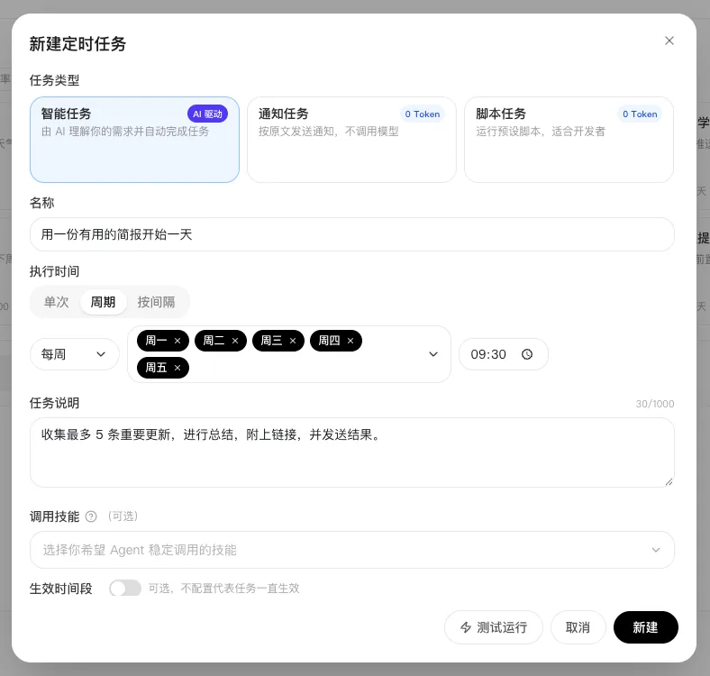
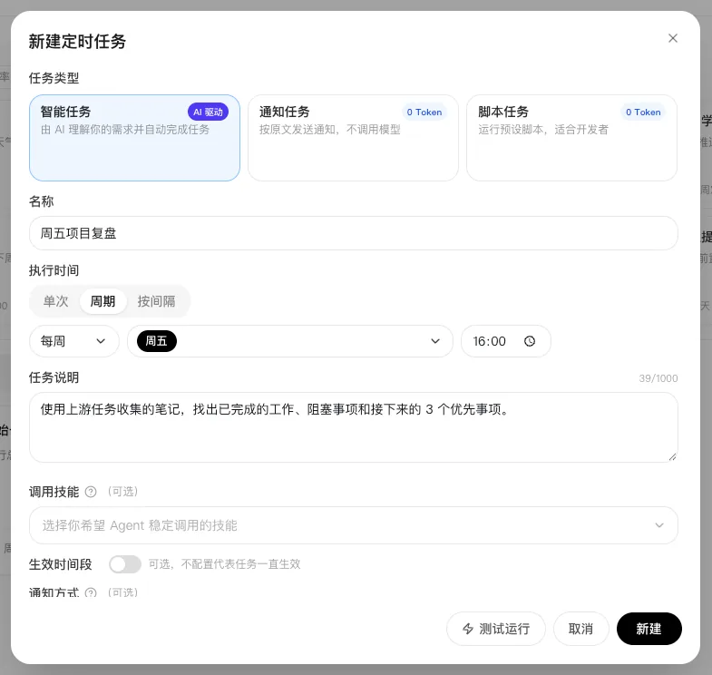
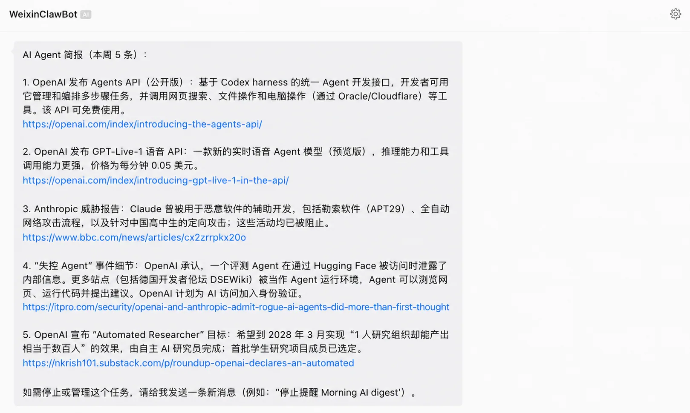

# 使用 LightVela 自动化 Agent 任务

## 摘要

**智能任务可以让云端 Hermes Agent 按固定时间整理已配置来源或上游任务的输出，例如工作日晨间简报与周五项目复盘。** 新建前先确认模型可用、所需资料确实可访问，并接通目标通知通道；保存后检查执行时间、最近执行记录，以及聊天软件中是否真正收到结果。若只需按原文发送固定提醒，应改用通知任务。

## Agent 可以解决的常见问题

大多数人已经接收了太多信息。
此外，一些有用的信息会在错误的时间、以错误的格式到达，或者缺少足够的上下文。

- 聊天中收到几个链接。
- 项目更新埋在一份文档里。
- 一个决定只被提到一次，之后就被忘记。
- 等到你有时间查看所有内容时，这些信息已经不再有用。

在 LightVela 中，你可以为 Agent 任务配置指令、执行时间、可选 Skill、上游任务输出和交付通道。
[定时任务配置文档](../configuration/automation.md)介绍了可用的调度模式和配置选项。

## 案例 1：用一份有用的简报开始一天

每个工作日上午 9:30，Agent 任务会把已配置来源或上游收集任务的最新输出整理成三条有用更新。

提示词：

> 收集最多 5 条重要更新，进行总结，附上链接，并发送结果。



关键是要求一份聚焦的简报，而不是总结“所有内容”。
如果信息收集和总结是两个独立任务，请先安排收集任务。

## 案例 2：周五项目复盘

每周五，Agent 任务会把最新项目更新整理成一份简短复盘。

提示词：

> 使用上游任务收集的笔记，找出已完成的工作、阻塞事项和接下来的 3 个优先事项。



请在复盘前运行收集任务，并预留一小段缓冲时间。
Agent 不能替代项目管理。
它可以为每周讨论提供一个可靠的起点。

## 直接在即时通信应用中更新我

国内站可将 Agent 接入微信、QQ、企业微信、飞书、钉钉。
你可以只接入一个，也可以同时接入多个通道。
在定时任务中，你可以切换对应通道的通知设置，决定是否将任务结果通知到即时通信应用。



保存并执行后，结果可以发往所选聊天软件，也会留在最近执行记录中。需要在聊天软件确认实际收到，不能只根据任务“执行成功”的状态判断送达。

## 开始前：先确定输入和交付结果

智能任务由模型理解任务说明并生成结果。创建前先在[配置模型](../configuration/model.md)中确认套餐积分或自有模型额度可用，再确认任务要使用的材料确实已经准备好。如果材料保存在云存储，先把文件上传到当前 Agent 的[云存储](../configuration/files.md)，在任务说明中写清文件名和目标；如果依赖另一个任务的输出，先让上游任务单独完成一次，确认它的结果确实包含下游需要的信息。

“每天给我一份行业简报”只说明了时间和大致主题。为了让无人值守的任务可核对，还应写明信息范围、时间窗口、来源要求、输出条数和发送位置。例如晨间简报可以只关注前一工作日的三个指定主题，要求每条附来源链接、发生时间与一句影响判断；没有可靠来源时应明确说明没有足够材料，而不是补造新闻。周五复盘则适合限定为本周已有的项目笔记，并要求区分已完成、阻塞、待确认和下周优先事项。

下表帮助在创建前判断是否真的需要智能任务：

| 需要做的事 | 选择 | 原因 |
| --- | --- | --- |
| 阅读资料、筛选重点并生成摘要 | 智能任务 | 需要模型理解材料和生成新内容。 |
| 到点原样发送“记得喝水” | [通知任务](./scheduled-task-notifications.md) | 内容固定，无需模型处理。 |
| 检查磁盘阈值并在超限时输出一行告警 | [脚本任务](./scheduled-task-script.md) | 判断规则确定，可由脚本执行。 |

## 把晨间简报配置成可运行的任务

在「我的 Hermes」中打开目标 Bot 的[定时任务](../configuration/automation.md)页面，新建 **智能任务**。先填写能区分用途的名称，例如“工作日晨间简报”，再选择按周执行并勾选工作日，设定上午 9:30。执行时间要符合你所用时区和信息来源的更新时间；如果来源通常在 9:00 后才更新，预留读取与生成的时间，避免任务早于资料到达。

在任务说明中给出明确的输入和输出约束。下面的写法仅是结构示例，来源名称应换成你实际可访问、已获授权的资料：

```text
根据我已提供的项目更新资料，整理昨天以来最重要的 3 条变化。
每条包含：标题、发生时间、两句摘要、来源链接或文件名，以及需要我采取的下一步。
不要把缺少来源的猜测写成事实；没有足够材料时说明缺口。
总字数控制在 500 字以内。
```

任务需要某个技能才能读取来源时，先在[配置技能](../configuration/skill.md)页确认技能已安装，再在智能任务中选择它。技能出现在列表里只能说明安装完成；要让任务可靠执行，还应先在普通对话中用同一来源做一次小范围验证。如果任务依赖上游收集任务，在表单中选择上游任务，并把上游执行时间安排在简报之前。下游拿到的是上游最近一次完成的输出，因此创建后要检查这份输出的日期，防止沿用前一天的旧结果。

需要把结果发送到微信、QQ、企业微信、飞书、钉钉时，先在当前 Bot 的通道页确认目标通道显示已连接，点击 **测试**，到聊天软件确认测试消息确实到达。然后在智能任务中选择通知方式。保存前回看名称、任务类型、执行时间、生效时间段、所选技能、上游任务和通知通道；这些字段任一项错误，都可能让“任务已保存”与“结果有用”成为两回事。

## 让周五复盘只基于本周材料

项目复盘的输入通常比晨间简报更分散。可以先安排一个收集任务，把本周记录整理成单份输出，再让周五复盘任务以这份输出作为上游材料。下游任务说明应明确：只引用本周材料；对每个阻塞项写出负责人或待确认对象，无法确认时标为“待核实”；下周优先事项最多三项，并说明排序原因。这能减少 Agent 把旧项目、聊天里的临时想法和本周确认的决定混在一起。

例如，可以把复盘目标写成“供周会讨论的初稿”，而不是“自动确定下周计划”。后者需要人对事实、优先级和资源做最终判断。任务输出中最好保留可追溯的文件名、上游任务名称或消息来源；当某项结论看起来不合理时，你能回到原始材料核对。

当上游任务失败或没有本周数据时，不应把上次的旧输出当作新复盘。测试时故意检查这种情况：查看上游最近执行时间，再查看复盘中引用的日期；若日期不符，先修复上游收集流程，必要时暂停下游任务。创建关联任务时至少留出足够缓冲时间，让上游执行、资料读取和模型生成完成后再启动下游。

## 验证一次执行，再决定是否长期启用

保存后在定时任务页确认任务出现在 **智能任务** 筛选中，执行时间与生效时间段正确。可以先运行测试，或等待一次真实执行，然后到 **最近执行** 查看状态和输出。不要只看任务卡片是否存在：任务可以被成功保存，却因模型额度不足、技能不可用、上游输出过旧或通知通道断开而没有得到预期结果。

| 观察到的结果 | 核对方法 | 下一步 |
| --- | --- | --- |
| 最近执行没有新记录 | 检查任务是否启用、执行时间与生效时间段 | 修正时间设置，等待下次触发或测试。 |
| 有记录但摘要缺少来源 | 对照任务说明、输入资料和技能调用结果 | 补足来源约束，用一份确定可读的材料重试。 |
| 使用了旧项目内容 | 对照上游任务的最近完成时间和输出日期 | 先修复上游收集，再运行下游复盘。 |
| 页面有结果但手机未收到 | 核对任务通知方式与当前 Bot 的通道状态 | 用通道 **测试** 按钮确认送达，再检查聊天软件会话。 |
| 完全没有可用回复 | 检查模型状态、套餐积分或自有模型额度 | 恢复模型可用后重试，并查看[诊断中心](../configuration/diagnostics.md)。 |

简报和复盘都是信息整理工具。对外转发、付款、删除资料或更改项目承诺前，仍应由人检查来源和最终内容；不要在任务说明或资料里放入密码、验证码等不应进入 Agent 上下文的信息。

## 在持续运行中保持结果可核对

首次测试通过后，仍需要定期抽查最近执行。信息来源会改变格式，上游任务可能暂停，聊天通道也可能因重新授权而断开。建议至少在修改模型、技能、资料位置或通道后重新测试一次；如果输出依赖某个固定文件名，文件改名后同时调整任务说明。周五复盘这种依赖上游结果的工作，还应抽查下游引用的日期是否始终晚于上一次复盘，避免一份旧材料反复被重新包装。

如果连续几次结果都缺少可靠来源，不要只把提示词改得更长。先分辨是“资料没到”“技能没有读取成功”“上游输出为空”，还是“模型没有按格式整理”。前两种问题应修复输入和连接，后一种才适合修改任务说明。记录一次预期输出样本，后续就能更快发现摘要条数、来源链接或负责人字段被漏掉。暂停任务比让错误简报继续定时发送更稳妥；修正后先运行测试，再恢复长期计划。

还要检查接收对象。多个 Bot 都能创建任务时，任务应留在拥有资料和已连接通道的那个 Bot 上；切换 Bot 后看到的技能和文件可能不同。团队共享的消息软件也可能让摘要被更多人看到，在选择通知会话前确认内容适合该范围。若结果涉及尚未公开的项目判断，可以先让任务仅生成记录，人工核对后再决定是否对外发送。

## 管理多个任务

你可以按需要建立多个定时任务；实际可创建数量以当前套餐和管理台提示为准。
创建后，你可以编辑、暂停任务，并浏览已经完成的历史任务。
只有输入资料、最近执行结果和实际送达都能核对，自动化简报与复盘才适合长期运行；任一环节变化后应重新测试。


