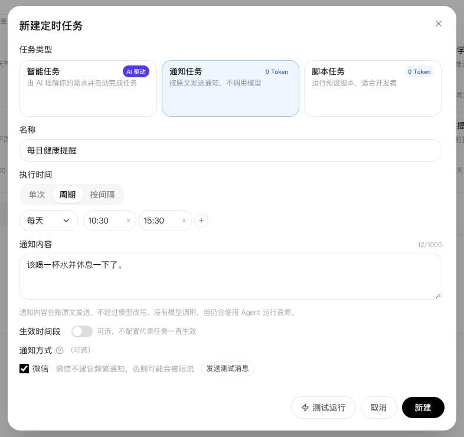
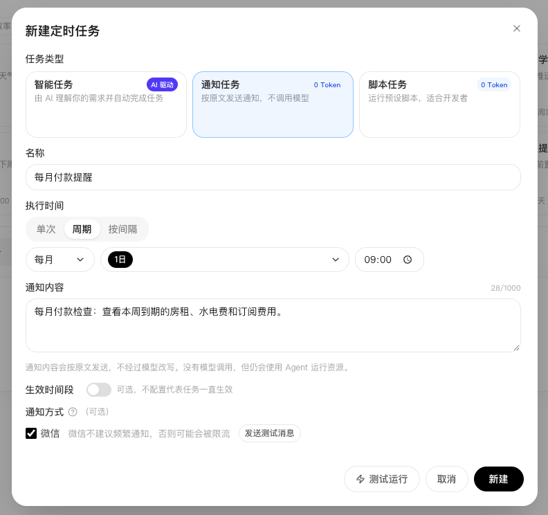
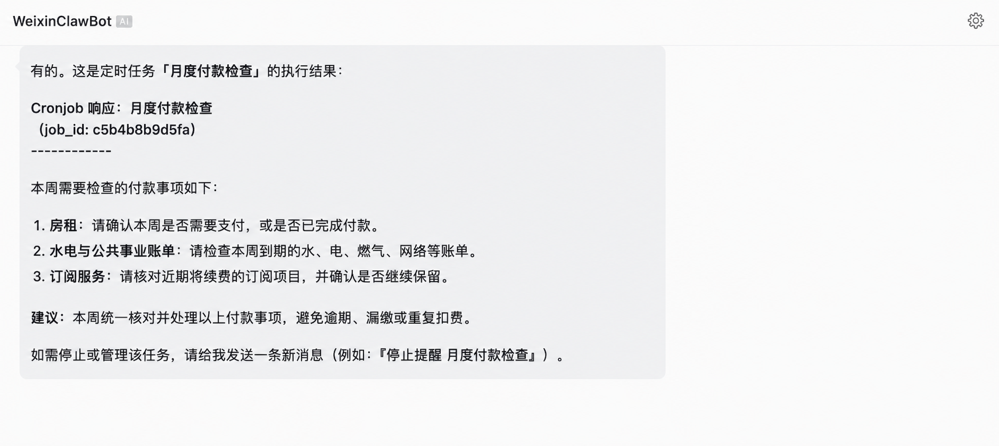

# 在 LightVela 中设置通知任务

## 摘要

**通知任务可以让云端 Agent 按计划发送固定消息，不调用 AI 模型，也不消耗模型 Token。** 本页用每日健康提醒和每月付款提醒说明如何配置消息、执行时间、生效时间段和国内交付通道。

通知任务适合那些内容固定、时间明确、无需模型改写的提醒场景。
你可以提前写好消息，让它在需要的时间通过已配置的通道送达。

## 通知可以解决的常见问题

大多数人并不是不在意重要任务，所以才忘记它们。
工作变忙时，一些小而必要的行动很容易被忽略。

- 长时间工作时忘记喝水。
- 服药时间晚于计划。
- 订阅续费提醒埋在收件箱里。
- 到了截止日期之后才想起账单。

在 LightVela 中，你可以为通知任务配置消息、执行时间、生效时间段和交付通道。
消息会按照原文发送，不会调用模型，因此不会消耗模型 Token。
[定时任务配置文档](../configuration/automation.md)介绍了可用的调度和通知选项。

## 案例 1：每日健康提醒

每天上午 10:30 和下午 3:30，通知任务会发送同一条简短提醒。

消息：

> 该喝一杯水并休息一下了。

关键是让消息保持简短并且可执行。
由于消息不会经过模型处理，通知不会被改写，也不会增加额外上下文。

如果提醒需要根据当天的天气、日程或其他动态信息调整，就不适合使用固定通知任务。
这类需要理解上下文的任务应改用 Agent 任务，并在提示词中说明需要收集和整理哪些信息。

## 案例 2：每月付款提醒

每月第一天，通知任务会提醒你查看即将到来的付款。

消息：

> 每月付款检查：查看本周到期的房租、水电费和订阅费用。

通知会让每笔付款在截止日期前保持可见。
如果不同账单的到期日期不同，请创建多个任务，让每条提醒在有用的时间送达。

创建任务时，应让任务名称能够直接说明提醒对象，并把时间设置在你有足够时间处理事项的时段。
例如，月初提醒适合用于汇总本周付款，临近到期日的提醒则更适合对应单笔账单。

## 直接在即时通信应用中更新我

LightVela 支持将 Agent 接入微信、飞书和 QQ。
你可以同时接入一个或多个通道。
在定时任务中，你可以切换每个已配置的通道，决定通知应该发送到哪里。

切换设置后，Agent 会将完整通知直接发送到你的即时通信应用。
你不需要打开 LightVela 或其他应用查看提醒。

建议先确认通道已经完成接入，再使用测试消息检查通知是否能送达。
如果没有收到消息，应先检查对应通道是否已启用，以及任务是否处于有效时间段内。

## 管理多个任务

你可以根据需要设置任意数量的定时任务。
创建后，你可以编辑任务内容和执行时间，暂停任务，并浏览历史运行记录。

当提醒内容或时间发生变化时，直接编辑原任务可以避免重复创建相同提醒。
暂时不需要的提醒可以暂停，之后再恢复，不必删除历史配置。
浏览历史运行记录则可以帮助你确认任务是否按预期执行，以及消息是否在正确的时间发送。

使用 LightVela，让你的个人 Hermes Agent 在你专注于其他工作时继续按计划维护重要日常安排。
