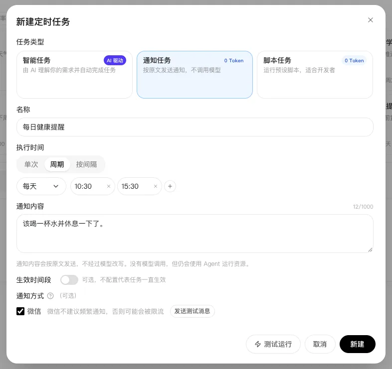
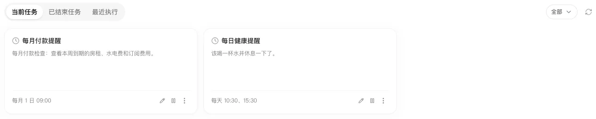

# 在 LightVela 中设置通知任务

## 摘要

**通知任务可以让云端 Agent 按计划发送固定消息，不调用 AI 模型，也不消耗模型 Token。** 本页用每日健康提醒和每月付款提醒说明如何配置消息、执行时间、生效时间段和国内交付通道。

通知任务适合那些内容固定、时间明确、无需模型改写的提醒场景。
你可以提前写好消息，让它在需要的时间通过已配置的通道送达。

## 通知可以解决的常见问题

大多数人并不是不在意重要任务，所以才忘记它们。
工作变忙时，一些小而必要的行动很容易被忽略。

- 长时间工作时忘记喝水。
- 服药时间晚于计划。
- 订阅续费提醒埋在收件箱里。
- 到了截止日期之后才想起账单。

在 LightVela 中，你可以为通知任务配置消息、执行时间、生效时间段和交付通道。
消息会按照原文发送，不会调用模型，因此不会消耗模型 Token。
[定时任务配置文档](../configuration/automation.md)介绍了可用的调度和通知选项。

## 案例 1：每日健康提醒

每天上午 10:30 和下午 3:30，通知任务会发送同一条简短提醒。

消息：

> 该喝一杯水并休息一下了。

关键是让消息保持简短并且可执行。
由于消息不会经过模型处理，通知不会被改写，也不会增加额外上下文。

如果提醒需要根据当天的天气、日程或其他动态信息调整，就不适合使用固定通知任务。
这类需要理解上下文的任务应改用 Agent 任务，并在提示词中说明需要收集和整理哪些信息。

## 案例 2：每月付款提醒

每月第一天，通知任务会提醒你查看即将到来的付款。

消息：

> 每月付款检查：查看本周到期的房租、水电费和订阅费用。

通知会让每笔付款在截止日期前保持可见。
如果不同账单的到期日期不同，请创建多个任务，让每条提醒在有用的时间送达。

创建任务时，应让任务名称能够直接说明提醒对象，并把时间设置在你有足够时间处理事项的时段。
例如，月初提醒适合用于汇总本周付款，临近到期日的提醒则更适合对应单笔账单。

## 直接在即时通信应用中更新我

国内站可将 Agent 接入微信、QQ、企业微信、飞书、钉钉。
你可以同时接入一个或多个通道。
在定时任务中，你可以切换每个已配置的通道，决定通知应该发送到哪里。

任务执行后，固定消息会通过所选聊天软件发送。仍应在聊天软件确认实际收到，不能只凭管理台显示“执行成功”判断提醒已经到达。

建议先确认通道已经完成接入，再使用测试消息检查通知是否能送达。
如果没有收到消息，应先检查对应通道是否已启用，以及任务是否处于有效时间段内。

## 新建前：确认提醒适合固定消息

通知任务适用于内容已经确定、只需要在指定时间发送的场景。它不读取当天的天气、日历或账单，也不会替你判断是否需要提醒。如果消息必须根据资料变化来写，应该使用[智能任务](./scheduled-task-agent.md)；如果要用确定规则检查文件或阈值，可使用[脚本任务](./scheduled-task-script.md)。区分任务类型能避免误以为固定提醒会自动更新内容。

创建前请确定三件事：谁需要收到提醒、何时收到、看到消息后能立刻做什么。“每月付款检查：查看本周到期的房租、水电费和订阅费用”比“记得付款”更容易执行，但它仍不会知道实际到期日。若每笔账单日期不同，分别创建任务并在名称中写明对象，别把不同日期塞进一条含糊的月初提醒。

国内站可在通知方式中选择微信、QQ、企业微信、飞书、钉钉。先在目标 Bot 的「通道」页确认选中的聊天软件显示 **已连接**，点击 **测试**，并到对应聊天软件确认收到测试消息。测试按钮只能验证当下的发送链路；通知任务是否在预定时间送达，还要以任务执行后的记录和聊天软件消息为准。

## 用每日提醒走完一次配置

在「我的 Hermes」中打开目标 Bot 的[定时任务](../configuration/automation.md)页面，选择新建 **通知任务**。填写便于识别的名称，例如“工作日午后喝水提醒”；选择按周执行并勾选工作日，再设定时间。若一天需要上午和下午各提醒一次，可按页面支持的时间设置分别配置，不要假设只填写一个时间就会自动发送两次。

通知正文应写成最终希望收到的文字。固定任务发送时不会调用模型润色，所以文字、标点、换行和 Emoji 都应在保存前检查。如果提醒中包含日期，确认它不会在下一次执行时变成过期信息。也不要在通知正文放密码、身份证号或不应发送到聊天软件的私密内容。

接着选择至少一种通知方式。通知任务没有通知方式时不能保存；如果选多个通道，应检查每个目标是否都属于当前 Bot、是否仍然已连接。生效时间段用于限制任务在哪些时间可执行；设置得过窄，可能让预定时间落在窗口外。保存前逐项回看任务类型、时间、正文、生效时间段与通知通道，特别核对时区和星期选择。

保存后，先确认任务出现在当前任务列表的 **通知任务** 筛选中。运行一次测试或等待首次真实执行，再到 **最近执行** 查记录，并打开对应聊天软件核对正文是否与输入完全一致。不同平台可能对换行或部分字符有不同渲染方式；如果格式很重要，应以实际收到的消息为准调整正文。

## 把每月付款提醒设在可行动的时间

月初提醒的作用是让你检查付款清单，而不是核算账单。可以选择每月第一天上午发送“查看本周到期的房租、水电费和订阅费用”，再在正文加入你自己的清单入口或处理顺序。若某笔付款在每月十五日到期，应另设到期前的提醒；日期和金额可能变化时，避免把固定值写入长期重复发送的正文。

提醒只需要发送给一个人时，先选一个你最常查看的通道。若同时选微信和企业微信，测试时分别确认两边都收到了消息，避免误以为勾选两个平台就自动完成双重投递。更换手机、重新授权或断开通道后，重新使用通道测试按钮，再观察下一次真实执行；已保存的任务不会替你确认新设备上是否仍能接收消息。

当不再需要付款提醒时，暂停或删除原任务，避免持续发送无用消息。若只是调整内容或时间，先编辑原任务并运行一次验证，通常比创建一条同名任务更容易避免重复提醒。

## 如何判断任务真的可用

| 看到的情况 | 先检查什么 | 处理方式 |
| --- | --- | --- |
| 保存按钮不可用 | 是否选择了通知方式、正文与时间是否填写 | 补齐必填项后再保存。 |
| 任务已保存但没有执行记录 | 任务状态、星期或日期、生效时间段 | 修正调度设置，等待下次触发或运行测试。 |
| 有执行记录但聊天软件没消息 | 当前 Bot 的通道连接、通知方式和实际会话 | 用通道 **测试** 按钮确认送达，必要时重新连接。 |
| 收到的文字与预期不同 | 输入正文与聊天平台渲染方式 | 修改原文并再次测试，固定任务不会自动改写。 |
| 同一提醒收到多次 | 是否建立了重复任务或选了多个通道 | 检查任务列表和通知方式，暂停多余的任务。 |

通知任务不调用模型，因此不能根据是否消耗模型积分来判断它是否运行。可靠的验收要同时看到正确的执行记录、正确的目标会话，以及可读且准确的消息正文。对于付款、服药等有实际后果的提醒，还应保留原有日历或业务系统提醒方式，并定期检查任务与通道状态。

## 修改时间或接收通道后重新验证

固定提醒常见的失效点不是正文，而是时间和收件位置。休假期间暂停过任务、在手机上重新登录聊天软件、更换通知通道，或把原来工作日提醒改成每天提醒后，都应回到任务列表检查启用状态、执行日期、生效时间段与勾选的通知方式。若任务页面允许测试发送，先用测试确认当前设置，再等待下一次真实执行并核对实际到达时间。

当一个提醒需要同时发到几个平台，逐一确认每个平台的消息；只在微信收到，不代表企业微信或钉钉也已收到。不同聊天软件可能把机器人会话折叠到不同位置，先搜索机器人名称或检查消息通知设置，再判断任务是否失败。相反，如果一个平台反复收到重复消息，也要检查是否在两个 Bot 上各建了一条相同任务，或同一 Bot 里有两个近似名称的任务。

面向付款和健康的内容应保持“提醒去核对”的措辞，不要写成任务会替你完成付款或医疗判断。金额、收款方、服药剂量和截止日会变化，固定文字不会自动同步这些信息；发生变化后应及时编辑正文或暂停任务。这样做也能避免一条原本有用的提醒在数月后继续传播过期内容。

## 管理多个任务

你可以按需要建立多个定时任务；实际可创建数量以当前套餐和管理台提示为准。
创建后，你可以编辑任务内容和执行时间，暂停任务，并浏览历史运行记录。

当提醒内容或时间发生变化时，直接编辑原任务可以避免重复创建相同提醒。
暂时不需要的提醒可以暂停，之后再恢复，不必删除历史配置。
浏览历史运行记录则可以帮助你确认任务是否按预期执行，以及消息是否在正确的时间发送。

固定通知的可靠性取决于准确的正文、执行时间和真实送达。每次调整接收通道或提醒内容后，重新检查下一次执行记录和聊天软件消息，确认提醒仍在合适的时间到达。
