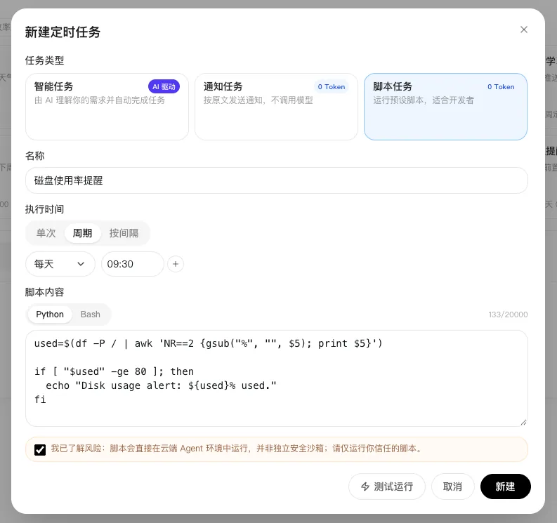
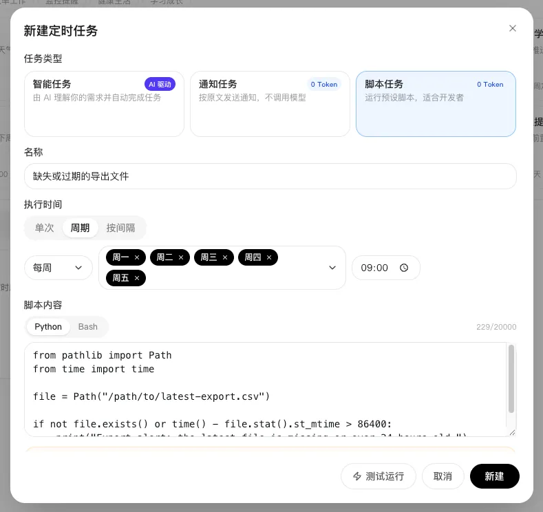
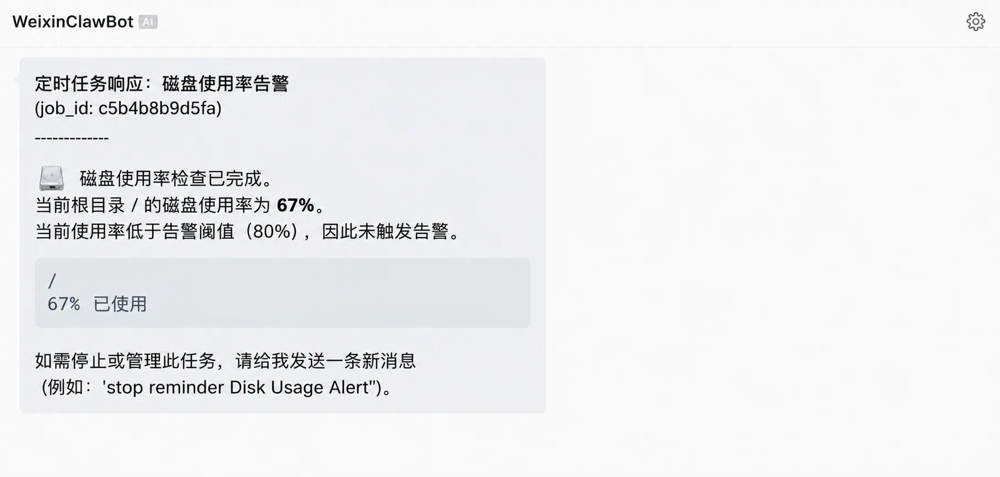

# 在 LightVela 中运行脚本任务

## 摘要

**脚本任务可以让云端 Agent 按计划运行 Bash 或 Python 脚本，不调用 AI 模型，也不消耗模型 Token。** 本页用磁盘使用率检查和导出文件检查说明如何配置脚本、执行时间、生效时间段和国内交付通道。

脚本任务适合那些规则明确、结果可以通过脚本判断的重复性系统检查。
它可以按计划运行 Bash 或 Python 脚本，并在脚本产生输出时发送结果。

## 脚本可以解决的常见问题

许多小型系统问题都可以通过简单检查发现。
但是，这些检查往往会被忘记，直到某些功能停止工作。

- 磁盘使用量增长，却没有被注意到。
- 每日导出停止生成新文件。
- 备份文件变得过期。
- 直到问题影响其他工作后才被发现。

在 LightVela 中，你可以为脚本任务配置 Bash 或 Python 代码、执行时间、生效时间段和交付通道。
任务不会调用模型，因此不会消耗模型 Token。
[定时任务配置文档](../configuration/automation.md)介绍了可用的调度和通知选项。

脚本会在云端 Agent 环境中运行，不等同于安全沙箱。
请只运行你信任的脚本，并在保存前确认脚本访问的路径和输出内容。

## 案例 1：磁盘使用率提醒

每天早上，Bash 脚本任务会检查可用磁盘空间，并且只在使用率达到 80% 时报告。

脚本：

```bash
used=$(df -P / | awk 'NR==2 {gsub("%", "", $5); print $5}')

if [ "$used" -ge 80 ]; then
  echo "Disk usage alert: ${used}% used."
fi
```



如果磁盘使用率低于阈值，脚本不会输出内容，也不会发送通知。
这样可以让例行检查保持安静，只有需要处理的问题才会引起注意。

设置阈值时，应根据任务所在环境的磁盘容量和正常增长速度确定数值。
阈值过低会产生过多提醒，阈值过高则可能让你没有足够时间处理磁盘空间问题。

## 案例 2：缺失或过期的导出文件

每个工作日晚上，Python 脚本任务会检查最新导出文件是否存在，以及它是否在过去 24 小时内更新过。

脚本：

```python
from pathlib import Path
from time import time

file = Path("/path/to/latest-export.csv")

if not file.exists() or time() - file.stat().st_mtime > 86400:
    print("Export alert: the latest file is missing or over 24 hours old.")
```



请将示例路径替换为真实的导出位置。
如果文件存在且较新，脚本会安静地完成，不会发送不必要的消息。

如果导出任务本身有固定完成时间，可以把检查安排在导出任务之后，并预留一小段缓冲时间。
这样可以减少导出仍在执行时被误判为文件缺失或过期的情况。

## 直接在即时通信应用中更新我

国内站可将 Agent 接入微信、QQ、企业微信、飞书、钉钉。
你可以同时接入一个或多个通道。
在定时任务中，你可以切换每个已配置的通道，决定脚本提醒应该发送到哪里。



当脚本成功退出且产生非空的标准输出时，任务会将这些输出作为通知发送到选定的即时通信应用。
如果脚本没有输出内容，任务会完成，但不会发送通知。

建议先通过测试运行确认脚本的退出行为和输出内容，再启用定时执行。
如果脚本访问重要文件，应同时检查路径是否正确，以及脚本是否可能修改或删除文件。

## 创建前确认脚本的运行边界

脚本任务运行在当前云端 Agent 的环境中，不等同于你电脑上的终端。示例中的根目录 `/` 和 `/path/to/latest-export.csv` 都是云端环境里的路径；它们不会自动指向本地电脑或另一台服务器的文件。创建任务前，先确认当前 Bot 所在环境里确实有要检查的文件和可用的命令。需要从其他系统取数据时，应先获得对应访问权限，避免把个人电脑路径或内网地址直接复制进脚本。

只运行你能理解和信任的 Bash 或 Python 代码。脚本任务有读写当前环境文件的能力，错误路径或删除命令可能影响 Agent 的工作资料。若只是做告警，先使用只读检查与标准输出；不要把 API 密钥、验证码或完整敏感文件内容写入脚本输出，因为非空输出可能经通知通道发送。保存前应检查代码中每一处路径、外部请求和可能修改文件的操作。

脚本任务适合“达到阈值时输出一句话”这样的确定判断。它不会创建模型对话、调用 Skill 或自动分析脚本报错。需要总结材料、理解自然语言或根据上下文选择行动时，改用[智能任务](./scheduled-task-agent.md)；只想固定时间发送既定文字时，改用[通知任务](./scheduled-task-notifications.md)。

| 检查目标 | 脚本应做什么 | 成功时的输出 |
| --- | --- | --- |
| 磁盘使用率 | 读取使用率，与预设阈值比较 | 超限时输出简短告警，正常时不输出。 |
| 导出文件新鲜度 | 检查指定文件是否存在及修改时间 | 文件缺失或过期时输出告警。 |
| 固定消息提醒 | 无需脚本检查 | 应使用通知任务，而不是让脚本 `echo` 固定文字。 |

## 把磁盘检查配置成定时任务

在「我的 Hermes」中打开目标 Bot 的[定时任务](../configuration/automation.md)页面，新建 **脚本任务**。填写能说明检查对象的名称，例如“云端磁盘使用率检查”；选择 Bash，粘贴上方示例脚本，再选择每天一次的执行时间。脚本里的 `df -P /` 检查的是云端环境的根文件系统，`80` 是示例阈值，应根据实际容量和日常增长情况调整。若你想监控的是另一个目录所在的文件系统，先确认该路径在云端环境真实存在，再修改检查目标。

为任务选择通知方式时，可使用国内站已连接的微信、QQ、企业微信、飞书、钉钉。先在当前 Bot 的「通道」页确认目标显示 **已连接**，点击 **测试**，到聊天软件确认测试消息确实到达。脚本产生告警时，任务才有文字可发送；因此测试发送通道与测试脚本输出是两件事，应分别完成。

保存前检查任务类型仍是脚本任务、语言为 Bash、执行时间和生效时间段符合预期，并确认安全提示。任务创建后不能直接切换为智能任务或通知任务；如果目标改变，应新建相应类型，而不是在脚本里模拟另一个任务类型。

## 用一个可控输出验证静默与告警

先在不会修改文件的条件下测试脚本。磁盘例子可以暂时把阈值调低，使脚本在测试时输出一行告警；核对 **最近执行** 中的退出状态与标准输出，再到聊天软件查看是否收到相同文字。验证后恢复实际阈值。正常条件下，脚本退出码为 `0` 且没有标准输出，应看到执行成功但没有通知；这属于静默成功，不是消息丢失。

导出文件例子同样应先使用一份测试文件。让文件存在且修改时间较新时，脚本不输出；改用一个确实不存在的测试路径时，应输出缺失告警。完成测试后将路径改回真正需要检查的云端文件，并再次核对。示例中 `86400` 表示 24 小时的秒数，若导出并非每日生成，应根据实际周期调整，而不是每天收到同样的过期提醒。

脚本使用相对路径时，运行目录变化可能导致读到错误文件。对重要检查，优先使用你已核实的绝对路径，并在任务说明或名称中标明检查对象。不要把“最近执行中有成功记录”理解为检查对象真实存在；例如一个脚本若吞掉错误又退出 `0`，页面只会看到脚本自己的成功状态。测试时应观察输出内容是否与预期检查结果一致。

## 故障排查与维护

| 现象 | 核对顺序 | 处理 |
| --- | --- | --- |
| 没有新的执行记录 | 任务是否启用、日期与时间、生效时间段 | 修正调度设置后测试或等待下一次执行。 |
| 执行失败 | 退出码、报错信息、云端路径与脚本语言 | 用一段更小的只读脚本重现，再修正命令或路径。 |
| 执行成功但没有通知 | 标准输出是否为空 | 空输出是预期静默；需要通知时明确输出一行文本。 |
| 有非空输出但手机未收到 | 通知方式和当前 Bot 的通道连接 | 使用通道 **测试** 按钮确认实际送达，必要时重新连接。 |
| 收到过多重复告警 | 阈值、检查频率、是否创建重复任务 | 调整阈值或执行间隔，暂停多余任务。 |

脚本发生非零退出、超时或无法启动时，应根据执行记录排查；它不会自动交给 AI 解释或修复。修改脚本、路径或通知方式后，重复进行一次“执行记录 + 实际聊天消息”的验证。若任务涉及关键备份或业务告警，仍应保留原系统的监控方式，不把单个聊天通知当作唯一保障。

## 长期运行时检查哪些变化

脚本第一次运行成功，不代表未来每次都能访问同一文件。导出目录可能迁移，文件名可能加入日期，云端环境里的依赖命令也可能变化。每次修改检查对象后，先用一个可控样本验证“正常时静默、异常时告警”两条路径，再看最近执行记录是否保留正确的退出状态。只验证异常输出，容易把一个始终打印告警的脚本误当成可靠监控。

把脚本名称写成“检查对象 + 触发条件”会方便后续维护，例如“导出文件超过一天未更新时提醒”。当任务不再需要，暂停或删除旧脚本；若同时保留旧版与新版，可能收到重复消息，也可能让两段代码对同一文件产生相互影响。切换 Bot 时，应再次核对它们使用的云端工作区和通知通道，避免误以为另一个 Bot 能直接访问原脚本的路径。

执行日志和通知正文都应只包含排障必需的信息。若脚本为定位错误临时打印了环境变量、文件内容或完整请求响应，修复后应删除这些调试输出，再重新测试。需要人工处理的告警最好包含检查对象和可行动的下一步，但不要把访问凭证放进消息里。

## 管理多个任务

你可以按需要建立多个定时任务；实际可创建数量以当前套餐和管理台提示为准。
创建后，你可以编辑脚本和执行时间，暂停任务，并浏览历史运行记录。


在设置任务前，请测试每个脚本，尤其是它会访问重要文件时。
当脚本逻辑或检查路径发生变化时，应重新测试任务，并确认输出仍然只在需要时触发。

脚本任务适合规则确定、输出可核对的检查。保留正常静默与异常告警两条测试路径，并在环境、路径或通知通道变化后重新验证。
