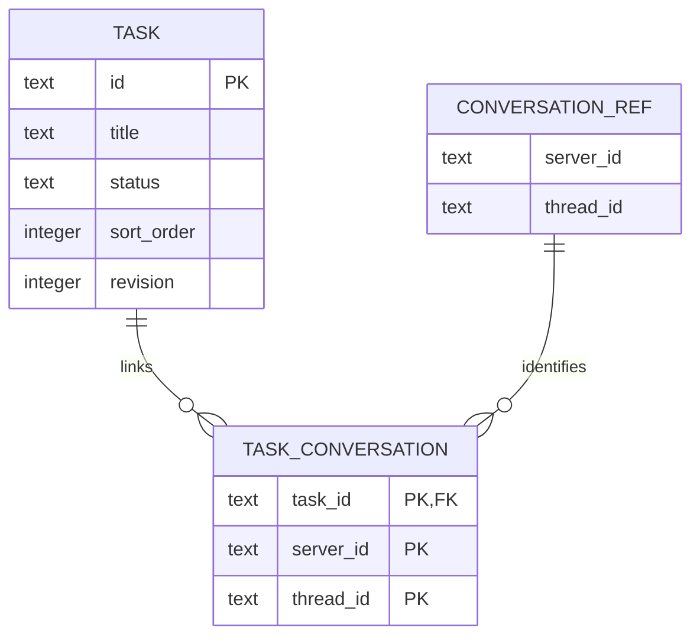

# Tasks 与看板领域模型

状态：首版源码已实现，2026-10-11；运行产物与验证状态见 [实现记录](../../docs/context/tasks/2026-10-11-opencraft-kanban.md#tasks_implementation_followup)。

用户确认采用 BB Tasks 的抽象：任务是独立业务记录，看板是任务视图。用户进一步要求旧卡片不迁移、不纳入新模型，不增加迁移、兼容或其他无必要实现代码。

## 核心关系

首版两张业务表：`tasks` 和 `task_conversations`。SQLite 存结构化行，后端拥有数据库；展示插件通过领域 API 读写。

`CONVERSATION_REF` 是现有会话的外部引用，不新建会话表。列表和看板读取同一批 Task；列表行、看板卡片都是投影，不另存一份记录。

## tasks

| 字段 | SQLite 类型 | 含义与约束 |
|---|---|---|
| `id` | TEXT | 不透明稳定 ID，主键；创建重试复用同一 ID |
| `title` | TEXT | 非空任务标题 |
| `description` | TEXT | 任务说明，可为空字符串 |
| `status` | TEXT | `backlog / todo / in_progress / in_review / done / canceled`；默认 `todo` |
| `project_server_id` | TEXT NULL | 可选的现有项目所属 Server |
| `project_id` | TEXT NULL | 可选的现有项目 ID；与上一字段同时为空或同时有值 |
| `sort_order` | INTEGER | 同状态内的手动顺序；项目过滤共用这一顺序 |
| `revision` | INTEGER | 正整数，内容、状态、顺序、关联发生变化时递增 |
| `created_at` | INTEGER | 后端生成的创建时间，Unix 毫秒 |
| `updated_at` | INTEGER | 后端生成的最近修改时间，Unix 毫秒 |
| `deleted_at` | INTEGER NULL | 删除标记；列表默认排除，ID 不可重用 |

没有项目归属的任务也可以存在。项目引用复用已有项目身份；任务归属项目与会话执行位置分开，可以关联另一台机器上的会话。首版不新建独立 Tasks 项目体系、编号前缀、负责人、标签、优先级、子任务、评论或附件表；有实际需求时再追加。

基础约束：STRICT 表；标题和 ID 校验；状态枚举 CHECK；项目引用成对 CHECK；revision > 0。基础读取索引为 `(status, sort_order, id)` 的未删除行索引；项目过滤确有查询需要时加对应组合索引。

## task_conversations

| 字段 | SQLite 类型 | 含义与约束 |
|---|---|---|
| `task_id` | TEXT | 本库 Task 外键 |
| `server_id` | TEXT | 已有会话身份中的稳定 Server ID |
| `thread_id` | TEXT | 对应 Server 中的 Thread ID |
| `created_at` | INTEGER | 关联建立时间，Unix 毫秒 |

复合主键为 `(task_id, server_id, thread_id)`，重复关联不会生成重复行。一个任务可关联多个会话，一个会话也可参与多个任务。通过 `(server_id, thread_id, task_id)` 索引反查当前会话的所有任务。

不复制会话标题、消息、执行结果、工具记录或运行状态。运行时 Host/profile、Hub route、lease、epoch、连接地址、凭据不进入任务关联表。`server_id` 由既有 ServerOrigin resolver 提供，插件不能自行从展示名称或机器位置推导身份；当前直接连接兼容映射仍由平台现有边界处理。

关联操作通过现有会话读取能力核实引用；断线时读取失败应保留已有关系并展示不可达。项目和会话来自外部 authority，不能设置跨数据库 FK。会话归档、删除或失联不级联删除任务；解除关联也不会删除、停止对应会话。

## 看板和列表

看板按 `tasks.status` 分列，列是上述六种状态的固定呈现。列标题走 i18n，不能把显示文字当状态 ID。卡片显示 Task 标题、关联会话数量和活动集合，不展开长说明或状态表单；标题打开任务详情，保留一个直接打开关联会话的快捷入口，完整会话列表由详情呈现。

列表使用独立紧凑行，显示标题、状态控件与活动摘要，不复用看板卡片。两种视图都只通过隔离的拖动把手排序，正文保留触控滚动。详情占用当前任务工作区而非弹窗：宽容器使用内容区和属性栏，窄容器堆叠同一组字段；任务说明和关联会话位于主要内容区。标题/说明仍由显式保存提交，不增加自动保存写入者。返回概览保留原节点和滚动，恢复仍有效的入口焦点；跨应用导航仍由既有 Router 管理，详情草稿沿用扩展 View 的记忆状态。

列表和看板复用任务查询、详情、筛选、状态修改和排序操作。一个状态下按 `sort_order, id` 排序；项目筛选或视图切换不会建立另一份排序。首版不建 `boards`、`board_columns`、`cards`、`board_tasks` 表，也不提供多看板、自定义列或保存筛选集合。后续确需保存视图时，只保存配置，仍读取同一批任务。

拖动跨列同时更新任务状态和顺序；列内拖动只更新顺序。目标邻居以 Task ID 指定，由后端事务计算位置，不能把前端整个列表覆盖回数据库。删除任务使其退出所有任务视图，不触碰会话。

## 两种状态

已有会话顶部的“…”菜单位于右侧面板按钮左边，提供“归属任务”。选择器可搜索现有任务、查看当前关系，并立即关联或解除；同一会话允许关联多个任务。空列表提供打开任务视图的入口。草稿尚无真实 Thread 身份，不显示此操作。

会话操作复用固定工作台后端的任务 API，每行按 task revision 写入并从 authority 重新读取确认；不迁移任务库、不修改会话、不启动执行。每行独立显示写入状态和失败结果。会话/账号切换卸载旧选择器，迟到结果不能更改新会话选择。

Task.status 表达业务进度。会话活动状态从既有 Runtime/Replica 读取，表达当前是否运行、等待交互、空闲、失败或不可达。关联表不拥有执行状态；断线不能当空闲，空闲不能当任务完成。

| 动作或事件 | Task 变化 | 会话变化 |
|---|---|---|
| 创建任务 | 默认待办 | 不自动创建会话；「新建会话」可保存任务并打开预填原生草稿 |
| 关联、解除会话 | 改关联、递增 revision | 不启动、停止或删除会话 |
| 手动改状态、拖动卡片 | 改业务状态和顺序 | 不触发执行 |
| 会话开始、空闲、失败 | 刷新活动展示，业务状态不自动改 | 由 Runtime 更新 |
| 会话断线或不可恢复 | 保留任务和关联，显示连接状态 | 由 Runtime 投影 |
| 用户标记完成 | 改为 `done` | 不强制中断仍在运行的会话 |

多个关联会话的活动情况以集合展示；不能用“最后一个 Thread 的状态”覆盖整个 Task。读取失败可保留 Runtime 已有投影并标明不可用/过期，不在 Tasks 数据库引入第二份会话状态缓存。

## API 与所有权

首版领域操作只有：列出任务、读取详情、创建、修改、移动、删除、关联会话、解除关联，以及按会话反查任务。Task DTO 对应任务字段；关联 DTO 对应稳定会话引用；会话活动 DTO 由应用注入的只读 Runtime adapter 提供。

修改操作携带 `expectedRevision`。后端事务内校验任务未删除及版本，提交任务/关联/排序的所有变化；实际改动的任务行递增 revision。冲突返回明确错误，客户端重新读取 authority，保留用户草稿。关联插入可幂等去重，解除已不存在的关联可幂等返回。创建的同 ID、同创建内容可以确认既有结果，不同内容必须报冲突，不能复活删除记录。发送超时先重新读取，不能盲目重放。

提交成功后发领域变更通知，列表、看板和详情重新读取同一任务快照；通知与 SQLite authority 分开。没有连接时展示已有数据/不可用状态，不偷偷写入浏览器本地库。后端沿用当前身份作用域和授权边界，模型不承诺新账号隔离或跨 Server 自动同步。

任务数据使用固定的工作台后端 authority，聊天切换 Host 不切换任务库。首版使用新的 `tasks.sqlite` 和独立基线，已有 `kanban.sqlite` 不接管、不转换。物理路径由后端决定，不交给插件或 Renderer。

数据库后续正常升级遵循 [SQLite 生命周期](sqlite-lifecycle.md)；首版只创建带校验和的独立 schema 基线，不编写旧接口兼容层或旧数据转换代码，也不删除用户的旧数据库。

## 工程执行的扩展边界

Tasks 保持业务记录和会话关系。Delegate、执行重试、并发、定时、工作流及 PR 属于执行/工程层，首版不因模型设计而增加这些表或空实现。

后续接入委派时，执行层通过既有 Host/Thread 接口执行并把稳定会话引用关联回 Task。任务关联不是执行请求：不能只靠创建一行关联就声称已派工。跨数据库和远端启动不具有同一 SQLite 事务；正式提供 Delegate 前，执行层必须定义持久请求、去重及失败恢复，不在 UI 临时拼一次 spawn 当成完成。

当前手动使用流程复用原生聊天：详情选择执行连接，点击「新建会话」保存任务并打开带标题/说明的聊天草稿，由用户核对模型、工作目录后点击发送。同 Server 的任务项目传入原生项目与目录；另一 Server 的会话使用其自身工作区，不把其他机器的项目 ID/路径带过去。首次 `thread/start` 返回稳定回执即关联任务，首次 Turn 失败也保留该会话关系；打开草稿不创建 Thread、不发送 Turn、不自动改变任务业务状态。

应用拥有按产品/账号隔离的客户端交接记录，只保存 draftId/taskId 和已确认的 Server/Thread 回执，复用既有原生草稿持久化恢复输入。任务内容与关系仍只存 SQLite。关联失败或回执丢失先读取任务核对，再用当前 revision 重试关联；保留真实会话回执供打开和重试，不重放 thread/start 或 turn/start。账号撤销和应用销毁隔离迟到读取。卡片直接打开关联会话；详情可立即调整状态，保留尚未保存的标题/说明。新任务也能直接选择已有会话，保存与关联顺序执行，失败保留已保存任务和输入，不需要退出重进。

## 实施时验收

- 列表与看板操作同一个 Task，跨列移动可立即在列表看到同一状态。
- 同一个任务关联多个 Server/Thread，当前会话可反查所有关联任务，重复关联不会重复展示。
- 修改任务、关联变更及排序有真实 SQLite 事务和并发冲突验证；失败保留草稿。
- 切换聊天 Host 不改变任务库；断线、线程空闲或失败不自动完成任务。
- 删除任务或解除关联不停止、不删除会话；失联引用不使整个任务不可读。
- Web 在实际 Workbench 中验证；Electron 与手机真机交互需要各自产物验收。

## 参考与依据

BB `plugins/tasks` 固定提交 `62fe3bc46bd1d935b71482b62a1e0887ffb83487` 的任务/多线程关联和独立运行状态；本模型保留其领域边界，收敛首版表与功能。

OpenCraft 当前入口：`packages/workbench-runtime/src/client-hub-server.ts` 的 ServerOrigin；`packages/workbench-runtime/src/appserver-runtime.ts` 的会话执行接口；`plugins/tasks` 实现本模型，旧卡片不参与新模型。
