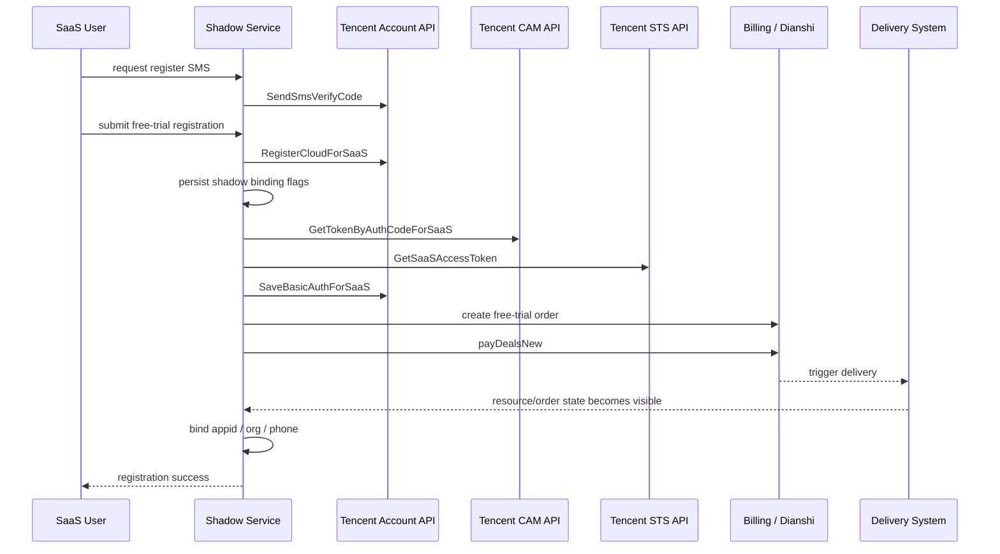
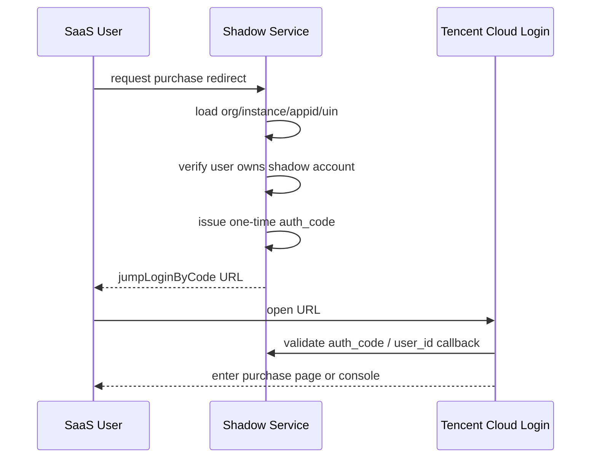
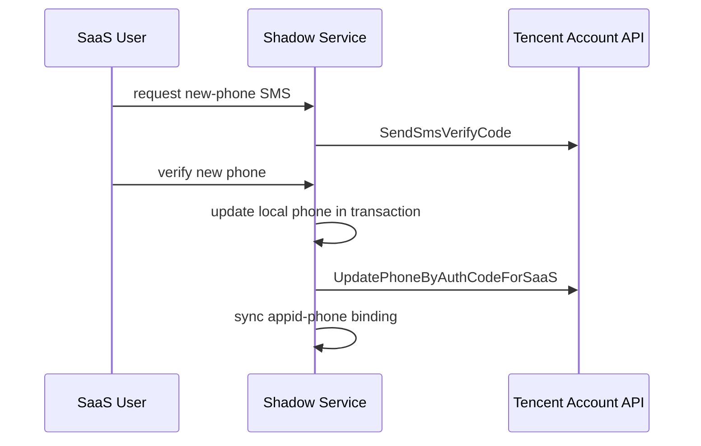

# Shadow Account Capability Service Architecture

## 1. Goal

Build a Go service that provides Tencent Cloud shadow-account capabilities for a SaaS product, including:

- shadow account registration
- basic authentication
- SaaS `auth_code` issuance and validation
- SaaS token and STS temporary credential exchange
- free-trial automatic purchase and payment
- paid renewal / upgrade / traffic-package redirect
- internal callback endpoints for Tencent Cloud to validate `user_id` and `auth_code`
- phone-number synchronization between SaaS user and Tencent Cloud shadow account

The service is designed as a single deployable binary first. The primary target is to make domestic-site shadow-account integration testable end to end in Tencent Cloud test environment before any microservice split.

## 2. Scope

### In scope

- domestic-site shadow-account mode
- Level2 integration model
- Tencent Cloud internal Go SDK integration via `tencentcloud-sdk-go`
- payment orchestration for free-trial auto-pay
- jump-based purchase flow for renew / modify / console access
- operator-oriented validation and test guide

### Out of scope

- Level3 account import and profile migration
- international-site integration
- invoice subsystem
- channel-distribution subsystem
- frontend page implementation
- business-specific resource delivery logic outside shadow-account and payment boundaries

## 3. Product Positioning

This service implements the "shadow account mode" described by Tencent Cloud account-access guidance:

- the SaaS keeps its own user-domain and portal
- Tencent Cloud account is created silently in the backend
- SaaS users do not directly see Tencent Cloud account identifiers
- basic authentication is used instead of standard real-name authentication
- Tencent Cloud purchase capability is available, but some flows must be wrapped by the SaaS

In code terms, this architecture follows the proven behavior already used in `smhapi`:

- `RegisterCloudForSaaS`
- `SendSmsVerifyCode`
- `GetTokenByAuthCodeForSaaS`
- `GetSaaSAccessToken`
- `SaveBasicAuthForSaaS`
- `DescribeAccountBindForSaaS`
- `jumpLoginByCode`
- free-trial order + pay + delivery orchestration

## 4. Recommended Runtime Shape

Use one Go service in the first phase:

- one HTTP server
- one business database
- one outbound Tencent Cloud SDK client factory
- one outbound billing/dianshi HTTP client
- one background worker for retries and reconciliation

This keeps testing simple:

- only one deployable unit
- one place to trace request IDs
- easier idempotency control
- fewer cross-service failure modes during test-environment bring-up

## 5. High-Level Architecture

```text
+-------------------+       +---------------------------+
| SaaS Frontend     | ----> | Shadow Account API       |
+-------------------+       | Go HTTP Server           |
                            +------------+-------------+
                                         |
                                         v
                            +---------------------------+
                            | Domain Modules            |
                            | account / token / billing |
                            | callback / ops            |
                            +------+---------+----------+
                                   |         |
                    +--------------+         +------------------+
                    v                                           v
       +---------------------------+             +---------------------------+
       | Business DB               |             | Tencent Cloud / Internal  |
       | user / auth_code / order  |             | account cam sts billing   |
       | binding / task / audit    |             | dianshi / jump login      |
       +---------------------------+             +---------------------------+
```

## 6. Go Package Layout

Recommended repo layout:

```text
shadow/
  cmd/
    shadowd/
      main.go
  internal/
    app/
      server.go
      router.go
    config/
      config.go
    platform/
      sdk_factory.go
      endpoint.go
      sign.go
    account/
      service.go
      cloudapi.go
      model.go
    token/
      service.go
      authcode.go
    billing/
      service.go
      dianshi.go
      pay.go
      redirect.go
    callback/
      handler.go
    storage/
      user_repo.go
      authcode_repo.go
      order_repo.go
      binding_repo.go
      task_repo.go
    worker/
      retry_worker.go
      reconcile_worker.go
    httpapi/
      public_handler.go
      internal_handler.go
      middleware.go
    audit/
      logger.go
      trace.go
  docs/
  go.mod
```

## 7. Core Modules

### 7.1 `platform`

Purpose:

- centralize all Tencent Cloud client construction
- isolate endpoint, secret, platform, timeout, retry, and environment switching
- avoid business code scattering test/prod differences

Responsibilities:

- create `account`, `cam`, `sts` clients from `tencentcloud-sdk-go`
- expose raw internal HTTP client for non-SDK payment endpoints
- carry environment-specific configuration

Important rule:

- `platform` must come from config, never from hardcoded branch logic hidden inside business code
- test and prod values must be explicitly separated

### 7.2 `account`

Purpose:

- handle shadow-account lifecycle operations

Responsibilities:

- send registration SMS
- register shadow account
- perform basic authentication
- update shadow-account phone number
- query SaaS user <-> Tencent Cloud binding relationship

Recommended interface:

```go
type Service interface {
    SendRegisterSMS(ctx context.Context, in SendRegisterSMSInput) error
    RegisterShadowAccount(ctx context.Context, in RegisterShadowAccountInput) (RegisterShadowAccountOutput, error)
    CreateBasicAuth(ctx context.Context, in CreateBasicAuthInput) error
    UpdatePhone(ctx context.Context, in UpdatePhoneInput) error
    GetUinBySaaSUserID(ctx context.Context, saasUserID string) (int64, error)
    GetSaaSUserIDByUin(ctx context.Context, uin int64) (string, error)
}
```

### 7.3 `token`

Purpose:

- bridge SaaS identity and Tencent Cloud temporary identity

Responsibilities:

- generate one-time `auth_code`
- validate and consume one-time `auth_code`
- use `auth_code` to get SaaS token
- use SaaS token to get STS temporary credentials

Design rules:

- `auth_code` must be one-time use
- `auth_code` must have explicit TTL
- validation must be transactional
- expired records must be cleaned by background worker

### 7.4 `billing`

Purpose:

- handle all purchase-related orchestration

Responsibilities:

- free-trial automatic order generation
- free-trial payment submission
- idempotent recovery on duplicate or delayed delivery
- purchase redirect generation for renew / modify / traffic package / console

Submodules:

- `dianshi.go`: free-trial order generation
- `pay.go`: invoke billing pay endpoint
- `redirect.go`: build `jumpLoginByCode` URL and target purchase URLs

Important split:

- free-trial first purchase is service-driven automatic pay
- renew / modify / traffic package is user-driven redirect to Tencent Cloud purchase pages

### 7.5 `callback`

Purpose:

- expose internal validation endpoints required by shadow-account mode

Callbacks to implement:

- `qcloud.saas.checkSaaSAccountExist`
- `qcloud.saas.checkSaaSAuthCode`

Behavior:

- validate `user_id` existence
- validate and consume `auth_code`
- return the mapped SaaS `user_id`

Deployment requirements:

- intranet reachable
- support URL plus port and L5
- same semantics in test and prod

### 7.6 `storage`

Purpose:

- own all persistence and idempotency state

Do not let business code write SQL directly. Repositories should own:

- inserts
- conditional updates
- duplicate detection
- read-for-update operations
- task leasing

### 7.7 `worker`

Purpose:

- handle retries and eventual consistency

Responsibilities:

- cleanup expired `auth_code`
- retry payment reconciliation
- retry bind and delivery synchronization
- detect "already paid but locally incomplete" cases

## 8. External Integrations

### 8.1 Go SDK integrations

Use the internal Tencent Cloud Go SDK already present under `tencentcloud-sdk-go`.

Prefer importing:

- `git.woa.com/tencentcloud-internal/tencentcloud-sdk-go/tencentcloud/common`
- `git.woa.com/tencentcloud-internal/tencentcloud-sdk-go/tencentcloud/common/profile`
- product-specific packages when available

Use SDK for:

- `account`
- `cam`
- `sts`

### 8.2 Raw HTTP integrations

Not every purchase endpoint should be assumed to have a usable Go SDK wrapper. For these cases, keep a narrow adapter:

- dianshi free-trial order endpoint
- billing pay endpoint
- internal redirect-related CGI if needed

Rules:

- keep raw HTTP adapters inside `billing`
- propagate request IDs into logs
- define typed request/response structs in Go
- never let handlers assemble billing JSON directly

## 9. Data Model

The exact physical schema can vary, but the service should own at least these logical tables.

### 9.1 `saas_user_shadow_binding`

Purpose:

- record SaaS user ID to shadow account identifier and Tencent Cloud UIN mapping

Suggested columns:

- `saas_user_id` (external `usr_<uuid>` primary key)
- `shadow_user_name`
- `uin`
- `owner_uin`
- `appid`
- `status`
- `created_at`
- `updated_at`

### 9.2 `shadow_auth_code`

Purpose:

- one-time auth-code bridge table

Suggested columns:

- `id`
- `saas_user_id`
- `auth_code`
- `expires_at`
- `consumed_at`
- `created_at`

Indexes:

- unique on `auth_code`
- index on `expires_at`

### 9.3 `shadow_free_order`

Purpose:

- free-trial order idempotency and recovery

Suggested columns:

- `id`
- `owner_uin`
- `big_deal_id`
- `deal_name`
- `instance_id`
- `status`
- `created_at`
- `updated_at`

### 9.4 `shadow_payment_task`

Purpose:

- retryable background reconciliation task table

Suggested columns:

- `id`
- `task_type`
- `resource_key`
- `payload`
- `status`
- `retry_count`
- `next_run_at`
- `last_error`
- `created_at`
- `updated_at`

### 9.5 `shadow_audit_log`

Purpose:

- operator and business observability

Suggested columns:

- `id`
- `trace_id`
- `action`
- `saas_user_id`
- `uin`
- `appid`
- `request_id`
- `status`
- `detail`
- `created_at`

## 10. Public API Surface

Suggested API surface for the Go service.

### 10.1 Public SaaS-facing endpoints

- `POST /v1/shadow/register/send-sms`
- `POST /v1/shadow/register/free-trial`
- `POST /v1/shadow/phone/send-sms`
- `POST /v1/shadow/phone/verify`
- `GET /v1/shadow/payment/redirect`
- `GET /v1/shadow/healthz`

### 10.2 Internal Tencent callback endpoints

Option A, one URL plus interface dispatch:

- `POST /internal/tencentcloud/account`

Option B, separate aliases if platform tooling requires them:

- `POST /internal/tencentcloud/check-account`
- `POST /internal/tencentcloud/check-authcode`

Recommendation:

- implement both
- keep one shared handler internally

This avoids unnecessary platform-tool friction.

## 11. Core Flows

### 11.1 Free-trial registration with automatic payment



Key invariants:

- the flow must be idempotent by `owner_uin` and `big_deal_id`
- payment success without visible delivery must enter reconciliation state, not silent failure
- delivery success after client timeout must still converge to success on retry

### 11.2 Renew / modify / traffic-package redirect



### 11.3 Phone-number update



Rollback rule:

- if Tencent Cloud phone update fails, local phone update must be rolled back

## 12. Idempotency and Failure Model

This service should assume the following failures are normal:

- order API timeout after order creation
- pay API timeout after payment success
- delivery visible later than pay response
- duplicate registration submission
- duplicate callback submission
- repeated redirect open in browser tabs

Design rules:

- every write path must have a business key
- never treat "already exists" as fatal before checking whether it represents prior success
- background reconciliation is required
- user-facing handlers should return stable semantic states:
  - success
  - in progress / delayed
  - retriable failure
  - permanent failure

## 13. Configuration

The service should load all environment differences from config.

Suggested config set:

- `APP_ENV`
- `HTTP_ADDR`
- `MYSQL_DSN`
- `SHADOW_PLATFORM`
- `SHADOW_PLATFORM_TEST`
- `TENCENT_SECRET_ID`
- `TENCENT_SECRET_KEY`
- `TENCENT_SECRET_ID_TEST`
- `TENCENT_SECRET_KEY_TEST`
- `ACCOUNT_ENDPOINT`
- `ACCOUNT_ENDPOINT_TEST`
- `CAM_ENDPOINT`
- `CAM_ENDPOINT_TEST`
- `STS_ENDPOINT`
- `STS_ENDPOINT_TEST`
- `BILLING_ENDPOINT`
- `DIANSHI_ENDPOINT`
- `CALLBACK_BASE_URL`
- `CALLBACK_L5`
- `REQUEST_TIMEOUT`
- `ENABLE_DEBUG_LOG`

Do not:

- hardcode endpoint selection in business modules
- mix test and prod `platform`
- embed secrets in code or repo

## 14. Observability

Every external request should log:

- `trace_id`
- SaaS `user_id`
- `shadow_user_name`
- `uin`
- `appid`
- external `RequestId` if available
- action name
- status
- retry count

Metrics to expose:

- registration success rate
- auth-code validation success rate
- free-trial payment success rate
- delayed-delivery count
- callback error count
- phone-update rollback count

## 15. Validation Strategy

Validation should happen in 4 layers.

### 15.1 Unit tests

Use:

- table-driven tests
- fake repositories
- fake Tencent clients
- `httptest`

Must cover:

- auth-code one-time consumption
- duplicate registration retry
- payment timeout then recovery
- callback request parsing
- redirect URL generation
- phone-update rollback

### 15.2 Contract tests

Build request/response golden tests for:

- `checkSaaSAccountExist`
- `checkSaaSAuthCode`
- `jumpLoginByCode` URL generation
- billing adapter request body

### 15.3 Integration tests

Run with test DB and stubbed outbound servers:

- full free-trial register flow
- delayed-delivery reconciliation
- duplicate-order recovery
- renew redirect generation

### 15.4 Tencent Cloud test-environment tests

Use the actual test environment only after local and integration tests pass.

## 16. How to Verify

### 16.1 Local verification

1. Start MySQL and the Go service.
2. Run unit and integration tests:

```bash
go test ./...
```

3. Verify callback endpoints locally:

```bash
curl -sS 'http://127.0.0.1:8080/internal/tencentcloud/account?token=replace-with-callback-token' \
  -H 'content-type: application/json' \
  -d '{
    "version":"1.0",
    "caller":"WACCOUNT",
    "componentName":"WACCOUNT",
    "eventId":"e1",
    "timestamp":1710000000,
    "interface":{
      "interfaceName":"qcloud.saas.checkSaaSAccountExist",
      "para":{"user_id":"usr_00000000-0000-4000-8000-000000000001"}
    }
  }'
```

```bash
curl -sS 'http://127.0.0.1:8080/internal/tencentcloud/account?token=replace-with-callback-token' \
  -H 'content-type: application/json' \
  -d '{
    "version":"1.0",
    "caller":"VERIFY",
    "componentName":"VERIFY",
    "eventId":"e2",
    "timestamp":1710000001,
    "interface":{
      "interfaceName":"qcloud.saas.checkSaaSAuthCode",
      "para":{"auth_code":"test-auth-code"}
    }
  }'
```

4. Verify one-time auth-code behavior:

- first request returns mapped `user_id`
- second request with same `auth_code` returns null or non-success semantic result

5. Verify redirect generation:

- target URL is correct
- `auth_code` is newly minted
- user-agent is preserved

### 16.2 Test-environment verification

Before test-environment verification:

- get test `platform`
- get test secret pair
- get test endpoint permissions
- configure intranet callback URL and L5 in SaaS-tool

Then:

1. Configure hosts as required by Tencent Cloud test-environment guidance.
2. Point service config to test endpoints.
3. Use Tencent Cloud test login page in mainline environment.
4. Trigger:
   - register SMS
   - free-trial registration
   - purchase redirect
5. For failures, capture the request ID from browser network tab.
6. Check Tencent Cloud test logs with that request ID.

Expected success checks:

- shadow account created
- basic auth created
- UIN and appid resolved
- free-trial order paid
- delivery visible
- callback interface invoked successfully
- purchase redirect reaches target Tencent Cloud page

### 16.3 Acceptance checklist

- `SendSmsVerifyCode` works in test env
- `RegisterCloudForSaaS` works in test env
- `GetTokenByAuthCodeForSaaS` works in test env
- `GetSaaSAccessToken` works in test env
- `SaveBasicAuthForSaaS` works in test env
- internal callback endpoint is reachable from Tencent intranet
- free-trial payment is idempotent
- delayed delivery is recoverable
- renew redirect works
- phone update propagates to Tencent Cloud side

## 17. Implementation Order

Recommended order:

1. config and client factory
2. callback endpoints
3. auth-code storage and token exchange
4. register + basic-auth flow
5. free-trial order and payment flow
6. redirect flow
7. phone-update flow
8. reconciliation worker
9. dashboards and alerting

## 18. Practical Notes

- Keep test and prod `platform` values explicit and separately configured.
- Do not hide payment recovery logic inside handlers; put it into `billing` plus `worker`.
- Expose separate callback aliases if platform tooling resists one-URL-plus-interfaceName routing.
- Prefer stable, typed adapter layers over embedding Tencent request maps in handlers.
- Make every important external call traceable by request ID.

## 19. Recommended Next Step

After this document, the next deliverable should be a minimal Go skeleton:

- `cmd/shadowd`
- `internal/platform`
- `internal/callback`
- `internal/token`
- `internal/account`
- `internal/billing`
- `internal/storage`

with one end-to-end test covering:

- issue `auth_code`
- validate callback
- build `jumpLoginByCode` redirect
