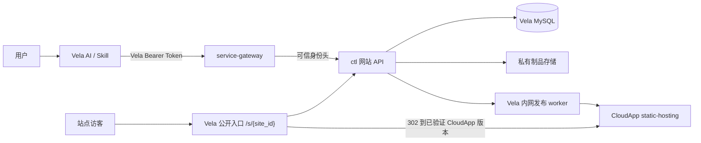
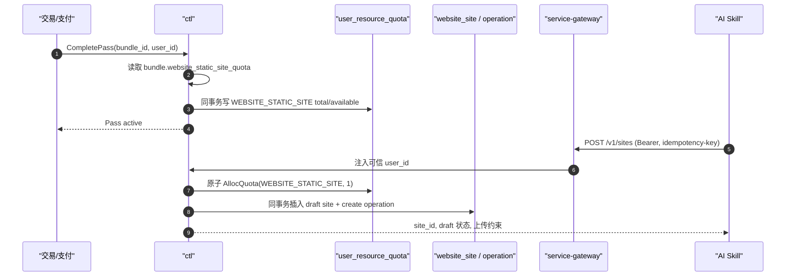
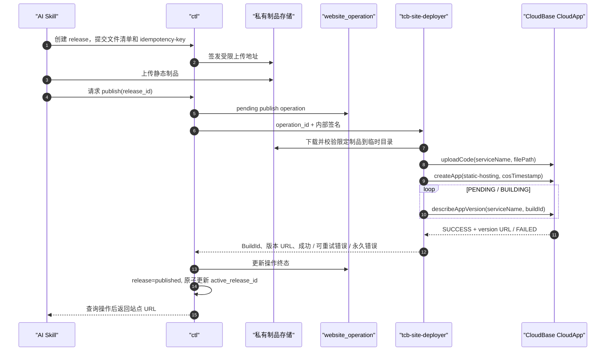
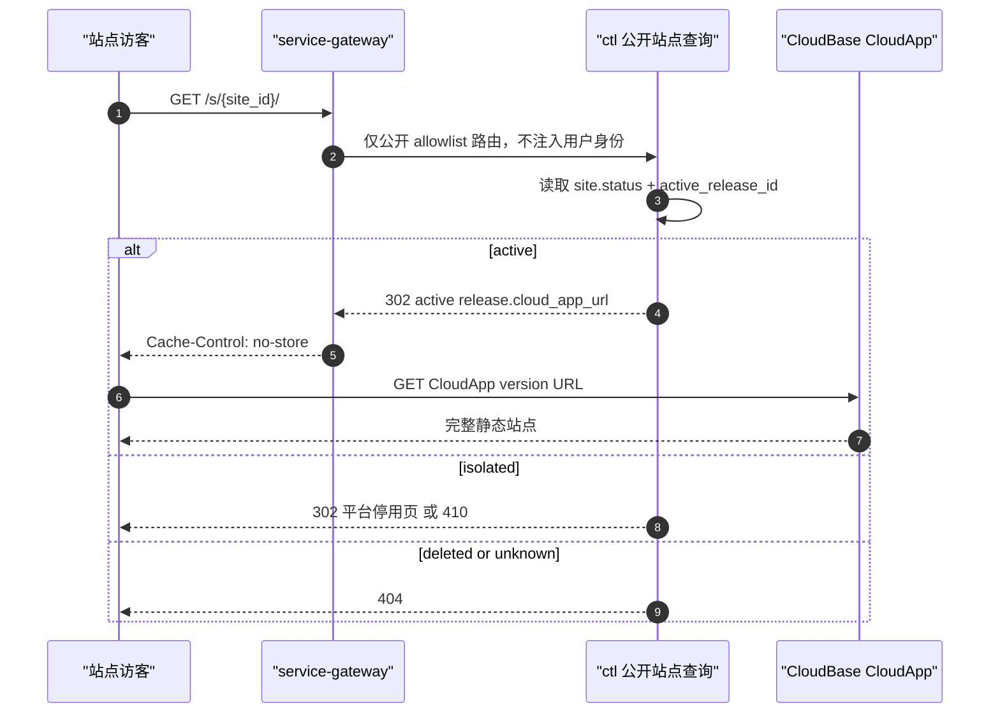
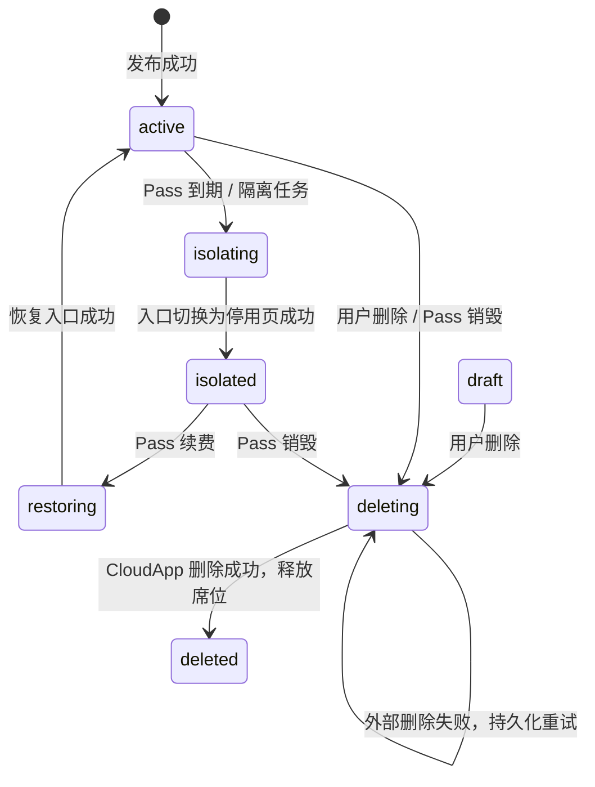
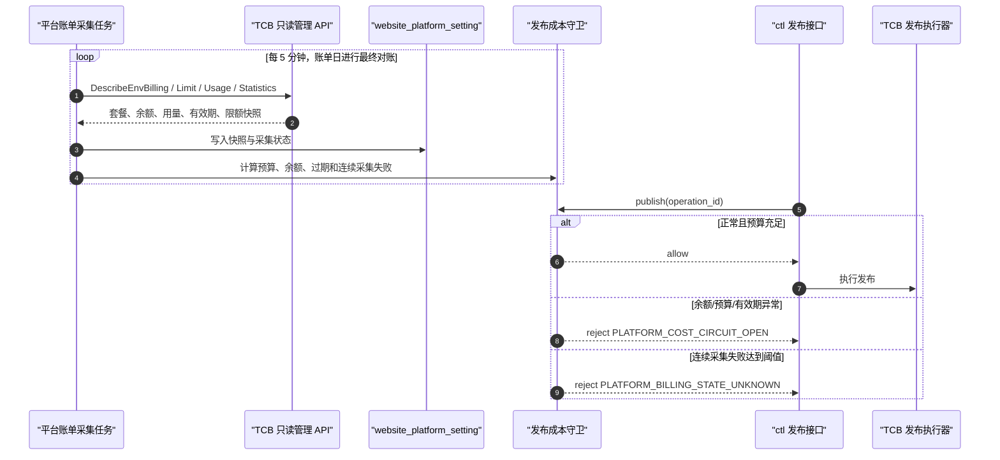

# 【产品需求】【LightVela】套餐内含 CloudBase 静态建站权益（一期）

## 基本信息

- 当前产品：LightVela
- 需求单状态：产品输入稿 / TAPD 草案，待评审
- 创建日期：2026-07-31
- 发布范围：能力与 API 先行；国内站与国际站的购买页、文案和上线节奏待产品确认
- 核心决策：**CloudBase/TCB 是 Vela 主账号持有的底层执行资源，不是终端用户单独购买的商品。Vela 现有套餐包含不同额度的静态建站权益。**
- 本轮确认：**静态建站额度是现有各档 Vela 套餐的包含项，不新增 TCB 套餐、独立订单、独立续费或面向用户的腾讯云账单。**

## 一句话定义

用户购买既有 Vela 套餐，获得该套餐包含的若干个“静态站点席位”；AI Skill 只调用 Vela 的建站接口并提交站点制品，Vela 统一在受控 CloudBase 静态托管环境发布网站、记录站点、扣减或释放席位并承担 TCB 实际资源成本。用户商品、订单、套餐页和权益账本中均不出现独立的“TCB 套餐”或 TCB 资源点商品。

## 背景与问题

当前 Vela 已有套餐、付费发货、Pass 生命周期和并发安全的用户资源配额账本。用户希望 AI 可以直接完成“生成网页并发布可访问 URL”的闭环，但不能把腾讯云主账号、CAM 密钥、TCB CLI 授权页或 CloudBase 数据库权限暴露给用户。

若将每个用户当作一个 CloudBase 买家，会出现三个问题：

1. 用户套餐与 CloudBase 环境套餐、资源点套餐混成两套商品，无法解释“我的 Vela 套餐究竟包含什么”。
2. 每个用户都创建一个环境会把环境数、初始化耗时、权限、计费、回收和告警成倍放大；对一期纯静态网页没有必要。
3. 让 Skill 直接持有 TCB 凭证会绕开 Vela 登录、配额、审计、站点记录和到期隔离，且 CLI 登录可能触发浏览器设备授权，不能作为终端用户链路。

因此本期把用户可购买、可见、可计量的商品定义为 Vela 套餐内的站点权益；CloudBase 仅是 Vela 平台的发布执行面。

## 已核实事实

### CloudBase 能力与成本

| 能力 | 官方能力 / 计费事实 | 一期定位 |
| --- | --- | --- |
| 环境 | 环境是资源和计费隔离单位；`CreateEnv` 明确适用于 SaaS、多租户、批量自动化创建。 | 共享 1 个受控静态托管环境，不按用户建环境。 |
| 静态网站托管 | 基于 COS + CDN，支持文件级上传、删除、子路径部署、默认域名和自定义域名。 | 一期唯一用户可见的 TCB 能力。 |
| 资源点套餐 | 当前公开页展示：免费体验 0 元/月、3,000 点；个人版 19.9 元/月、40,000 点；标准版 199 元/月、330,000 点；企业版 999 元/月、1,500,000 点；约 1,000 点约合 1 元。套餐点数后依次扣资源包、按量。 | 平台财务预算，不下放给单一用户；价格、SKU、可购地域与税费必须在购买当天以控制台/API 复核。 |
| 主要消耗 | 官方资源点 FAQ 给出的标准版估算：数据库约 200 点/万次、云函数约 13.3 点/万次、CDN 约 210 点/GB；规划公式中存储按 `GB × 1,200` 估算。余额低于 10% 有官方告警。 | 一期主要看 CDN 流量、发布器调用与制品存储；存储换算不能作为静态托管的最终结算单价，须由当期账单复核。 |
| NoSQL | 文档数据库，支持 CRUD、聚合、事务、实时能力与安全规则。 | 不向一期用户直接开放。 |
| PostgreSQL | CloudBase PG 架构提供 SQL、RLS 和迁移能力；环境创建后架构不可切换。 | 二期独立环境的推荐数据库选项。 |
| MySQL | Serverless MySQL，按计算和存储计量，支持 SDK / HTTP API / 内网直连。 | 二期可选，不作为 Vela 控制面真源。 |
| 云函数 | 可部署 HTTP 函数，适合轻量发布编排；单 HTTP 请求有运行时间和包体限制。 | 作为 TCB 内部静态发布执行器的候选实现。 |
| 云托管 | 容器化动态服务；单环境服务和运行实例有上限。 | 不纳入一期。 |
| CloudApp 应用部署 | Manager Node SDK v5 的 `cloudAppService`；支持 `static-hosting`、独立应用域名、构建状态和版本列表。 | **一期每站一个 CloudApp 应用的主发布面。**它与 CloudBaseRun/云托管是不同产品，不能混用其配额或 API。 |
| HTTP 访问服务、认证、AI、日志、安全规则 | 都可作为完整应用后端能力的一部分。 | 仅列为后续动态站点能力，不在一期承诺。 |
| Manager Node SDK | 支持管理环境、函数、数据库、存储、静态托管和权限；在云函数环境初始化时可不显式传长期密钥。 | 用于部署执行器 Spike。 |
| CLI / API Key | CLI 可进行托管部署，但本地登录可能走设备授权；官方 CLI 文档明确 `api_key` 当前未开放，仅 `publish_key`。 | 仅用于平台 PoC/运维，禁止进入最终 Skill 主链路。 |

资源点套餐切换为单向操作，不能退回旧固定配额模式。TCB 的套餐升级、续费、变配和资源包购买属于**平台基础设施采购**，不能由任意 Vela 用户请求触发；一期仅允许受审计的运营/财务流程修改平台套餐，Vela 用户购买的仍只是既有 Bundle。

### 已有真实验证与边界

- 上海已真实验证：创建 CloudBase 环境、匿名认证、私有 NoSQL 写读、静态托管部署、浏览器刷新后会话和数据持久化。
- 已实际调用过的控制面包括 `CreateEnv`、`CreateTable`、`RunCommands`、`GetProviders`、`ModifyLoginConfig`、`ModifyResourcePermission` 和 `hosting:deploy`。
- 北京环境创建曾被账号级环境操作限制拦截，**不能表述为北京已跑通，也不能作为生产可用性证据**。
- 当前未验证自定义域名、CloudBase 云函数内静态托管写入、用户隔离数据库、动态站点或生产地域。它们均是本需求的验收前置或后续范围，不是既成事实。

### mono2 可复用基础

| 现状 | 结论 |
| --- | --- |
| `ctl/pkg/model/bundle` 已有 `agent_quota`、`credit`、`features`。 | `features` 是展示 JSON，**不能**拿来做授权或扣减。需要结构化 `website_static_site_quota`。 |
| `user_resource_quota` 有 `(user_id, resource_name, resource_key)` 唯一键及 `AllocQuota` / `FreeQuota` 条件更新。 | 可作为 `WEBSITE_STATIC_SITE` 的最终权益账本。 |
| `CreatePassWithQuota` 与 `CompletePass` 已在购买发货时创建 Pass 并更新 `OPENCLAW_INSTANCE` 配额。 | 重构为同事务写入多种资源配额；不能新开一套不一致账本。 |
| Pass 已有 isolate、renew、destroy 父子任务和 CAS 状态机。 | 站点停用、恢复、删除复用该生命周期，不在 HTTP 请求内直接做外部删除。 |
| `service-gateway` 已通过鉴权后向 ctl 注入可信用户 ID。 | `/v1/sites` 沿用该模式；请求体禁止带可被信任的 `user_id`。 |
| 当前 `RenewPass` 只对既有 Pass 续期，不接收新的 Bundle；`MoveToHistory` 当前只删除 `OPENCLAW_INSTANCE` 配额行。 | 首发先覆盖新购/试用及同 Bundle 续费；换套餐必须新增显式的权益迁移事务，Pass 最终销毁必须在站点子任务成功后再清理 `WEBSITE_STATIC_SITE` 配额。 |

### 调研来源

- [CloudBase 环境与 CreateEnv](https://docs.cloudbase.net/quick-start/env-setup)：环境管理、平台/SaaS 自动创建场景。
- [CloudBase for Platform](https://docs.cloudbase.net/quick-start/enterprise-ai-platform)：统一账号、多租户独立环境、环境池和动态应用能力。
- [CloudBase 静态托管 CLI](https://docs.cloudbase.net/cli-v1/hosting)：文件部署、子路径和删除能力。
- [Manager Node SDK](https://docs.cloudbase.net/api-reference/manager/node/introduction)：服务端、云函数和临时凭证的管理面鉴权。
- [Manager Node SDK CloudApp](https://docs.cloudbase.net/api-reference/manager/node/cloudApp)：`static-hosting`、`uploadCode`、`createApp`、构建状态、版本与删除 API。
- [Manager Node SDK 静态托管](https://docs.cloudbase.net/api-reference/manager/node/hosting)：旧式 `hosting.uploadFiles/findFiles/deleteFiles`、托管域名和网站文档配置。
- [资源点计费 FAQ](https://docs.cloudbase.net/quick-start/resource-point)：统一资源点池、套餐/资源包/按量扣费顺序、资源换算与不可回退约束。
- [CloudBase 价格说明](https://cloud.tencent.com/document/product/876/127357)：资源点套餐、资源包和按量计费；金额与可购规格以上线当日控制台为准。

### TCB 全产品与一期取舍矩阵

本次已按 CloudBase 文档包的 18 个产品域审阅。下表不是产品广告清单，而是每种能力放入 Vela 建站链路时的身份、计费或隔离影响；它决定一期为何只选择静态托管而不把“能调用”误当作“该开放”。

| CloudBase 产品域 | 核心能力与 API 入口 | 与本需求的关系 | 一期决定 |
| --- | --- | --- | --- |
| 文档型数据库 | NoSQL、事务、聚合、实时推送、索引、安全规则；Web/Server SDK 和 Cloud API。 | 客户端规则建立在 CloudBase `auth.uid/openid`，不是 Vela 用户身份。 | 不开放；Vela MySQL 仍是站点与权益真源。 |
| MySQL / PostgreSQL | Serverless MySQL、HTTP API、内网直连；PG SQL、RLS、迁移、PG Storage。 | 是动态站点的数据能力，但共享环境无法只凭目录隔离数据库。 | 二期按独立环境提供；PG + RLS 是首选。 |
| 数据模型 | 从模型生成多端 CRUD、关联、权限与事件。 | 对普通应用开发有价值，但会把数据库模型/权限暴露给用户。 | 二期评估；不能替代 Vela 套餐账本。 |
| 身份认证 | 匿名、邮箱、短信、社交、自定义登录、OIDC/SSO、Token 和用户角色。 | TCB 浏览器 SDK 的登录态与 Vela JWT 是两套主体。 | 一期不用作站点作者身份；公开站点无登录。 |
| 云存储 | COS 文件、临时链接、ACL、安全规则、CDN、数据万象和内容审核。 | 私有制品适合保存源产物；静态托管桶则是公开发布面，两者不能混用。 | Vela 私有制品桶 + TCB 静态托管发布桶分离。 |
| 云函数 | 普通/HTTP 函数、路由、触发器、并发、日志与环境变量。 | 能承载受控发布执行器；不应承载用户生成的可执行代码。 | 使用一个平台私有发布器，需完成权限 Spike。 |
| 云托管 | 容器、服务间内网、VPC、灰度、监控、服务鉴权。 | 支持未来动态应用，但一个环境最多 15 服务、28 运行实例，且 CPU/内存按量。 | 不纳入一期。 |
| 静态网站托管 | COS + CDN 文件分发、子路径、网站文档、路由、默认/自定义域名、安全策略。 | 当前用户故事的唯一公开 TCB 能力。 | 一期采用。 |
| CloudApp 应用部署 | `uploadCode` 上传受控站点包，`createApp(static-hosting)` 创建或更新同名应用，`describeAppVersion` 轮询构建，支持版本列表和历史版本删除。 | 为每个站点给出独立应用 URL 和原生版本记录，避免在共享目录中自行模拟发布指针。 | **一期主路径。**仅允许平台发布器调用；用户 Skill 不见 `serviceName`、环境 ID 或 SDK。 |
| HTTP 访问 / AnyService / EnvConfig | 将域名路径绑定函数、云托管或静态托管；环境配置和服务编排。 | 可用于独立环境的动态应用入口。 | 仅用于平台统一托管域名；不允许用户自行绑定。 |
| Web / Server Node SDK | 浏览器/业务服务调用数据库、存储、函数、认证等资源。 | 是“应用数据面 SDK”，不是套餐控制面。 | 站点制品不得内置管理 SDK 或凭证。 |
| Manager Node SDK | `env`、`hosting`、函数、存储、数据库、权限、日志和通用云 API 的管理入口。 | 能在平台侧完成非交互式托管发布和核验。 | 发布器唯一的 TCB SDK。 |
| Cloud API / HTTP API | CAM/STS 签名控制环境；HTTP API 提供认证、函数、数据库等业务调用。 | `CreateEnv`、计费、配额适合二期控制面；HTTP API 不能绕过 Vela 鉴权。 | 仅平台后台使用，用户 Skill 不直调。 |
| CloudBase CLI | 环境、函数、托管、存储、域名、日志、监控、AI 的人机/CI 工具。 | 支持设备码登录，也可调 API；本地人机登录可能需要浏览器。 | 仅开发/运维和 PoC，非线上发布依赖。 |
| CloudBase Platform | 子账号模式或自有品牌模式，为每租户分配独立环境和受限凭证。 | 解决“用户直接管理自己 TCB 环境”，而不是“Vela 套餐内含有限建站席位”。 | 二期独立环境选型；一期有意不选。 |
| AI / Agent / AI Builder / Toolkit / MCP | 模型调用、Agent 框架、知识库、MCP、AI Coding 工具与模板。 | 可辅助后续生成动态应用，但会增加模型计费、凭证和运行时攻击面。 | Vela 自身 AI 负责生成；不把 TCB AI/MCP 接到用户主链路。 |
| CLS 日志、监控、规则、错误码、Recipes | 资源指标、日志检索、安全规则、错误码和交付参考。 | 是平台可观测、排障和安全基线。 | 使用 hosting/function/env 指标与 CLS RequestId 关联 Vela operation。 |

### API 面与身份边界

| API 面 | 腾讯云身份语义 | 是否允许最终 Skill 使用 | 本方案用途 |
| --- | --- | --- | --- |
| Vela `/v1/sites` | Vela 用户会话，经 `service-gateway` 注入可信 ID。 | 是。 | 唯一用户/AI 调用面。 |
| CloudBase Client SDK | CloudBase 用户 Token（匿名、自定义登录、OIDC 等）。 | 否。 | 不让 Vela JWT 假装成 TCB 身份。 |
| `@cloudbase/node-sdk` / HTTP API | CloudBase 应用服务端或终端用户身份。 | 否。 | 二期独立环境应用的数据面。 |
| `@cloudbase/manager-node` | 云开发管理者身份：长期 CAM、STS；云函数环境可不显式传长期密钥。 | 否。 | 平台发布器使用 v5 `cloudAppService`；旧 `hosting` 模块仅作 fallback。 |
| 腾讯云 Cloud API | CAM 签名或 STS，控制环境/账单/配额等。 | 否。 | 平台预置、账单采集和二期环境创建。 |
| CloudBase CLI / MCP | 设备码、子账号密钥、API Key 或临时凭证。 | 否。 | 研发/运维排障；不能替代服务接口。 |

这条边界直接回答“用户是否还要打开 CLI 授权页”：**一期不需要。** 设备码授权是 CloudBase CLI/MCP 获得可操作 TCB 资源凭证的流程；Vela Skill 不获得该凭证，只调用 Vela 服务。

### 一期涉及的 TCB 管控与数据面 API

下表是完成一期所需的 API 面，而不是把 TCB 的所有 API 暴露给 Skill。调用前均以官方当期请求/响应契约为准；操作 ID、RequestId 和脱敏错误码写入 `website_operation`，凭证、原始请求体和制品内容不写业务日志。

| 场景 | 官方接口/SDK | 调用身份与频率 | 一期处理原则 |
| --- | --- | --- | --- |
| 采购前检查 | `CheckTcbService`、`DescribeTcbRegions`、`DescribeEnvLimit`、`DescribeBaasPackageList` | 平台 CAM，只由 Stage 0 管理任务调用。 | 先确认服务已开通、地域、环境上限和套餐可购性，再决定是否采购；不把过去某地域的 PoC 结果外推。 |
| 环境生命周期 | `CreateEnv`、`DescribeEnvs`、`ModifyEnvPlan`、`RenewEnv`、`DestroyEnv` | 平台 CAM；`CreateEnv` 会触发下单/扣款，环境可用前须轮询 `DescribeEnvs`。 | 一期不按用户创建；仅用于创建/维护受控平台环境。二期一租户一环境才启用这条链路。 |
| 套餐与成本采集 | `DescribeEnvBilling`、`DescribeEnvLimit`、`DescribeEnvStatistics`、`DescribeCreditsPackageUsageDetail`，必要时 `DescribeMonitorMetric` | 平台 CAM 的只读定时任务；先以 5 分钟采样，账单日再对账。 | 记录套餐 ID、有效期、资源点余额/用量、CDN/存储/错误率快照；字段需以现场响应确认，采集失败时进入保护状态，不能继续盲目发布。 |
| 托管环境发现 | `DescribeEnvs` 或 Manager SDK `env.listEnvs()`，读取 `StaticStorages[0].StaticDomain`。 | 发布器启动/健康检查时只读。 | 默认域名只用于内部验证；生产发布必须核验平台自定义托管域名状态。 |
| CloudApp 静态发布 | Manager SDK v5 `cloudAppService.uploadCode`、`createApp`、`describeAppVersion`、`describeAppInfo`、`describeAppVersionList`、`deleteAppVersion`、`deleteApp`。 | 仅 Vela 内网发布 worker 使用。`serviceName` 全局唯一并由 `site_id` 推导；发布器保存 BuildId 后轮询成功/失败。 | **一期主链路。**SDK 的 `uploadCode` 要本地绝对路径，所以 worker 只能将本 operation 的私有制品解压到临时目录；不允许用户提交本地路径。 |
| 旧式静态托管 fallback | Manager SDK `hosting.uploadFiles`、`hosting.findFiles`（前缀 + marker 分页，单页最多 1,000）、`hosting.deleteFiles`。 | 仅当 CloudApp Spike 确认不满足地域、容量、权限或部署行为时使用。 | `findFiles` 只能核验对象键、大小、ETag、数量和分页完整性；ETag 可发现变更但不是 SHA-256 内容证明。SHA-256 在 Vela 私有制品入库时校验，不能误称为 TCB 回读校验。 |
| 平台托管配置 | `CreateHostingDomain` 后轮询 `DescribeHostingDomainTask`；旧 `hosting.getWebsiteConfig` / `setWebsiteDocument` 只配置环境级 fallback。 | 平台管理员/基础设施任务。 | 仅配置平台域名、证书和安全策略；用户与 Skill 无此权限。 |
| 用户应用数据面 | CloudBase Client SDK、Node SDK、HTTP API、CLI/MCP。 | CloudBase 用户 Token、CAM/STS 或 API Key。 | 一期禁止调用。二期才按独立环境和最小权限设计开通，不能绕过 Vela 鉴权。 |

CloudBase 还提供 `createBillingDeal`（购买/续费/变配套餐或资源包）等管理能力。它只证明平台可以自动化采购，不等于应该让 Vela 用户、Skill 或业务服务带着用户请求去调用；一期明确不接入该 API，避免把用户建站行为变成不可控的腾讯云扣费动作。

## 目标用户与场景

### 目标用户

- 已登录并拥有有效 Vela Pass 的个人或工作区用户。
- 使用 Vela AI / Skill 生成落地页、作品集、活动页、文档页等静态网站的用户。
- 运营与平台管理员：配置套餐包含的站点席位，查看平台 TCB 成本、发布失败和站点状态。

### 主用户旅程

1. 用户购买或续费既有 Vela 套餐，获得套餐配置中声明的静态站点席位。
2. 用户授权的 AI 按 Skill 生成静态网页制品和清单，调用 Vela 建站 API 创建草稿站点。
3. Vela 在同一事务中占用一个席位、保存站点和发布操作；异步发布器上传至共享 CloudBase 静态托管路径。
4. 发布成功后，Vela 返回稳定站点 URL，用户可在控制台和 AI 对话中看到站点、版本与状态。
5. 用户删除站点时，Vela 先完成托管目录删除，再释放席位；套餐到期则先停用访问，续费后恢复；最终销毁才删除制品和释放席位。

## 产品目标与非目标

### 一期目标

1. 用户能在不接触腾讯云账号、TCB CLI、CAM Key 或浏览器设备授权页的情况下，由 AI 创建并发布静态网站。
2. 每个 Vela 套餐都可配置独立的静态站点席位数；购买、换套餐、续费、删除和销毁与已有 Pass 权益一致。
3. 所有站点、版本、公开 URL、操作、错误和所属 Pass 可在 Vela 数据库审计和管理。
4. 发布过程具备幂等、可重试、配额强一致和成本熔断，避免重复发布、超卖或无限消耗 TCB 资源点。

### 一期明确不包含

- 不给用户创建腾讯云子账号、CloudBase 环境、CAM Key、API Key 或 TCB CLI 配置。
- 不开放 CloudBase NoSQL / PostgreSQL / MySQL、云函数、云托管、HTTP 路由、对象存储给最终用户或 Skill 直接调用。
- 不支持 SSR、长连接、后端接口、用户登录、支付、数据库表、可执行代码、容器或动态站点。
- 不承诺“每个站点独立 TCB 流量包”或按路径原生限流，因为共享环境的 CDN 计量不是按 Vela 用户隔离。
- 不自动开通用户自定义域名、证书、ICP备案；不承诺每个站点独立二级域名。
- 不写死任何现有套餐的席位数。没有运营确认时默认值必须为 `0`，不向用户误售。

## 方案比较与决策

| 方案 | 做法 | 优点 | 代价 / 风险 | 结论 |
| --- | --- | --- | --- | --- |
| A. CloudApp 静态应用 + Vela 权益控制 | 一个受控 TCB 环境；每个 Vela 站点映射一个全局唯一 CloudApp `serviceName`，用 `uploadCode` + `createApp(static-hosting)` 发布，并由 BuildId/版本 API 收敛。 | CloudBase 原生提供独立应用 URL、构建状态、版本记录和历史版本删除；Vela 不必自行维护 COS 文件级原子切换。 | 必须验证 CloudApp 在目标地域的可用性、应用数上限、构建耗时、权限和成本；发布器需安全落地临时制品。 | **一期主路径，先完成 Stage 0 Spike。** |
| B. 共享静态托管目录 | 一个受控环境，按 `sites/<site_id>/v/<release_id>/` 隔离文件；Vela 自己维护版本指针。 | 文件级控制最强，可跳过 CloudApp 构建管道。 | 新项目场景下是较旧的托管路径；需自行处理版本、清理、域名和 CDN 一致性。 | 仅在 Stage 0 证明 CloudApp 不满足要求时启用的 fallback。 |
| C. 每用户一个 CloudBase 环境 | 用 `CreateEnv` 为每个用户开环境和完整后端资源。 | 原生资源隔离，后续 DB/函数能力完整。 | 环境套餐/资源点、环境配额、地域、回收、域名与运维成本显著上升；纯静态场景浪费。 | 二期高阶动态建站候选。 |
| D. 只用自建 COS/CDN | 不使用 CloudBase，Vela 直接发布 COS。 | 实现和成本模型最简单。 | 失去本次要探索的 TCB 能力与后续环境演进路径。 | 不采用。 |

## 一期产品与技术方案

### 1. 套餐权益模型

在 `bundle` 增加结构化字段：

```text
website_static_site_quota BIGINT NOT NULL DEFAULT 0
```

语义是“该 Pass 同时最多保有的静态站点数”，而不是 TCB 资源点、流量 GB 或发布次数。与已有 `agent_quota` 一样，它是可授权的套餐定义字段；`features` 仅补充用户展示，例如“含 N 个静态站点”。

已确认的商品和权益语义：

- 现有每个 Bundle 都增加该字段，运营为每档套餐分别配置额度；首发迁移默认 `0`，只有明确纳入灰度的既有套餐才设置正数。
- 交易侧仍销售既有 Bundle，价格、订单、支付、续费和发票逻辑不新增“TCB/CloudBase”商品行。套餐页可显示“含 N 个静态站点”，但该展示不参与后端鉴权。
- Bundle 是**后续发货模板**，有效 Pass 生成时将额度原子写入 `user_resource_quota`，该行才是已购用户权益快照。运营后来修改 Bundle 不得静默改变存量用户总额。
- 现有 `CreateTrialPass`、`CompletePass` 和付费建 Pass 均已拒绝同一 `user_id` 存在多个 Pass；同时额度账本的唯一键为 `(user_id, resource_name, resource_key)`。一期沿用此“一用户一个有效套餐”模型，`resource_key` 固定为空串即可精确表达“当前套餐包含的席位”。未来若产品允许并行持有多个套餐或工作区共享套餐，必须先改为以 `pass_id` / 主体为键的多权益账本，不能把多档额度直接相加。

在 `user_resource_quota` 新增逻辑资源：

```text
resource_name = WEBSITE_STATIC_SITE
resource_key  = ""
total         = 当前有效套餐的 website_static_site_quota
available     = total - 已保有的草稿、发布中、在线、已隔离且未销毁站点数
```

规则：

- 创建草稿即占 1 个席位，防止无限草稿绕过配额。
- 发布失败不释放席位，用户可重试、编辑或删除。
- 主动删除：TCB 路径清理成功后释放；清理失败继续占用并重试。
- Pass 隔离：站点停用但继续占用；续费恢复；Pass 销毁成功删除全部站点后释放。
- 套餐降档：若已占用数高于新套餐额度，发货事务必须失败并返回明确的 `PASS_QUOTA_EXCEEDED` 类错误，不得产生负 `available`。
- 运营修改仅影响后续发货；已持有 Pass 的权益变更需显式的批量调整任务和审计，不允许直接改 `bundle` 后悄悄覆盖用户配额。
- 首发的“续费”只保留同一 Bundle 的现有总额；现有 `RenewPass` 没有换 Bundle 入参。用户升/降档必须先实现 `ChangePassEntitlement`：锁定 Pass 和全部资源配额行，校验新额度不低于已占用席位，在同一事务更新 Bundle/资源总额/可用额并写审计。该接口完成前，前端和 Skill 不展示“换套餐立即生效”。

### 2. 数据模型

| 表 | 核心字段 | 作用 |
| --- | --- | --- |
| `website_site` | `site_id`、`user_id`、`pass_id`、`status`、`name`、`cloud_app_service_name`、`cloud_app_domain`、`active_release_id`、`public_url`、`isolated_at` | 用户站点真源和生命周期；CloudApp 应用名由服务端生成。 |
| `website_release` | `release_id`、`site_id`、`state`、`artifact_key`、`sha256`、`total_bytes`、`file_count`、`manifest_json`、`cloud_app_build_id`、`cloud_app_version_name`、`cloud_app_url`、`published_at` | 不可变制品、Vela 发布记录与 CloudApp 版本映射。 |
| `website_operation` | `operation_id`、`site_id`、`release_id`、`action`、`idempotency_key`、`status`、`attempt`、`next_retry_at`、`provider_request_id`、`error_code` | 发布、停用、恢复、删除的持久化幂等与审计。 |
| `website_platform_setting` | 受保护的环境标识、托管公开域名、套餐 ID/账单快照时间、每日资源点/CDN/存储预算、单制品大小、单站文件数、发布速率、全局开关 | 平台成本护栏；只允许管理员修改。 |

数据库约束和索引必须在首个实现 MR 内落地，不能只依赖服务端约定：

- `website_site`：主键 `site_id`；唯一 `cloud_app_service_name`；索引 `(user_id, status, created_time)`、`(pass_id, status)`。`cloud_app_service_name` 必须由服务端从 `site_id` 生成，例如 `vela-site-<opaque-site-id>`，不接受用户站点名；CloudBase 要求其全局唯一。
- `website_release`：主键 `release_id`；唯一 `(site_id, sha256)` 用于同一站点同内容的幂等复用；索引 `(site_id, state, created_time)`。`artifact_key` 只允许指向该 release 的私有前缀。
- `website_operation`：主键 `operation_id`；唯一 `(site_id, action, idempotency_key)`；唯一 `(site_id, release_id, action, active_dedupe_key)` 防止同一 release 同时存在两个未终态操作；索引 `(status, next_retry_at)`、`(site_id, created_time)`。操作终态把 `active_dedupe_key` 置空；同一幂等键请求体哈希不同必须返回冲突，不得复用旧操作。
- `website_platform_setting`：单例行或以受控 `setting_key` 唯一；环境 ID、域名、预算和密钥引用不允许由用户 API 写入。真实密钥只存凭据系统，表中最多保存 Secret 引用名。

建议状态：

```text
website_site.status:
  draft -> publishing -> active
  active -> isolating -> isolated -> restoring -> active
  {draft, active, isolated, failed} -> deleting -> deleted

website_release.state:
  uploaded -> pending_publish -> publishing -> published
  publishing -> failed

website_operation.status:
  pending -> running -> succeeded | retry_wait | failed_permanent
```

不从 `website_site` 删除已发布版本的审计信息；实际 CloudApp 制品删除成功后保留最小审计记录（ID、时间、哈希、CloudApp BuildId/版本名、操作者、结果），不保留用户内容。

### 3. 公开 URL、CloudApp 版本与 fallback 文件布局

CloudApp 主路径中，一个 `site_id` 对应一个不可变的 `cloud_app_service_name`；每次 release 对同名 CloudApp 执行更新部署。CloudBase 返回的 `BuildId` 只用于异步状态轮询，`describeAppVersion` 成功后返回该版本 URL，`describeAppInfo` 返回独立应用 Domain 和最新版本名。

- 用户的稳定入口是 `https://<vela-public-domain>/s/<site_id>/`。它是 `service-gateway` 的 `AccessPublic` 路由，转至 ctl 的公开只读查询；ctl 仅对 `active` 站点返回 `302` 到该 `release.cloud_app_url`。公开入口不接受用户身份头；Vela API 响应不包含 TCB `envId`、`serviceName` 或凭证。
- 生产版本更新不依赖覆盖 TCB `index.html`：只有 CloudApp 报告 `SUCCESS` 并返回可访问版本 URL 后，Vela 才原子切换 `active_release_id`。稳定入口 `302` 使用 `Cache-Control: no-store`，所以新版本失败继续指向上一个成功的 `cloud_app_url`。Vela 的回滚仅更新 `active_release_id`，不需要声称 CloudApp 有“激活旧版本”接口。
- 发布器维护每站保留版本数。到达保留上限后，仅删除不等于 `active_release_id` 的 CloudApp 历史版本；`deleteApp` 才用于销毁整个站点，且会删除其所有历史版本。
- 到期隔离时 ctl 让公开查询返回平台停用页或 `410`；恢复时重新跳转数据库所记的 `cloud_app_url`；销毁后固定 `404`。这些状态切换不依赖改写用户制品或 CloudApp 配置。
- Skill 生成纯静态制品，使用相对资源路径；一期不支持服务器路由、后端 API、数据库连接串和可执行代码。CloudApp `framework=static`，`installCmd` 与 `buildCmd` 均为空，只执行受控静态部署。
- CloudApp 默认应用域名可用于内部灰度和一期早期交付，但生产稳定入口仍使用 Vela 平台域名。默认静态托管域名存在访问频率限制；自定义平台域名绑定需 `CreateHostingDomain` 后轮询 `DescribeHostingDomainTask`，并满足证书与境内备案要求。用户自定义域名属于二期。
- 若 Stage 0 启用共享静态托管 fallback，文件布局固定为 `sites/<site_id>/v/<release_id>/...` 和 `__vela/disabled/index.html`；由 Vela 跳转到不可变版本目录，绝不以覆盖 `index.html` 作为版本指针。

### 4. 鉴权与信任边界



- Skill 不得传 `user_id`、`pass_id`、TCB `envId`、SecretId、SecretKey、TCB API Key 或任意 CAM 令牌。用户身份只能由 `service-gateway` 鉴权后注入。
- `ctl` 必须再次按可信用户 ID 查询有效 Pass 与 `WEBSITE_STATIC_SITE` 配额；网关身份头不能由公网客户端伪造或透传。
- 制品先入 Vela 私有存储；发布执行器只获取该 `operation_id` 对应的短时、只读制品 URL，不能上传任意本地路径、读取任意 URL 或操作其他 TCB 环境。当前仓库只发现 `service-gateway` 为 Hermes 救援导入生成 COS 预签名 URL，尚未发现可直接复用的通用站点制品服务；一期必须新增受限 `WebsiteArtifactStore`（专用桶/前缀、对象归属校验、限时 PUT/GET、删除和扫描），不能把救援导入配置或对象前缀直接挪作网站上传。
- 用户的公开静态站点无需 CloudBase 用户认证；Vela 控制面、制品上传、发布、删除和站点列表均必须登录。
- TCB 主账号密钥不进入前端、Skill、站点制品、日志、数据库业务表或聊天回复。若执行器必须使用腾讯云凭证，使用专用最小权限 CAM 身份/STS，并在密钥管理系统保存和轮换。

#### 4.1 必须共用事务的本地状态变更

创建站点不是“先扣额度，后插站点”的两个独立调用。它必须由新的 `WebsiteEntitlementDao` 接收同一个 `*gorm.DB`：在一个事务中以条件 `UPDATE` 占用 `WEBSITE_STATIC_SITE`，插入 `website_site(draft)` 和 `website_operation(create)`，再提交。任一步失败则额度、站点、操作均回滚。

现有 `userresourcequota.AllocQuota` / `FreeQuota` 固定从默认 DAO 取连接，**不能直接在上述事务中复用**；实现时应新增传入 `tx` 的条件更新方法，或将 DAO 绑定到传入事务。`Idempotency-Key` 的唯一冲突处理也必须在同一事务内完成：同键同请求哈希直接返回已有站点/操作，同键不同哈希返回 `409`。

发布、停用、恢复和删除跨越 TCB 外部调用，不能企图把它们包进 MySQL 长事务。它们只在短事务中 CAS 创建/领取 `website_operation`，由异步执行器完成外部副作用，再在短事务中校验期望状态后落终态。删除操作只有“TCB 目录已核验删除 + MySQL 标记 deleted”均成功后，才在同一事务内释放席位；超时或未知结果一律保持占用并由幂等重试和对账任务收敛。

### 5. TCB 发布执行器

一期主实现是 Vela 集群内的私有 `tcb-site-deployer` worker，而不是先把发布器做成 CloudBase 云函数。原因是 Manager SDK 的 CloudApp `uploadCode` 必须接收受控的本地绝对文件路径；在 Vela worker 中落地和清理临时制品、最小 CAM/STS 鉴权、重试和审计边界都更直接。云函数可以在 Stage 0 验证后作为后续运行位置，但不是生产链路前置。

1. `ctl` 在短事务中领取唯一 `operation_id`，worker 以内部队列/签名获取操作；worker 不是用户 API，也不接受用户 Token。
2. worker 校验操作状态、时效、站点归属、静态 manifest 和私有制品 SHA-256，只下载该 operation 关联的制品，解压到唯一的临时目录；拒绝软链接、路径穿越、超大/压缩炸弹和任意 URL。
3. worker 用专用最小权限 CAM/STS 初始化 `@cloudbase/manager-node` v5，调用 `cloudAppService.uploadCode({ serviceName, filePath })`，再调用 `createApp({ deployType: 'static-hosting', serviceName, staticConfig: { cosTimestamp, framework: 'static', installCmd: '', buildCmd: '' } })`。`serviceName`、环境 ID 和所有构建参数只从服务端记录推导。
4. worker 用 `describeAppVersion({ serviceName, buildId })` 轮询 `PENDING/BUILDING/SUCCESS/FAILED`；`SUCCESS` 后读取版本 URL 与 `describeAppInfo` 的版本名/应用域名，写入 release。`FAILED` 只记录可展示的脱敏失败码，保持上一个 active release。
5. 删除 release 用 `deleteAppVersion`，最终销毁站点用 `deleteApp`；网络超时一律视为未知，先通过 `describeAppVersion` / `describeAppInfo` 发现状态再安全重试，不能直接重复创建不同的应用名。

CloudBase HTTP 云函数仅作为可选部署位置：Stage 0 需证明其运行身份拥有 CloudApp 和私有 COS 的最小权限、临时磁盘/超时足够且不会把长期密钥写进函数配置。若该 Spike 不通过，维持 Vela 内网 worker；**禁止把 CLI 或人为浏览器授权当成生产发布链路**。旧 `hosting.uploadFiles/findFiles/deleteFiles` 仅是已验证的 fallback，不与 CloudApp 主链路混用。

### 6. 端到端数据流

#### 购买、发货和创建站点



#### 制品发布



#### 公开访问与版本切换



#### 到期隔离、续费与销毁



Pass 到期和销毁的实现不直接复用实例动作，而是复用现有的父任务编排、CAS、重试、终态回调和指标模式：新增 `IsolateSitesForPass`、`RestoreSitesForPass`、`DestroySitesForPass` 子任务。任一外部 TCB 操作失败时不得提前释放配额。`DestroySitesForPass` 的全部 CloudApp `deleteApp` 成功后，父任务才允许调用泛化后的 `MoveToHistory`；该 DB 事务需同时归档 Pass、删除 `OPENCLAW_INSTANCE` 与 `WEBSITE_STATIC_SITE` 两种账本行。这样不会出现 Pass 已销毁但 CloudApp 或站点席位残留的中间态。

### 7. 对外接口契约

所有用户接口经 `service-gateway` 暴露，`ctl` 只信任网关注入的身份。响应中的 URL 仅为站点公开地址，不返回 TCB 环境或凭证信息。

| 接口 | 请求要点 | 行为 |
| --- | --- | --- |
| `GET /v1/sites/quota` | 无用户 ID 参数 | 返回站点总数、可用数、已使用数和可创建标识。 |
| `GET /v1/sites` | 游标分页 | 仅返回当前用户站点。 |
| `POST /v1/sites` | `name`、`Idempotency-Key` | 原子占用席位并创建草稿。配额不足返回 403 业务码。 |
| `POST /v1/sites/{id}/releases` | 文件 manifest、SHA-256、`Idempotency-Key` | 创建不可变 release 并返回受限上传地址。 |
| `POST /v1/sites/{id}/releases/{release_id}/publish` | `Idempotency-Key` | 入队发布操作，返回 `operation_id`。 |
| `GET /v1/site-operations/{operation_id}` | 无跨用户查询 | 返回 pending/running/succeeded/failed、可显示的错误码和 URL。 |
| `DELETE /v1/sites/{id}` | `Idempotency-Key` | 入队删除；成功清理后才释放席位。 |
| `GET /s/{site_id}/` | 无鉴权、仅 GET、严格路径 allowlist | 公开稳定入口；查询 active release 后 302 到不可变版本，隔离/删除按状态返回停用或不存在。 |

接口规范：

- `Idempotency-Key` 在同一用户、同一动作、同一站点的重复请求必须返回同一 `operation_id` 或同一资源结果；同 key 不同请求体返回冲突。
- 文件名使用规范化相对路径，拒绝 `..`、绝对路径、控制字符、软链接、服务端可执行文件和不允许的 MIME。
- 单制品字节数、文件数、单文件大小、每小时发布数均由平台配置；超过上限在上传前拒绝。
- 对外错误码需区分：无有效套餐、站点席位不足、站点已隔离、制品不合法、发布排队、平台成本熔断、临时失败、永久失败；不透出 CloudBase 原始凭证或内部路径。
- `GET /s/{site_id}/` 是唯一公开例外：它只读取可公开字段，禁止透传 `X-Lightclaw-User-ID`、Cookie 或调用方自带的内部身份头；路由仅允许该 `GET` 路径，不能把 ctl 其他接口暴露为 `AccessPublic`。

### 8. AI Skill 交付约束

一期 Skill 是 Vela API 的使用说明和受限工具契约，不是 TCB CLI 教程。它必须：

1. 先调用 `GET /v1/sites/quota`，容量不足时提示用户删除站点或升级套餐，不尝试绕过。
2. 生成纯静态文件：`index.html`、CSS、JS、图片等；使用相对资源路径，不生成服务端密钥、数据库连接串、云函数或后端 API。
3. 创建站点、上传制品、调用发布并轮询 `operation_id` 至终态。
4. 成功后调用 Vela 记录接口的结果即为站点真源；向用户输出 Vela 返回的公开 URL、站点名和版本，不输出 TCB 环境 ID 或任何凭证。
5. 遇到失败只依据 Vela 业务错误码重试可重试动作；不得调用 CloudBase CLI、管理 API 或让用户打开腾讯云授权页。

## 套餐、运营与管理后台

### 管理端配置

管理员在现有 Bundle 管理能力中维护：

- `website_static_site_quota`：整数，默认 0，必须大于等于 0。
- 配置对象是当前已售的 Vela Bundle，不创建新的 Bundle 类型、交易 SKU 或用户可单独购买的“TCB 加购包”。首批开放前，运营列出“现有 Bundle ID -> 静态站点席位”的审核表；未列入的套餐保持 `0`。价格是否因包含该权益调整，仍由原 Bundle 定价流程决定，不在 TCB 控制面处理。
- 用户展示 Feature：例如 key=`static_site`、value=`N 个静态站点`；只用于展示，后端不读取它授权。
- 平台级静态建站开关：关闭时禁止新建/发布，已发布站点按运营策略保持或切换停用页。
- 平台级资源点、CDN、存储和发布并发上限；超过阈值自动进入保护状态并通知管理员。

### 发货改造

`CompletePass` 与试用发货需要将现有单资源 `CreatePassWithQuota` 重构为“资源配额集合”的同一数据库事务。写入 `OPENCLAW_INSTANCE` 与 `WEBSITE_STATIC_SITE` 时必须全部成功或全部回滚；同 Bundle `RenewPass` 只续期，不重置已使用席位。换套餐不复用当前 Renew 链路，按上一节的 `ChangePassEntitlement` 独立实现、审计和灰度。

管理员仅修改 Bundle 配置不应直接改写已购用户的 `user_resource_quota`。如运营要做存量权益调整，必须走有审计的批处理：逐个读取已用数、判断降档是否会低于已占用、写入变更记录，并给超额用户提供保留/降级/清理策略。

## 成本、限额与风险控制

### 成本模型

用户的“站点席位”是产品容量控制，并不是对 TCB 底层费用的一一映射。共享环境中 CDN 流量、CloudApp 部署、资源点消耗无法天然精确归属到 Vela 用户；一期需用平台预算加站点级可观测数据控制风险。CloudBase AI 模型 Token 也会从资源点套餐扣除，因此一期在建站环境不启用 CloudBase AI/Agent/Builder 生成链路，避免模型调用挤占静态站点预算；后续启用时必须独立环境或独立预算阈值。

| 层次 | 控制项 | 动作 |
| --- | --- | --- |
| 单次上传 | 文件白名单、私有制品 SHA-256、大小、文件数、压缩炸弹检查 | 上传前拒绝。 |
| 单站点 | 发布频率、总制品大小、异常发布次数、CloudApp 构建时长/失败率、保留版本数 | 限速、暂停发布、保留可用旧版本，超过保留上限后才删除非 active 历史版本。 |
| 用户 | 静态站点席位 | 事务扣减，不能超卖。 |
| 平台 | 每日发布数、存储、CDN、资源点余额、套餐有效期、默认域名频控状态、错误率 | 由只读账单/限额采集 + Vela 指标共同触发告警、限流、新建/发布熔断。 |
| 财务 | CloudBase 套餐点数、资源包、按量上限 | 低于 10% 余额告警前设置内部预警；消费异常时人工审核。 |

资源点并不覆盖所有可能的额外采购项。例如官方说明中的大促 QPS 扩容包属于单独按天购买，不能被“套餐内含建站席位”或资源点余额掩盖。首期静态站点不采购此类扩容；若压测显示需要，必须由平台预算审批后单独开启，且把阈值和失效时间接入发布守卫。

#### 平台账单与发布熔断数据流



守卫在一次采集超时时不立即熔断；连续失败阈值、预警余额和日预算均为管理员配置。它只阻断新建、上传和发布，不撤销已在线站点，也不把 TCB 原始错误透给用户。

### 启动策略

- 不购买“最大 TCB 套餐”作为默认策略。先以可承受的低档资源点套餐或试点环境启动，以试点期间的实际 CDN GB、制品 GB、发布次数和账单快照测算；达到预警阈值后，由运营/财务走独立平台采购流程升级或购买资源包。一次切换到资源点套餐不可回退旧计费模式。
- 单独为平台建立预算看板，不把 TCB 账单当作用户套餐配额的唯一来源。资源点池还可能被 CloudBase AI Token 消耗，平台若在同账号/环境启用该能力，必须纳入同一预算守卫或物理隔离。
- 未完成域名备案/证书前不承诺国内自定义域名；测试和灰度先使用 TCB 默认域名或已备案的平台域名。

## 二期演进：数据库与动态站点

当高阶套餐要支持“AI 生成带数据库、登录、函数/API 的应用”时，再采用 CloudBase Platform 的一租户一环境模式：

1. Vela 按高阶套餐购买/分配独立 TCB 环境，并把环境 ID 与工作区绑定。
2. 创建环境后轮询可用状态，配置 PostgreSQL + RLS（首选）或按场景选择 NoSQL/MySQL、云函数、HTTP 路由和日志。
3. 用户仍只使用 Vela 身份与 Vela Skill；是否给 CAM 子账号仅在用户确实需要进入腾讯云控制台时再评估。
4. 大规模独立环境按官方环境池能力评估和申请，不把一期共享 CloudApp 静态站点方案强行扩展成多租户数据库。

触发二期的准入条件：需要用户数据写入、服务端逻辑、登录态、后台 API、合规隔离、独立预算/域名，或一期共享环境无法满足业务隔离要求。

## 发布、灰度、监控与回滚

### 灰度步骤

1. `website_builder_enabled` 总开关关闭状态下完成迁移、接口、管理端和单元/集成测试。
2. 在已验证可用的非生产 CloudBase 环境完成 CloudApp Spike：`uploadCode/createApp/describeAppVersion/deleteApp`、独立 URL、版本回滚跳转、超时重试、制品校验、停用页和恢复；同时记录应用数上限、构建耗时、资源点/CDN 成本和最小 CAM 权限。只有 Spike 失败才验证旧静态托管 fallback。
3. 仅对内部白名单用户开放 1 个固定低额度 Bundle；严格观测站点创建、成功率、TCB 点数、CDN、制品大小和错误码。
4. 再对一个实际套餐灰度配置正整数席位；逐档开放必须由运营确认额度和财务预算。

### 指标与告警

| 指标 | 口径 | 告警 / 行动 |
| --- | --- | --- |
| `website_quota_alloc_total` | 成功占用席位次数 | 用于套餐权益与异常创建审计。 |
| `website_publish_total` / `website_publish_failed_total` | 按结果、错误码、环境统计发布 | 失败率超阈值停止新发布并排障。 |
| `website_operation_pending_age_seconds` | 最老 pending/running 操作年龄 | 超阈值告警，检查执行器和 TCB。 |
| `website_cloudapp_build_duration_seconds` / `website_cloudapp_build_failed_total` | 按 CloudApp BuildId、状态和错误码统计 | 构建超时/失败率超阈值，暂停新发布并检查 CloudApp API/配额。 |
| `website_active_sites` | active + draft + publishing + isolated 未销毁站点数 | 与 user_resource_quota 定期对账。 |
| `website_artifact_bytes` | 用户/站点/平台制品存储 | 靠近预算时限制新上传。 |
| `tcb_resource_point_balance`、`tcb_cdn_bytes`、`tcb_package_expire_at` | `DescribeEnvBilling` / 用量与限额 API 的平台级快照 | 低于内部阈值、采集连续失败或套餐将到期时熔断新建/发布；不影响已在线站点。 |
| `website_reconcile_mismatch_total` | DB、配额、CloudApp 应用/版本状态不一致 | 自动修复失败后人工介入。 |

### 回滚

- 产品开关：立即停止新建、上传和发布，已成功站点保持最后成功版本。
- 发布回滚：在 Vela 数据库中把 `active_release_id` 切回上一个已校验、仍在 CloudApp 保留期内的 release；不覆盖历史制品，也不要求 CloudApp 提供“激活旧版本”接口。
- 执行器回滚：停止消费新操作、保留 `website_operation`，修复后从幂等键恢复。
- 数据库迁移回滚：发布前提供 down migration；已经生成的网站内容不依赖删除 DB 行来回滚。
- 配额回滚：只能根据 `website_site` 非 deleted 数量重算并审计，不能盲目把 `available` 加回。

## 验收标准

1. 管理员能为每个既有 Bundle 配置 `website_static_site_quota`；套餐页展示与后端额度同源，但篡改展示 Feature 不影响授权。
2. 新购和试用时，Pass、实例配额和静态站点配额在同一事务内更新；同 Bundle 续费不改变席位。换套餐只有在 `ChangePassEntitlement` 事务上线后才开放，任何一种失败均无部分发货。
3. 已登录用户经 Skill 创建站点时，在并发请求下不会超过可用席位，草稿也占用；删除成功后才可创建新的站点。
4. Skill 无需、也无法获得 TCB 密钥、环境 ID、CLI 登录或浏览器授权；其所有操作都通过 Vela API 且用户身份不可伪造。
5. 静态制品经过路径、MIME、哈希、大小和文件数校验后才由 worker 写入专属临时目录并部署到由 `site_id` 推导的唯一 CloudApp；任一用户无法借制品路径、`serviceName` 或 BuildId 读取、覆盖或删除其他站点。
6. 发布成功后用户获得可访问的稳定 URL；新版本失败不影响上一成功版本；重复请求不产生重复版本或重复扣费。
7. 到期后站点被切换到停用页而非删除，续费后恢复；Pass 最终销毁时目录清理成功才释放席位。
8. 平台资源点、CDN、存储、发布失败率和积压操作均有可观测指标与熔断；资源点不足时新发布被拒绝且不泄露内部错误。
9. 已完成的 TCB 发布执行器 Spike 证明生产执行路径不依赖人工 CLI/浏览器授权；否则该风险明确阻断生产灰度。
10. 内部灰度至少跑通：购买/配额、创建、两次发布、失败重试、删除、到期隔离、同套餐续费恢复、销毁、并发超额、成本熔断十条链路；套餐迁移上线后补充升档、降档和占用超额三条回归。

## 实施拆分与交接

| 阶段 | 承接方向 | 交付物 | 完成条件 |
| --- | --- | --- | --- |
| 0 | 云平台 / 安全 | CloudApp `static-hosting` Spike、最小 CAM/STS 策略、`Describe*` 成本/限额采集契约、应用数/构建时长/版本 URL 验证、平台公开域名/证书/备案可行性、环境与地域确认、成本预算 | 输出真实 CloudApp 权限、静态发布、账单采集和访问入口验证，不带长期密钥进入代码；不通过才批准旧静态托管 fallback。 |
| 1 | ctl 后端 | Bundle 字段、多资源配额事务、站点/版本/操作迁移与 DAO、Pass 生命周期任务 | 单元与 MySQL 集成测试覆盖并发与回滚。 |
| 2 | 执行器 | Vela 内网 `tcb-site-deployer`、制品校验、CloudApp 上传/发布/版本清理/销毁、幂等重试 | 测试环境浏览器级 CloudApp 发布闭环。 |
| 3 | service-gateway / 前端 | `/v1/sites` 路由、站点列表/详情/额度/操作状态、管理端套餐字段 | 可信用户身份、错误态和空态完整。 |
| 4 | Skill / AI | Vela 建站 Skill、制品规范、轮询与错误恢复 | 不包含 TCB 凭证或 CLI 指令，真实生成并发布站点。 |
| 5 | SRE / 财务 / QA | 指标、告警、熔断、成本对账、灰度和回归用例 | 达到验收标准后逐套餐开放。 |

### 当前仓库改造地图

| 现有位置 | 已有能力 | 一期改造 |
| --- | --- | --- |
| `ctl/pkg/model/bundle/entity.go`、`ctl/pkg/transport/bundle.go`、`ctl/main/api/bundle_handler.go`、`ctl/pkg/logic/bundle/logic.go` | Bundle 实体、后台修改、用户套餐展示和 Feature 展示均已结构化。 | 增加 `website_static_site_quota` 字段、SQL up/down migration、导入/修改/管理/用户 DTO 与校验；Feature 只用于同源展示。 |
| `ctl/pkg/logic/pass/logic.go`、`ctl/pkg/model/pass/dao.go` | 试用与付费发货均校验用户唯一 Pass，`CreatePassWithQuota` 已在一个事务插入 Pass 并替换 `OPENCLAW_INSTANCE` 额度。 | 将其泛化为资源配额集合，事务中同时写 `WEBSITE_STATIC_SITE`；新增显式 `ChangePassEntitlement`，不改造现有 `RenewPass` 以假装支持换套餐。 |
| `ctl/pkg/model/userresourcequota/dao.go` | `AllocQuota` / `FreeQuota` 是条件更新，但固定使用默认 DB。 | 新增可传 `*gorm.DB` 的条件扣减/释放，供建站事务复用；保留原接口兼容实例链路。 |
| `ctl/pkg/model/pass/history_dao.go`、Pass 父子任务 | 销毁 Pass 时同事务迁移 history 并删除 `OPENCLAW_INSTANCE` 账本行，已有任务状态机与重试模型。 | 所有 CloudApp 删除成功后，再在 `MoveToHistory` 同事务删除 `WEBSITE_STATIC_SITE`；新增站点 isolate/restore/destroy 子任务。 |
| `ctl/main/api/server.go` | 已用 `http.ServeMux` 注册 `/v1/*`、后台和内部回调路由。 | 新增受鉴权 `/v1/sites*`、内部 worker 回调和只读 `/s/{site_id}/` handler；不可在用户请求中信任 `user_id`。 |
| `service-gateway/internal/gateway/config.go`、`server.go` | 支持 `AccessPublic`、GET allowlist，且在鉴权前清除伪造身份头。 | 新增 `/v1/sites` authenticated 路由和仅 `GET /s/` 的 public allowlist；不得把 ctl 通配路径公开。 |
| `service-gateway/internal/gateway/worker_actions.go` | 已有某一救援导入场景的 COS 预签名上传，不是通用制品服务。 | 新增专用 `WebsiteArtifactStore`，独立桶/前缀、对象归属、限时 PUT/GET、扫描和清理；禁止复用救援导入对象命名。 |
| `ctl/migrations/`、`ctl/main/common/migration_guard.go` | SQL up/down migration 与迁移门禁已存在。 | 站点表、Bundle 字段、操作唯一键和索引全部提供成对 migration，并纳入 migration guard 测试。 |

建议按阶段拆成可独立验收的研发事项：先做 Stage 0 CloudApp Spike，再落 Bundle/Pass/账本和表结构，再接发布 worker 和公开入口，最后接 Skill、管理端、告警与灰度；任何阶段都不把长期腾讯云凭证提交进 mono2。

## 待确认事项

1. 哪些现有 Vela Bundle 在首批灰度中包含静态站点席位，以及各自数量。该值由运营配置，默认 0。
2. 一期灰度是否已有可用的 Vela 平台公开域名；若没有，先接受 TCB 版本 URL 作为测试结果，还是先完成域名、证书、备案和 `service-gateway` 公开路由后再对用户承诺稳定 URL。
3. 首个生产环境/地域和主账号的预算上限。上海 PoC 成功不等于生产地域已确定。
4. 用户维度是个人用户还是工作区。若后续出现团队/工作区，`user_resource_quota` 的所有者模型需先扩展为主体维度，不能只把 `user_id` 字段硬套。
5. 是否要把“每月发布次数”也作为套餐权益。若需要，它应是带结算周期的独立计数器，不能滥用目前的站点席位表。

## 建议 TAPD 信息

- 标题：`【产品需求】【LightVela】套餐内含 CloudBase 静态建站权益（一期）`
- 工作区：`10132091`
- 优先级：High
- 产品范围：复杂需求，先完成 Stage 0 Spike 与产品评审，再拆后端、执行器、前端/Skill、QA/SRE 承接事项。
- TAPD 状态：**本地草案，未创建远端父单，未创建 MR。**
